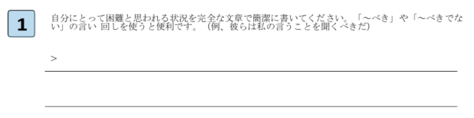
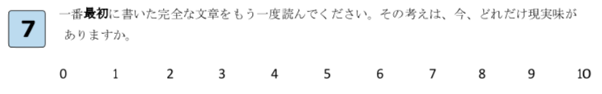

# グーグルも採用した最強のメンタルケアテクニック「認知行動療法」を手軽に実践する7ステップ

## 最強のメンタルケア技法「認知行動療法」とは？

「パレオな男」では、よく「**認知行動療法**」を取り上げることがあります。

ヒトが持ってる思考の「偏り」とか「エラー」を修正してメンタルを治そう！ってタイプのセラピーで、とにかく現時点でのデータ数は最強。深刻なうつ病や神経症に効果が高いのはもちろん、「上司に怒られてへこんだ……」とか「またタスクをこなせなかった……」ぐらいの日常的な悩みも解決してくれるんですな。

そのため、個人的には「認知行動療法」は現代人の基礎教養ぐらいに思ってるわけですが、思えば「パレオな男」には具体的な使い方を書いてないんですよ。「[自動思考キャッチトレーニング](https://yuchrszk.blogspot.com/2017/01/blog-post_14.html)」とか「[ぐずぐず主義克服シート](https://yuchrszk.blogspot.com/2014/08/blog-post_5.html)」といった個々のテクニックは紹介してきたものの、ストレスが発生してから解決するまでの流れを一連のステップとして取り上げてこなかったんですな。

ってことで今回は、日常のメンタルケアに絶大な威力を持つ「認知行動療法」を使いこなすための手順を、7つのステップにわけてご説明します。その意味では「パレオな男」に書いても問題ないネタではありますが、お役立ち度が高い内容なので、こちらで取り上げることにしました。

---

## グーグルが使う7ステップ「認知行動療法」

ひとくちに認知行動療法といってもいろんな流派があるんですが、ここではアンドリュー・バーンスタイン博士が開発したバージョンを取り上げます([1](https://www.amazon.co.uk/End-Stress-revolutionary-approach-healthier/dp/074995230X))。

これは、認知行動療法の要点をまとめたもので、シンプルで使いやすいのがウリ。グーグルやコカコーラ社などが企業研修などに採用してまして、社員のストレス対策に大きな効果をあげてたりします。ご存じのとおり、ここらへんの企業は「効果がないものは取り入れない！」って信念で動いてますんで、研修実績があるのは素晴らしいですねー。

では、さっそく具体的な方法を見ていきましょう。一例として「上司に怒られてムカついた！」って状況を考えてみます。

### STEP1 「べき」の解説

まずは自分に起きたトラブルを簡潔に説明します。たとえば「確かにミスしたのは自分だけど、あそこまで上司が怒鳴るべきじゃない」みたいな感じ。ここで、まず現在の状況を客観的にとらえるわけですな。

### STEP2 思考の採点

続いて、自分の思考の「現実味」を採点します。もし「上司は怒鳴るべきじゃない」を心の底から正しいと感じるなら10点、「でも上司が怒鳴るのも無理はないか……」って気持ちがあるならそれ以下の点数をつけましょう。採点基準は自分の主観でOKです。

### STEP3a 感情の把握

自分のストレス源について考えたときに、どんな感情がわきあがるかを上のリストから選んで丸をつけましょう。リストに当てはまる感情がなければ、しっくりくるものを考えて付け足してください。

### STEP3b 行動の把握

そのストレスを感じたあとに、どんな行動をとったかを上のリストから選んで丸をつけましょう。リストに当てはまる行動がなければ、しっくりくるものを考えて付け足してください。

### STEP4 リライト

画像の指示にしたがって、最初の文章と逆の意味になる文章を書いてみましょう。たとえば「あそこまで上司が怒鳴るべきじゃない」って文章なら、「現実には、その時点では上司が怒鳴るのが当然だった」みたいになります。

### STEP5 エビデンス

ここでは、ステップ4で書いた文章が「正しい」と思われるエビデンスを、思いつくままに書いていきます。「現実には、その時点では上司が怒鳴るのが当然だった」って文章を書いた場合は、

- 現実には、その時点では上司が怒鳴るべきだった。なぜなら彼は僕が悪いことをしたと信じているし、その時点では間違いなく彼に悪い影響があったからだ

- 現実には、その時点では上司が怒鳴るのが当然だった。なぜなら彼は自分の思い込みを正そうとしたことがないからだ。

- 現実には、その時点では上司が怒鳴るのが当然だった。なぜなら彼は「ミスした部下には怒鳴るのが当たり前だ」という考え方を持っているからだ。

- 現実には、その時点では上司が怒鳴るのが当然だった。なぜなら彼は自分の要求を怒りでしか表現できないタイプだからだ。

といった感じになります。

ここで大事なのは、トラブルの原因が「自分のせい」でも「上司のせい」でもどっちでもいいってところです。よく考えたら自分が悪いと思えば、自分を原因にした文章を書けばいいし、どう考えても上司が悪いと思えば相手のせいにした文章を書けばOK。いずれにせよ、自分にとって「これは正解だ！」と実感が持てる文章にしてください。

### STEP6a 感情の把握

ここでは、ステップ5の文章を読み直して、どんな感情がわきあがるかを上のリストから選んで丸をつけましょう。リストに当てはまる感情がなければ、しっくりくるものを考えて付け足してください。

### STEP6b 行動の把握

ステップ6aで抱いた感情に対して、自分が取りたくなった行動を上のリストから選んで丸をつけましょう。リストに当てはまる行動がなければ、しっくりくるものを考えて付け足してください。

### STEP7 再読

最後に、ステップ1で書いた「確かにミスしたのは自分だけど、あそこまで上司が怒鳴るべきじゃない」って文章を読み直して、どれだけ自分にとって真実味があるかを採点します。ここで「やはり真実だ」と思った場合は、別にステップ2でつけた点数と同じにしても構いません。

## まとめ

というわけで、手軽にできる認知行動療法の7ステップでした。大事なのは、この作業を通して自分の思考と感情を客観的につかむところなので、結果として考えが変わらなくても構いません。

ただし、実際にやってみるとわかりますが、客観化の作業をくり返すうちに、ネガティブな感情は確実におさまっていくはず。自分の感情をもてあまし気味な方は、ぜひお試しください。

ちなみにこのテクニックは、ダイエットや仕事が多すぎてパニックを起こした時なんかにも使えますんで、適宜お使いください。どうぞよしなに。
