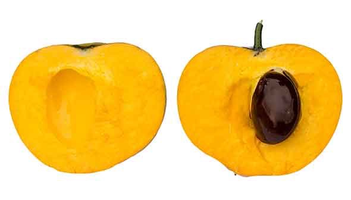
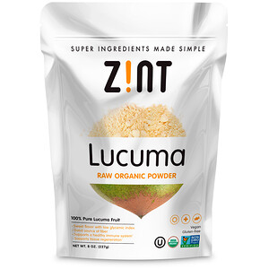
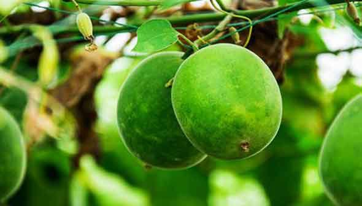

# 【食事】安全に使えそうな甘味料についてあらためて考えてみる話

パレオダイエットをやってて困ることといえば、甘味料の問題っすよね。精製糖は避けたいなぁ……と思いつつも、つい甘いものにひかれてしまうのはヒトの性分であります。

おそらく現時点では、

- ハチミツ
- ステビア

のどちらかを選んでる人が多いだろうと予想しますが、

- ハチミツ＝決してカロリーの質は高いわけではない（低いわけでもないけど）
- ステビア＝なんだかんだで不確定要素も多い（たとえば「内分泌系を乱すのでは？」って考え方もある）

といったポイントもありまして、帯に短しタスキに長しみたいな状況ではあるんですな。

そんなわけで個人的には、

- やっぱ添加糖は使わないのが理想だよね！
- 甘みが欲しかったらフルーツでしょ！

ってところを目指したほうがいいよなーとは思うわけですが、それでも甘味料を使いたい！って方がおりましょう。

そこで、ここでは「**フルーツ由来の甘味料**」について見ていこうかと思います。昔から存在する商品ではありますが、近年になってまた研究が進み始めまして、「意外と使えるんじゃない？」って話になってきたもんですから。

---

## その１ ルクマパウダー

ルクマは日本ではマイナーですが、南米では古来から親しまれてきたフルーツの一種（上画像参照）。わりと抗酸化作用が高くてビタミンも豊富なんで([R](https://www.ncbi.nlm.nih.gov/pubmed/26212989))、一部ではスーパーフードとも呼ばれております。

こいつから水分を取り去って甘味料にしたのが「ルクマパウダー」で、全体の64％がスクロース。残りの21％がグルコースで、15％はフラクトースで構成されております。

ルクマパウダーがいいのは、基本的に果実を脱水させて作るため、ほかより食物繊維や複合糖質が多くふくまれるところ。具体的には1回の使用量20gあたり、

- 80kcal
- 炭水化物16g（そのうち4gが糖質で8gが食物繊維）

って構成になってるんですな。具体的なGI値などはまだ確定されてないものの、他の甘味料にはないメリットを持った商品だと言えましょう。

また、その他のポイントとしては、カロテノイドなどをふくむファイトケミカルも豊富なことがわかっていて([R](https://www.dukeupress.edu/a-reference-guide-to-medicinal-plants))、こちらも非常に良い感じです。栄養価値でいえば、数ある甘味料のなかでもトップクラス。

ただ、残念ながら、まだルクマパウダーの毒性を調べたデータが査読論文にはなってないのが弱点だったりします。数世紀にわたって南米で使われてきた甘味料なので、おそらくなんの問題もないとは思いますが、その点のみご了承ください（もちろん1日の使用量を守ればって前提で）。

[ルクマローオーガニックパウダー](https://jp.iherb.com/pr/Zint-Lucuma-Raw-Organic-Powder-8-oz-227-g/81194?rcode=IRO489)

Zint

[iHerb](%E2%80%9Chttps%3A//jp.iherb.com/pr/Healthy-Origins-5-HTP-100-mg-120-Veggie-Caps/14472?rcode=IRO489%E2%80%9D)

## その２ モンクフルーツ

モンクフルーツは日本でいう「羅漢果」のことで、こちらはだいぶメジャーですよね。砂糖のほかにモグロシドっていう配糖体が入っていて、これがテーブルシュガーの300倍ぐらいの甘みを持つんですな（ステビアの甘みにもモグロシドが関わってたり）。

果実にはモグロシドが1％しか入ってないんですけど、こいつを凝縮させて80％以上にしたのがモンクフルーツ系の甘味料になります。その意味では、ルクマパウダーよりも加工度が高いのがちょっと難点でして、おそらくは栄養価も低くなってるんじゃないかなぁ、と。

ただし、モンクフルーツには特有のアドバンテージもありまして、

- モグロシドには抗酸化作用や抗炎症作用がある([R](https://www.ncbi.nlm.nih.gov/pubmed/19083420))

- 腸内細菌へのダメージはないと思われる([R](https://www.sciencedirect.com/science/article/pii/S0889157516302113))

ってのがなかなかナイスなポイントなんですよねぇ。なにせ人工甘味料は腸内環境を荒らす傾向がありますんで、これはうれしいとこじゃないかと。

といっても、モンクフルーツの毒性についてもまだ未知数なところはあったりもします。たとえば、ラットに大量のモンクフルーツをあたえたところ、体内の炎症マーカー（TNF-αとか）が増えたなんてデータ([R](https://www.ncbi.nlm.nih.gov/pubmed/18037551))も存在してるんですよねぇ。もちろん普通に消費してるぶんには問題ないでしょうが、アレルギー体質の人は避けたほうが無難かなーと。

## まとめ

いろいろと書いてきましたが、あくまで「甘さが欲しければフルーツを！」ってのを基本にしつつ、それでも甘味料を使いたいときは、ルクマパウダーとモンクフルーツは悪くないチョイスかと思われます。

とくにルクマパウダーはポテンシャルがあるんで、個人的にも使う……かも？ぐらいの感じですかねー。
