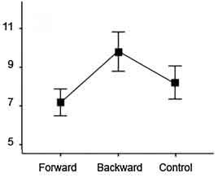

# 【速報】たった数秒の"あれ"で記憶力がアップするぞ！というおもしろ実験の話

**たった数秒の”あれ”で記憶力がアップするぞ！**っていうおもしろい実験が出てたんで、速報としてアップしておきます。

---

で、まずは結論から言っちゃうと、「数秒の”あれ"」ってのは「**後ろ歩き**」のことです。なんと、数秒の後ろ歩きで記憶力が上がるというんですな。

これはローハンプトン大学の研究([1](https://www.ncbi.nlm.nih.gov/pubmed/30368065))で、数百人の男女に6パターンの実験を行なって「**記憶力を上げる方法ってないの？**」って問題について調べてくれております。

たとえば、ふたつめの実験はこんな感じ、

1.
  1. 114人の男女に「ランダムに選んだ20個の単語リスト」を覚えてもらう
  2. その後、全体を3グループに分ける
    1. 何もしない
    2. 前に10メートル歩く
    3. 後ろに10メートル歩く

1. 単語の記憶力テストをする

ほかの実験も基本的なデザインは同じで、単語テストのほかにも、

- 動画の内容を覚える
- イラストの内容を覚える

などの作業を指示しつつ、どのグループがもっとも記憶力がアップしたかをみたんですな。

すると、結果は以下のようになりました。中央の四角が「後ろに歩いたグループ」であります。

ってことで、みごとに後ろ歩きの成績が高いですねー。このグラフだと「前歩き」の成績がもっとも低いですけど、ほかの５つの実験ではコントロール群と大差ないんで、誤差の範囲といったところ。

この傾向は他の実験も同じで、いずれも「後ろ歩き」の勝利。ざっくりと、20〜30％ぐらい他のグループより成績が良くなっております。不思議ですなぁ。

じゃあ、なんでこういう現象が起きたかと言いますと、

> 人間は、動作によって過去の方向にメンタルタイムトラベルを行うことができる。それにより異なるタイプの情報を記憶する能力が高まった。
>
> この現象を、私たちは「記憶のタイムトラベル効果」と名づけた。

だそうです。簡単に言えば、

1. 後ろ向きに歩く
2. なんだか時間をさかのぼったような気分になる
3. 勘違いした脳が過去の記憶へのアクセスを増やす
4. 記憶力アップ！

みたいな流れです。後ろ向きに歩くと、あたかも動画を逆再生したかのような錯覚が生まれ、ついでに脳まで記憶をさかのぼろうとするんだ、と。いやー、脳って単純ですね。

ってことで研究チームは、この現象を活かすためのアプリを開発中で、高齢者の記憶力低下の予防に使おうとしてるらしい。どんなアプリかいまいちわかりませんが、楽しげですね。

そんなわけで皆さまにおかれましては、勉強のあとに軽く「後ろ歩き」などしてみると、多少の違いが出るかもしれません。自分でもやってみるかな……。
