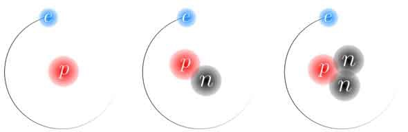

# 【速報】難しくてよくわからない！本やアイデアの理解度を激しくアップさせる簡単な方法

読書中に「難しくてよくわからん！」と投げたくなった経験は誰にでもありましょうが、新たに出た論文は「**ちょっとしたことで、テキストの理解度を激しくアップさせられるよ！**」って結論が出ておりました。ちょっと使える内容なんで、さっくり速報としてシェアしておきます。

---

さて、昔から「**絵で描くと覚えやすい！**」って現象は、よく知られております。

たとえば2015年にウォータールー大学が行なった実験([R](https://www.tandfonline.com/doi/full/10.1080/17470218.2015.1094494))では、被験者に「単語リストを記憶してもらう」ってタスクを指示したところ、

- 単語をイラストにして記憶したグループは、アルファベットで単語を何度も書いたグループや、写真を見ながら記憶したグループより格段に成績が良かった

って結果が出てたりします。これは「ドローイング効果」と呼ばれてまして、味気ない文字よりもイラストを使ったほうが頭に残りやすいのは、直感的にも納得しやすいんじゃないでしょうか。特にイラスト化は、目だけでなく手も使うんで、より多くの感覚を動員できますしね（いわゆるマルチモーダル）。

ただ、いままで行われてきた研究は、あくまでシンプルな情報の記憶に関するものが多め。単語をおぼえるとか人名をおぼえるみたいなタスクが多くて、「微分における導関数の定義とは？」とか「セロトニントランスポーターの役割とは？」みたいな複雑な概念やメカニズムの理解に役立つかは未知数だったんですよ。

ってことで新しく出た論文(s[R](https://journals.sagepub.com/doi/pdf/10.1177/0963721418755385))では、「****複雑な情報の記憶にもイラスト化は役立つの？****」って問題を調べてくれていて、ちょっと目新しい感じでした。

こちらもウォータールー大学の実験で、最初に取り上げた実験と同じ研究チームによるものです。ざっくり実験デザインを申し上げますと、

1. 被験者に難しい現象の解説テキストを読んでもらう（同位体の仕組みとか胞子の生殖メカニズムとか）
2. 1分だけ使って、理解した内容を図解してもらう
3. テキストを何度も読み返したグループとくらべる

みたいになってます。たとえば同位体だったら、↓みたいな図解をしてもらったわけですな。

でもって、その結果は大方の予想どおりであります。

- **絵に描いてみたグループは、内容をよく記憶していたし、難しい概念もはるかによく理解していた！（もちろん、絵が上手いかどうかは関係ない）**

だったんですな。理解度でいえば、ざっくり50％ぐらいの差がついてまして、こりゃあ試さない手はないですな！とか思うわけです。

研究チームいわく、

> 「絵を描く」という行為には、言葉の意味をくわしく吟味し、その内容を自分なりの思考に置き換える作業がふくまれる。

とのこと。たんにテキストを何度も読むだけだとどうしても思考が上すべりしちゃうんだけど、絵に描き起こすためにはより深く内容に注意を向けねばならず、そのぶんだけ理解力が深まるんだ、と。

よく「物事を理解はするためには、いったん自分の言葉で説明しなおしてみるのが大事」なんてことを言いますけど、この作業がイラスト化には自然とふくまれてるわけですねー。なるほど。

そんなわけで、もし本を読んで「難しすぎてよくわからない！」みたいな状況にハマったら、試しに自分でイラストにしてみると吉。自分でもやってみよう。
