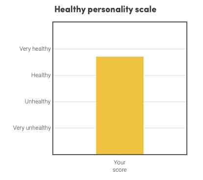

# 【速報】健康でタフなメンタルに欠かせない17のパーソナリティ特性とは？

よく「パレオな男」では、

- 健康なパーソナリティ
- 健やかなメンタル

みたいな表現を使うわけです。しかし、よく考えればこれもざっくりした概念で、「具体的にどういう人のことを言うの？」と聞かれれば、ちょっと答えに困っちゃうわけです。自信があればいいのか、優しい人のことを指すのか、はたまた感情が安定している人なのか。

もちろん心の病にかかってれば判断しやすいですけど、健康的なパーソナリティって意外とハッキリした区別が難しいんですよね。「幸福な家族はどれも似通っているが不幸な家族は不幸のあり方がそれぞれ異なっている」みたいな話ですな。

ってことで新しく出た研究は、「**健康なパーソナリティの人が共通して持つ特性とは何か？**」って問題を深掘りしていて、おもしろかったです。

研究チームいわく、

> 現代の心理学ではビッグファイブのような基本的モデルを使って、人格障害などの理解を進めようと試みている。しかし、その一方では、健康的なパーソナリティを定義してこなかった。

ってことで、確かに、ありそうでなかったデータだなーとか思いました。

---

取り上げるのはカリフォルニア大学の論文([R](https://osf.io/7wxkp/))で、内容は２つのパートにわかれております。

#### 実験パート1

まずは心理学の専門家137人にインタビューを行い、「健康的なパーソナリティってなんだと思います？」と質問。[ビッグファイブ](https://yuchrszk.blogspot.com/2017/06/sbf.html)の5項目をさらに30の要素に噛みくだき、「健康的なパーソナリティ」に欠かせないと思うポイントに点数をつけてもらったんだそうな。

そのうえで専門家がおおむね同意する要素を抽出して、おおまかなコンセンサスを作り上げたらしい。研究チームいわく、

> 素人だろうが専門家だろうが、たいていの人は「健やかなパーソナリティ」について明確な考えを持っているようだ。

ってことで、専門家のレーティングにはそこまでの散らばりがなかったみたい。

#### 実験パート2

続いて、上記であぶり出した「だいたいの専門家が納得する健康的なパーソナリティ」を3000人を超える被験者が行った性格テストや行動記録などのデータと照合。「この要素は健康的なパーソナリティに欠かせない！」ってのをいくつか抜き出し、「**健康パーソナリティインデックス**」って名前の性格テストを作ったんですな。

その結果、「健康的なパーソナリティ」の人は、以下の特徴を持ち合わせておりました。まず、よく言われるポイントから挙げていくと、

1. 感情が安定している
2. 誘惑に抵抗するのがうまい
3. 率直にものごとを言える
4. 自信がある
5. 自発性がある
6. 責任感がある
7. セルフコントロールがうまい
8. 楽観的である
9. 攻撃性が低く意地悪でない
10. 他人を利用しない
11. ストレスに強い
12. 他人と温かな関係を築ける

みたいになってます。いずれも納得のメンツじゃないでしょうか。

では、続いて個人的に「へー」と思ったポイントも見てみましょう。

1. 自分の感情の識別がうまい（「いま軽く怒ってるな」みたいにすぐ認識できる）
2. 仕事や勉強の能力が高い
3. 野心が大きい
4. うぬぼれが強い（「自分には才能がある」みたいな）
5. ずうずうしい

[感情の識別はストレス解消の基本](https://amzn.to/2Qa9w6y)なんで言われてみれば納得なんですけど、「うぬぼれ」とか「ずうずうしさ」みたいにパッと見ネガティブな要素が入ってるのがおもしろいっすねぇ。

もっとも、ちょっと前の[ロンドン大学研究](https://yuchrszk.blogspot.com/2018/10/blog-post.html)でも「正常なナルシシズムなら逆にOK！」って結論なので、

- [他人との比較で自分の価値を確認するタイプのナルシスト](https://yuchrszk.blogspot.com/2017/12/blog-post_21.html)
- [隠れナルシスト](https://yuchrszk.blogspot.com/2015/12/10.html)

といった負の自己中でなければ、健康なパーソナリティには必要なのかもしれませんなぁ。

ちなみに、ここで紹介した「**健康パーソナリティテスト**」は「[FUTURE INTELLIGENCE](https://amzn.to/2KU3Szx)」で有名なスコット・バリー・カウフマン博士の[サイト](https://scottbarrykaufman.com/healthy-personality-scale/)でチェックできますんで、英語が苦でない方はお試しあれ。試しに私もやってみたら、そこそこのスコアが出て安心しました（笑

