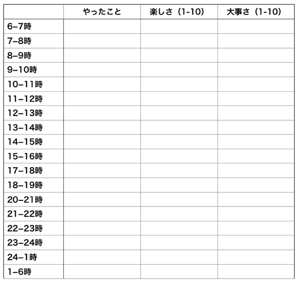
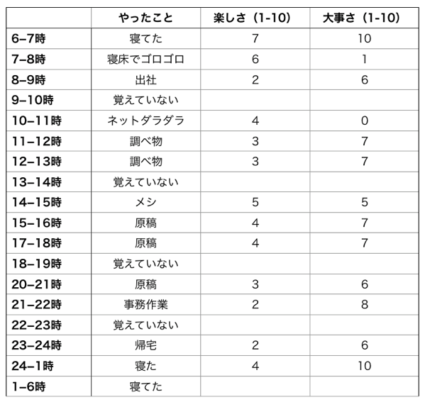

# 不安とストレスをガッツリ改善！良い子のための「行動活性化療法」入門：第1週「モニタリング編」

「不安症でしてねぇ」みたいなことをよくブログでも語ってるわけです。

これは生まれつきの性格で、なんせビッグファイブの神経症傾向がやたら高いんですよね。いまではだいぶ改善したものの、会社員だったころは本当にヒドくて、

1. いつも疲れが取れない
2. 疲れのせいで集中力が低下
3. すべてのことに興味がなくなる
4. 生きづらい！

みたいなステップで気分が落ち込んでいってことをおぼえております。いやー、おそろしい。

当然、仕事の生産性もいまの10分の1ぐらいで、会社に寝袋を持ち込んで10連泊とかしたのも良い思い出です。その後、40代になって[再び寝袋で寝るようになる](http://yuchrszk.blogspot.jp/2017/07/blog-post_12.html)とは思ってませんでしたが（笑）

というわけで、「パレオな男」ではよく[認知行動療法](https://yuchrszk.blogspot.com/2015/10/aware.html)（以下、CBT）をオススメしてるわけです。思考のゆがみを正してメンタルを修正していくタイプの介入法ですな。

大量のデータで効果が認められたナイスな方法なんですけど、私が不安傾向を修正するのに使ってた方法が、実はもうひとつあったりします。その名も「**行動活性化療法**」（以下、BA）で、[過去にも軽く書いた](https://yuchrszk.blogspot.com/2016/10/blog-post_85.html)ことがあったりしました。

臨床の現場でもCBTと同じぐらい人気が高い手法で、そのポイントは**「行動」にフォーカス**すること。CBTが自分の頭のなかの動きに集中するのに対して、BAは好きな行動を増やしていく形でメンタルに介入してくんですな。

つまりCBTとはアプローチの方向が逆なんで、どちらも一緒に使っていくと効果が出やすくなっていい感じ。とくにCBTの考え方は、慣れないうちは「なんだか抽象的だなぁ……」とか思っちゃうケースも多いので、BAを併用したほうがいいかもしれません。

そんなわけで、ここから数回にわけて、BAの手法をまとめていこうかと思います。前にブログでも同じことをやってたんだけど、当時はイマイチうまく構成できなかったんで、こちらを「完全版」として使っていただければ幸いです。

---

## 「行動活性化療法」第1週：モニタリング

まず前提として、だいたいのデータでは6〜8週間ほどBAを続けたあたりで効果が出てまして、ガッツリとメンタルの悪化に取り組みたい人はそれぐらいやったほうがよさげ。ただし、人によっては最初の週からメリットを感じる人もいますんで、とりあえず試しみるのも良いかと思われます。

ってことで、まず最初の週はモニタリングです。まずは、以下の用紙に、それぞれの時間に自分がやったことを記入していきましょう。

ご存じの方も多いかもですが、ダニエル・カーネマン先生なんかが[参加者の1日のメンタルを調べるのに使ってた方法](https://yuchrszk.blogspot.com/2015/09/blog-post_51.html)をシンプルにしたものです。

記入する内容は「昼寝」でも「原稿書き」でも「テレビ」でも何でもOK。続いて、その右に「どれぐらい楽しかったか？」と「人生における重要度」を10点満点で採点してってください。

このように自分の日常をモニタリングして、

- 自分は無意識に何をやってるのか？
- 自分は普段の行動をどれぐらい楽しんでいるか？

をハッキリさせるわけですな。

記入のタイミングはどこでもいいですけど、とりあえず寝る前にやるのがベストかと思います。何をしてたか思い出せないところは、無記入でも問題ありません。

また、「楽しさ」と「大事さ」のバランスは人それぞれですんで、自分が正直に感じたままを記入していただければ幸いです。たとえば「テレビを見る」ってタスクでも、やりがいがあると感じる人もいるかもしれないですからね。

ってことで、まずはこれを1週間続けていただければと思いますが、最後によくある質問を以下にならべておきます。

- **めんどうで続きそうもないんですが**：確かに慣れないうちはめんどうなんだけど、これがBAのベースかつ中心のテクニックになりますんで、ぜひやって欲しいとこです。実際のところ、やってみたら10分もかからないはずですんで。

- **書くことが何もないんですが**：「なにもしなかった」も活動のひとつとして書き込んでください。BAでは、「ベッドでゴロゴロしてた」でも「とにかくぼーっとしてた」でも行動としてあつかいますんで。

- **ダメな1日を記録すると気分がヘコむんですが**：これは確かに真実でありましょう。ただし、これは自分の行動を客観的に見つめるのが本来の目的ですんで、どんな日常だろうが科学者になったような気持ちで書き続けてみていただければと。

- **記入を忘れちゃったんですが**：別に1日ぐらい忘れてもへこまなくていいです。すぐ気を取り直して、寝る前のルーチンになるように続けていただければ幸いです。とりあえず何日かの抜けができても、7日分のデータが集まれば十分ですんで。

そんなわけで、「行動活性化療法」の第1週目はこんなところです。たぶん、10週までの連載になる予定になってますのでー。
