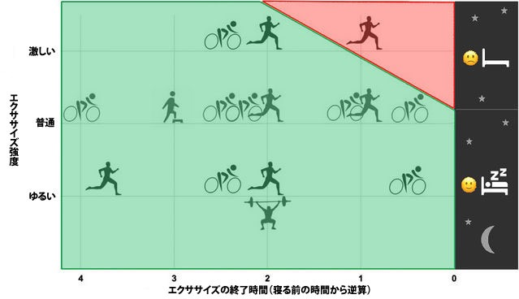

# 【速報】寝りにつく何時間前までに運動をすると睡眠の質は上がるのか？を調べたメタ分析が出てたよー

運動が快眠に効くってのは有名な話で、日中には体を動かしたほうがグッスリ眠れるのは直感的にも理解しやすいのではないかと。

ただ、ここで難しいのは、

- どれぐらいの運動がもっとも睡眠に効くの？
- 寝るどれぐらい前まで運動したらいいの？

みたいなポイントじゃないでしょうか。なんせ運動ってのは神経の覚醒効果もあるんで、ヘタなタイミングでやったら逆に睡眠の質を下げかねないわけですな。

この問題については、2015年に[ざっくりしたレビュー](https://yuchrszk.blogspot.com/2015/07/blog-post_26.html)を行ったんですが、近ごろかなりいい感じのデータが出てきたので速報としてメモしておきます。

---

これはチューリッヒ工科大学の研究([R](https://link.springer.com/article/10.1007/s40279-018-1015-0))で、過去に行われた「**午後の運動と睡眠の質**」にかんするデータから質が高い23件をまとめたもの。みんな大好き[メタ分析](https://yuchrszk.blogspot.com/2016/01/blog-post_12.html)になってまして、精度が高めの結論を出してくれております。ありがたいですねぇ。

で、その結かについては、研究チームがわかりやすいインフォグラフィックを作ってくれてますんで、こちらをどーぞ。赤いゾーンは「睡眠に影響を与えるよー」ってレベルの運動を意味しております。

ってことで、ここから何がわかるかと言いますと、

- **よほど激しい運動じゃないと、寝る前に動いてもほぼ睡眠の質は下がらない！**

ってことですな。スプリントとかHIITぐらいキツい運動を就寝の1時間前にやると、さすがに睡眠の質は下がっちゃうんだけど、それより負荷が低ければ睡眠の直前でも問題は起きないらしい。うーん、そうだったのか……。

研究チームいわく、

> この研究における「激しいエクササイズ」とは、**運動中にしゃべることができないレベルの活動**を意味する。
>
> 「普通のエクササイズ」は、**運動中に歌うことができないはしゃべることならできるレベルの活動**だ。
>
> 昔から、日中の運動が睡眠を改善することはよく知られてきた。今回の研究で分かったのは、寝る前の運動にはほとんどネガティブな影響がないという事実だ。

とのこと。ってことで、私が2015年に出した見解は間違っておりましたので、皆さまはこちらの知見を参考にしてください。すんません！

> もちろん、眠りにつく1時間前に激しいエクササイズをすると睡眠の総時間や睡眠の質は下がるので、そこは注意して欲しい。

そんなわけで、寝る前にHIITをやるのは良くないとしても、軽く走ったり筋トレをするレベルなら問題はなさげ。よく眠りたいなら、とにかくどんなタイミングでもいいから運動しよう！ってことですな。
