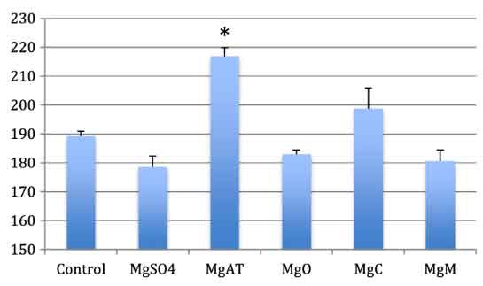
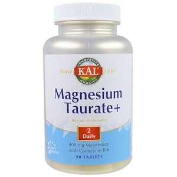

# 【速報】脳に働いて不安を減らしてくれるかもなマグネシウムが見つかった件

マグネシウムが[脳の働きに欠かせない](https://yuchrszk.blogspot.com/2014/07/ddfm.html)のは有名な話。すごくざっくり言うと、マグネシウムは脳の中枢神経系に働きかけるミネラルなんで、こいつが足りないと、

- 頭痛
- 鬱
- 知覚異常
- 記憶力の低下
- めまい

みたいな症状が出てきちゃうんですな。なので、逆にちゃんとマグネシウムをとっていれば、

- [不眠が改善した](https://yuchrszk.blogspot.com/2016/04/blog-post_25.html)
- [メンタルが改善した](https://yuchrszk.blogspot.com/2017/03/blog-post_24.html)

といった結果が得られやすいんですね。マグネシウムは葉菜に豊富ですが、日本でも意外と足りてない人は多いんで、ぜひ切らさないようにしておきたいところ。

ただ、ここで問題になってくるのが、マグネシウムがどれだけ体内でちゃんと使われるか？ってポイントであります。たとえば[iHerb](%E2%80%9Chttps%3A//jp.iherb.com/pr/Healthy-Origins-5-HTP-100-mg-120-Veggie-Caps/14472?rcode=IRO489%E2%80%9D)なんかを探すと、

- クエン酸マグネシウム
- マグネシウムタウレート
- マグネシウムマラテ（リンゴ酸マグネシウム）

みたいにたくさんの種類が出てきますが、それぞれ体への吸収率は異なるんですな。当然、体がちゃんと使ってくれたほうが効果は高くてコスパもいいわけです。

ってことで新しく出たデータでは、「**どのタイプのマグネシウムが脳に効きそうなの？**」って問題を調べてくれてて有用でした。

---

これはトルコで行われた研究([1](https://link.springer.com/article/10.1007/s12011-018-1351-9))でして、いろんなマグネシウムのなかから「脳にすぐに吸収されるものはどれ？」ってのを調べてくれたんですな。といっても、まだ動物実験の段階なんで菅、このタイプの研究は初なんで、なかなか参考になります。

実験で比較されたマグネシウムは、

- 硫酸マグネシウム
- マグネシウムタウレート
- 酸化マグネシウム
- クエン酸マグネシウム
- リンゴ酸マグネシウム

の5つ。これらを400 mgほどラットに投与したあとで、どんな違いが出るかを見たわけです。

でもって、どんな結果が確認されたかと言いますと、

- **脳のマグネシウム 濃度については、タウレートがずば抜けて高かった**

- ただしタウレートは筋肉組織には取り込まれていなかった

だったんですな。どれぐらいタウレートの数値が高かったかと言いますと、以下のような感じです。

※マークがついてるのがタウレートで、確かに他のマグネシウム よりも頭ひとつ抜けてますねー。

また、この実験ではラットのメンタル測定もやってまして（動物が不安そうにしてるかどうかを行動から判断する）、

- **タウレートを飲んだグループのみ不安っぽい行動が減った！**

なんて結果も出てたりします。なんでもタウレートを投与したラットは、ほかよりもビクついたり物陰に隠れたりしなくなったんだそうな。これは気になる結果ですなぁ。

もっとも、くり返しになりますがまだ動物実験の段階ですし、ちょっと他に例がないデータなんで、「**マグネシウムタウレートが脳に効く！**」とはとても言えないレベルの話です。あくまでも「タウレートが脳にいい可能性があるんだなー」ぐらいにとらえておいていただければ。

いちおうタウレートの購入先も貼っておきますけど、そこまで新しもの好きでないのなら「[定番の快眠サプリ「マグネシウム」のベストはこれだ！](https://daigovideolab.jp/blog/1689050)」で紹介したほうを選ぶのが無難だと思われます。

[マグネシウムタウレート](https://jp.iherb.com/pr/KAL-Magnesium-Taurate-400-mg-90-Tablets/70118?rcode=IRO489)

KAL

[iHerb](%E2%80%9Chttps%3A//jp.iherb.com/pr/Healthy-Origins-5-HTP-100-mg-120-Veggie-Caps/14472?rcode=IRO489%E2%80%9D)
