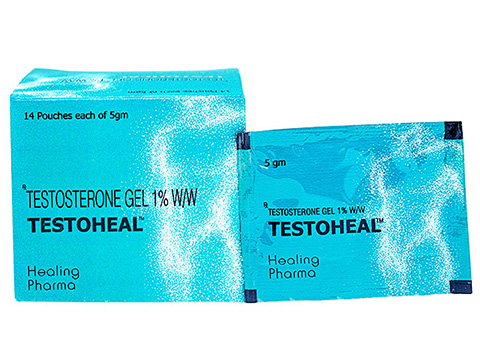

# 【速報】沈みがちなオッサンのメンタルに「テストステロン補充」が効く！というメタ分析

テストステロンがメンタルと連動してるのは有名な話。テストステロンってのは人間に活力をあたえるホルモンなんで、減ったらいろいろと問題が起きがちなわけです。

で、「それならテストステロンを補充すればメンタルも元気になるんじゃない？」って考え方が生まれまして、実際に抗うつ剤の効果がアップしたなんてデータ([R](https://psychnews.psychiatryonline.org/doi/full/10.1176/pn.38.3.0026b))も出てたりします。また、[2016年のメタ分析](https://yuchrszk.blogspot.com/2016/07/blog-post_4.html)では、テストステロン補充で中高年の筋肉が増える！なんて結果もありまして、やっぱ男性ホルモンって大事なんだなー、みたいな。

さらに直近の新たな[メタ分析](https://yuchrszk.blogspot.com/2016/01/blog-post_12.html)では、テストステロンを補充したらメンタルは改善するの？って問題を掘り下げてて、私のように40を超えた人間には役立ちそうであります。

---

これはチューリッヒ大学などが行った研究([R](https://jamanetwork.com/journals/jamapsychiatry/article-abstract/2712976))で、

- テストステロン療法にかんする470件の論文から質が高い27件をピックアップ（サンプル数は男性1890人）

- 療法の種類は、ホルモン注射かジェルを股間に塗るタイプ

- 療法の前後でうつ病の症状が改善したかどうかをみる

みたいになってます。その結果には、おもに3つのポイントがありまして、

1. テストステロン療法は男性のメンタルに効く！（OR = 2.3） その効果は抗うつ剤と同じレベル！
2. テストステロンを使えば使うほど効果は高くなる！（もちろん癌とのバランスはありますが）
3. 治療前のテストストロンレベルが高い人でも、テストストロンを追加するとメンタルが改善する！

みたいになっております。とりあえず、テストストロンはやっぱメンタルの改善に効くみたい。歳をとって心が沈みがちになったような人は、試してみるのもいいのかもですな。

あと、個人的に「へー」と思ったのは3つ目で、テストステロンの初期値とうつ病に関係がないってのはおもしろいっすね。まぁ現代では「[うつ病は全身の炎症が原因だ！](https://yuchrszk.blogspot.com/2016/12/blog-post_27.html)」って説がわりと優勢なんで、男性ホルモンよりはそちらに気を配ったほうがいいんでしょうが。

また、この研究だと1週間に100mg」のテストステロンで効果が出てる模様。いちおうネットでジェルを買うこともできますが、なんせ前立腺がんリスクがあるんで、個人でホルモン補充はしないようにお願いします。

[テストヒールジェル(TestohealGel)](https://alwys.net/contents/ard.php?id=OS011504&adwares=os026375)

