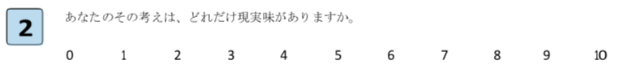
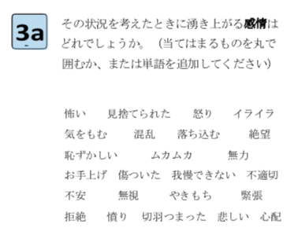
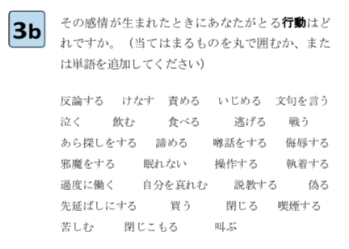
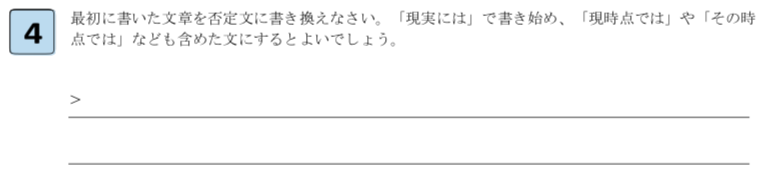
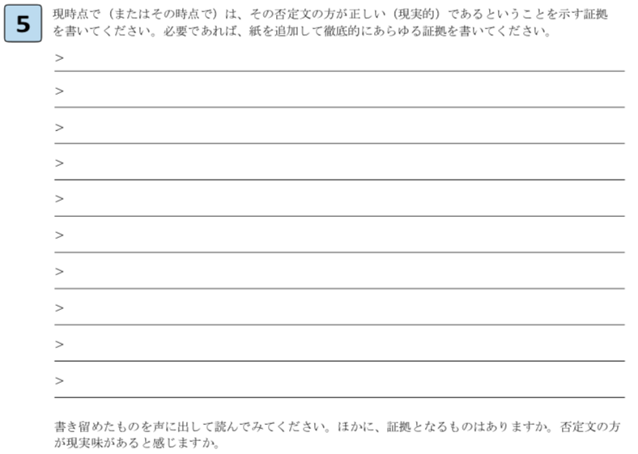
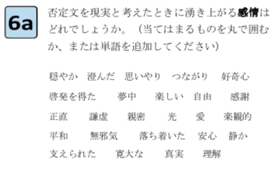
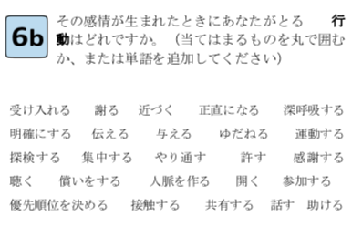

# 認知行動療法をダイエットに活かすための7ステップ

ちょっと前に「[「認知行動療法」を手軽に実践する7ステップ](https://daigovideolab.jp/blog/1675775)」って話を書いたんですよ。

[認知行動療法](https://daigovideolab.jp/search?channel_owner=paleo&word=認知行動療法)には「パレオな男」で何度も書いてるメンタルの改善テクで、自分が持ってる「考え方の誤り」を修正していくのがポイント。たとえば、

1. 「自分はいつもダメだ！」と思った
2. 「本当に自分はいつもダメか？実際はうまくやれたこともあるのでは？」みたいに現実的な議論をぶつける
3. ゆがんだ思考が修正されて気持ちが落ち着く

みたいな流れになっております。現実的には「いつもダメ」な人なんて存在しないんで、そこらへんを治してやるわけですな。

ただ、本格的に認知行動療法をやるのは大変で、コツコツと「[自動思考のキャッチトレーニング](https://yuchrszk.blogspot.com/2017/01/blog-post_14.html)」を続けたり、毎日のように自分の思考を細かく修正する必要があったりと、かなーり地道な作業を求められるんですよ。

が、前回に紹介した「7つのステップ」は、認知行動療法を簡単な手順にまとめてまして、なんか落ち込んだときに手軽に取り組めるのがいい感じ。メンタルがヘコんだときの応急処置に使うとよろしいかと思われます。

で、この「7つのステップ」を説明したときに「**このテクニックはダイエットにも使えます**」と簡単に書いたところ、「やり方がわからない！」ってお声をいくつかいただきましたんで、減量法への応用バージョンも書いておこうかと。そもそもダイエットはメンタルの影響がデカいので、認知行動療法が役立つ可能性が高いんですよね。

---

## ダイエットに効かせるための「認知行動療法」活用

では、さっそくダイエットに認知行動療法を使う手順を説明していきます。

## STEP1 「べき」の解説

まずは自分の悩みを書くステップですが、今回はダイエットの問題なので、「**私は痩せなければならない**」とか「**もっと引き締まった体型にならないと」**みたいに書いておけばOKです。

## STEP2 思考の採点

続いて思考の採点です。ダイエットに使う場合は、「自分がどれぐらい強く痩せたいと願っているか？」をレーティングしてください。もし「死ぬほど痩せたい」なら10点、「よく考えたらそれほでもないか……」と思ったならそれ以下の点数をつけましょう。

## STEP3a 感情の把握

「痩せなければ！」と思ったときに、自分のなかにどんな感情がわきあがるかを上のリストから選んで丸をつけましょう。鬱になった、恥ずかしくなった、なんかイヤーな気持ちになったなど、なんでも構いません。リストに当てはまる感情がなければ、しっくりくるものを考えて付け足してください。

## STEP3b 行動の把握

「痩せなければ！」と思ったあとに、自分がどんな行動をとったかを上のリストから選んで丸をつけましょう。ここで書き出して欲しいのは、「ジムに行って走った」みたいなポジティブな行動じゃなくて、あくまでもネガティブなものです。たとえば、

- 逆にポテチをバカ食いしちゃった
- ビールを飲んじゃった
- テンションが下がって寝た
- SNSに逃げ込んだ
- できるだけゆったりした服を着てごまかした
- 身近な人に嫌な態度をとった
- 彼女との会話がぎこちなくなった

のようなものをピックアップしてください。リストに当てはまる行動がなければ、しっくりくるものを考えて付け足せばOK。ここで書き出した行動が、対策すべきダイエットの障害だと考えられます。

## STEP4 リライト

で、認知行動療法をダイエットに使う場合は、このステップがちょっと変わります。[通常のステップ](https://daigovideolab.jp/blog/1675775)ではステップ1で書いた文章を否定文に書き換えるんですが、ここでは「現実には、私は現時点では◯◯なはずだ」と変換してください。

たとえば「私は痩せなければならない」って文章なら「現実には、私は現時点では痩せないはずだ」となりますし、「もっと引き締まった体型にならないと」なら「現実には、私は現時点では引き締まった体型にならないはずだ」になります。

「そんなことを書いたらモチベーションが下がる！」と思うかもですが、ここではあくまで「**現時点**」での問題点をあぶり出して、冷静に見つめなおす視点を持つのが目的。そのために必要なステップなのだとお考えください。

## STEP5 エビデンス

ここでは、ステップ4で書いた文章が「正しい」と思われるエビデンスを、思いつくままに書いていきます。「現実には、私は現時点では痩せないはずだ」って文章を書いた場合は、以下のような文章が考えられるでしょう。

- 現実には、私は現時点では痩せないはずだ。なぜなら消費カロリーより多く食べてるからだ
- 現実には、私は現時点では痩せないはずだ。なぜなら運動をしないからだ
- 現実には、私は現時点では痩せないはずだ。なぜなら体に悪いものばかり食べてるからだ
- 現実には、私は現時点では痩せないはずだ。なぜなら40歳を超えたからだ
- 現実には、私は現時点では痩せないはずだ。なぜならホルモンバランスが乱れているからだ
- 現実には、私は現時点では痩せないはずだ。なぜならストレスでどか食いするからだ

といった感じになります。ここで大事なのは、

- 現実には、私は現時点では痩せないはずだ。なぜなら私には価値がないからだ

みたいに主観的な心理状態を書かずに、客観的にも判断できるエビデンスに落とし込むこと。上の文章を書き換えるなら、

- 現実には、私は現時点では痩せないはずだ。なぜなら「私には価値がない」と思ってしまうせいで、食べ過ぎに走るからだ

のようになります。あくまで他人から見てもわかるような原因を書くのが大事であります。

## STEP6a 感情の把握

ここでは、ステップ5の文章を読み直して、どんな感情がわきあがるかを上のリストから選んで丸をつけましょう。リストに当てはまる感情がなければ、しっくりくるものを考えて付け足してください。

## STEP6b 行動の把握

ステップ6aで抱いた感情に対して、自分が取りたくなった行動を上のリストから選んで丸をつけましょう。リストに当てはまる行動がなければ、しっくりくるものを考えて付け足してください。

## STEP7 再読

最後に、ステップ1で書いた「私は痩せなければならない」って文章を読み直して、どれだけ自分にとって重要性があるかを採点します。ここで「やはり重要だ」と思った場合は、別にステップ2でつけた点数と同じにしても構いません。

## なぜこの作業で痩せるのか？

さて、ダイエットにおいて上記の作業が大事なのは、「痩せるプレッシャー」からいったん距離をあけるためであります。ダイエットがうまくいかないときってのは、

1. 痩せなければならない！と思う
2. その気持ちがプレッシャーになる
3. プレッシャーによるストレスが爆誕
4. ストレスを解消しようとして逆効果な行動を取る

ってマイナスのループにはまりがちなんですが、この悪循環をいったん目に見えるようにするのが狙いです。「あー、自分はダイエットのせいでこんな行動を取ってたのか」「こういう理由で痩せないんだなぁ」ってのを客観的につかんでもらうわけですな。

というと、「自分が痩せない理由なんかわかってる！」とか思いがちですけど、ただ頭で考えるのと文字に書き出すのでは大違い。自分が無意識のうちに取ってる行動と肥満の原因を頭の外に吐き出すだけもプレッシャーがほどけて、ダイエットがはかどりやすくなるんですよ。認知行動療法では「外在化」と言われる状態です。

ってことで、ダイエット以外にも「なにか◯◯をせねば！」ってプレッシャーで頭がいっぱいな人は、今回の手順でストレスを振り払ってみるのも一興。お試しあれー。
