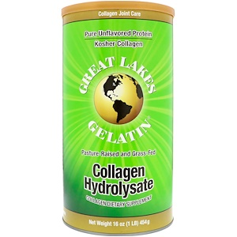
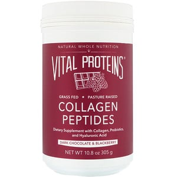

# 実は激しく優良食材な「ゼラチン」のメリットと正しい取り入れ方

そういえば、**ゼラチン**の重要性について書いたことがなかったので、簡単にまとめておきます。

ゼラチンってのはご存じコラーゲンを加熱して作る、お菓子なんかによく使われる食品のこと。というと体に悪そうなイメージを持つ方もいるかもですが、その実態はタンパク質のかたまりでして、かなり体にはよろしいんですよ（だいたい98〜99％はタンパク質）。

しかもゼラチンが特徴的なのは、普通の肉とはアミノ酸の構成が大きく違うところです。「[正しい肉の食べ方](https://yuchrszk.blogspot.com/2016/10/blog-post_33.html)」にもチラッと書いたとおりゼラチンは、

- グリシン
- プロリン
- リジン

といったアミノ酸が多めでして（特にグリシンが豊富）、このポイントが普通の肉とは違った作用を生み出すんですよね。

なので、いつも鶏むね肉とか赤身肉ばかり食べてるような方は、アミノバランスの偏りを減らすためにも、ゼラチンを意識してとるのが吉。というわけで今回は、

1. ゼラチンで期待できるメリット
2. ゼラチンをいかに増やすか？

の2点にしぼって考えていきたいと思います。

---

## ゼラチンの量を増やすとどんないいことがあるのか？

では、まずゼラチンで得られる（かもしれない）メリットを見ていきましょう。

### 1．睡眠の質が上がるかも

上述のとおりゼラチンには「グリシン」ってアミノ酸が入ってて、こいつが睡眠の改善に効くんですな。グリシンと睡眠改善については一定のデータがありまして、

- [不眠に効くサプリを、効果が高い順に５つ並べてみた](https://yuchrszk.blogspot.com/2014/09/blog-post.html)
- [症状別：ぐっすり眠るためのサプリの飲み方を考えてみたよ](https://yuchrszk.blogspot.com/2016/04/blog-post_25.html)

といったあたりを参照していただければと思います。グリシンでどの程度まで睡眠の質が上がるかはまだ議論がありますけど、大方のデータは快眠効果を支持してまして、まずは信用して問題ないのではないか、と。

### 2．筋肉の減少を食い止めるかも

歳をとると日ごとに筋肉は衰えていくもので、30才過ぎから10年ごとに3〜5％ずつが失われていくくと考えられております。これを食い止めるにはタンパク質を増やすのが一番でして、ここにゼラチンが効くんじゃないか？って出tーたがいくつかあるんですよ([R](https://www.ncbi.nlm.nih.gov/pubmed/28375879),[R](https://www.ncbi.nlm.nih.gov/pubmed/29941158))。

ここでもポイントはグリシンでして、どうも筋肉への過度なストレスをやわらげてくた結果、ムダな現象にブレーキをかけてくれるみたい。加齢のほかにも、病気やカロリー制限中の筋肉ダメージをふせぐのにも良さげ。

### 3．腸内環境を改善するかも

ゼラチンに豊富なプロリンやグルタミンは、胃酸の分泌を増やす働きがありまして、食べたものの消化と吸収を助けてくれちゃう([R](https://www.ncbi.nlm.nih.gov/pmc/articles/PMC2898551/),[R](https://www.pathophysiologyjournal.com/article/S0928-4680%2800%2900045-6/fulltext))。ついでに、水分を吸収したゼラチンが腸内を刺激して、お通じもよくしてくれたりします。

その結果、リーキーガットのような症状が改善する可能性がありますんで([R](https://www.ncbi.nlm.nih.gov/pmc/articles/PMC2898551/))、日ごろからお腹の調子が悪いような人が試す価値は十分にございましょう。

### 4．老化物質を減らすかも

普通に赤身肉にはメチオニンってアミノ酸が豊富に入っております。こいつは脳の働きに欠かせない重要な成分だったりするんですけど、他方では、代謝の過程でホモシステインっていう毒性が高い物質を生みやすいんですよ。

ホモシステインの恐ろしさについては、

- [脳の機能を劣化させる悪玉「ホモシステイン」対策入門](https://yuchrszk.blogspot.com/2017/04/homocysteine.html)
- [お肌と脳の劣化をもたらす「ホモシステイン」対策に効く最強の食材とは？](https://yuchrszk.blogspot.com/2017/05/blog-post_6.html)

などを参照していただければ幸い。とにかく、体を一気に老けこませる物質のひとつだとお考えください。

で、このメチオニンを適度なバランスにたもつためには、ゼラチンに豊富なグリシンやプロリンなどが欠かせないんですな([R](https://www.ncbi.nlm.nih.gov/pubmed/20093739))。ってことで、老化物質をいたずらに増やさないためにもゼラチンは役立つはずであります。

## いかにゼラチンを取るべきか？

ってことで、いずれもハッキリしたデータではないものの、アミノ酸のバランスが大事なのは確実なんで、ゼラチンの摂取を意識しとくといい感じです。

では、具体的にいかにゼラチンを増やすかと言いますと、

- **ボーンブロス**：[牛骨や鶏ガラから作るスープ](https://yuchrszk.blogspot.com/2016/09/blog-post_7.html)。海外の健康サイトで騒がれるほどのメリットはまだ認められてないものの、グリシンやプロリン、グルタミンが豊富なのは間違いなし。ついでに必須のミネラルやビタミンもとれていい感じです。

- **ゼラチンパウダー**：普段から鶏むねやプロテインパウダーが多い筋トレ好きや、そもそも肉を食べないベジタリアンなどは、ゼラチンパウダーを買うのも良いかと思います。ただし、国内のものはイマイチ品質がよくわからんので、わりとチェックが厳しい海外製をオススメしておきます。

って感じ。個人的にはボーンブロスを作っていただきたいところですけど、なんせ時間がかかるんでゼラチンパウダーに頼るのも否定はしません。

個人的なオススメとしては、

[コラーゲン加水分解物、コラーゲンジョイントケア](https://jp.iherb.com/pr/Great-Lakes-Gelatin-Co-Collagen-Hydrolysate-Collagen-Joint-Care-16-oz-454-g/52774?rcode=IRO489)

Great Lakes Gelatin Co

[iHerb](https://jp.iherb.com/pr/Healthy-Origins-5-HTP-100-mg-120-Veggie-Caps/14472?rcode=IRO489)

[コラーゲンペプチド](https://jp.iherb.com/pr/Vital-Proteins-Collagen-Peptides-Dark-Chocolate-Blackberry-10-8-oz-305-g/78141?rcode=IRO489)

Vital Proteins

[iHerb](%E2%80%9Chttps%3A//jp.iherb.com/pr/Healthy-Origins-5-HTP-100-mg-120-Veggie-Caps/14472?rcode=IRO489%E2%80%9D)

などのブランドはグラスフェッド系の牛を素材にしててナイスです。そこまでこだわる必要もないのかもですが、とりあえず品質が高いものを選ぶんだほうがいいかなぁ、と。

そんなわけで、今回は意外と見過ごされがちなゼラチンのお話でした。

もちろん進化医学的にもゼラチンは大事で、そもそも多くの狩猟採集民は、現代人のように肉の美味いとこ取りをせず、**どんな獲物も頭からシッポまで丸ごと食べるのが基本**なんですよ。そのおかげで筋や腱といった結合組織の摂取も豊富になり、アミノ酸のトータルバランスが万全になっていくわけです。自然のメカニズムはよくできてますなぁ。
