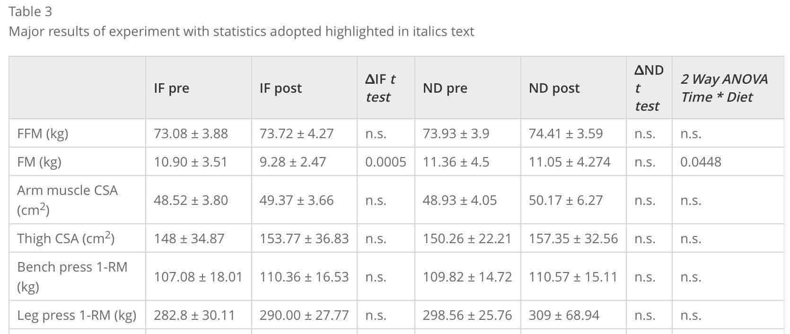

# 【速報】リーンゲインズと筋トレを組み合わせれば、自然とバッキバキな体になれるかもだ！というRCTの話

「パレオな男」では昔から[リーンゲインズ](https://www.amazon.co.jp/%E3%82%AD%E3%83%A4%E3%83%8E%E3%83%B3-0337B002-CANON-CanoScan-LiDE60/dp/B0009Y6BKK/ref=sr_1_1?s=computers&ie=UTF8&qid=1548211406&sr=1-1&keywords=canoscan+lide60)ってプチ断食手法を取り上げております。

- 1日のうち8時間以内なら何を食べてもOKだけど、それ以外の16時間は断食！

って手法のことで、この時間配分さえ守れば、朝ごはんを抜こうが晩ごはんを抜こうがOK。とにかく1食抜いて空腹の時間を作ると、ダイエットやアンチエイジングの効果が得られるんじゃないか？と考えられてるんですな。

ただし、そもそも「プチ断食」が新しい研究分野なもので、これといったデータがイマイチ少ないのが難点。とくにリーンゲインズは実証例が少なくて、

- [ラマダンを調査したら体型改善の効果が確認された](https://yuchrszk.blogspot.com/2016/02/28.html)

- [肥満ぎみの中年男女で調べたら大きなダイエット効果が認められた](https://yuchrszk.blogspot.com/2018/07/1350kcal.html)

といった事例があるぐらいなんですな。つまり、まだ健康的な被験者にRCTを行なったケースがなかったんで、具体的な効果は未知数だったわけです。

が、そう思ってたら、「若くて健康的な人がリーンゲインズをしたらどうなるの？」を調べた良いデータが出てましたんでご紹介。

---

これはパドヴァ大学の研究([R](https://www.springermedizin.de/effects-of-eight-weeks-of-time-restricted-feeding-16-8-on-basal-/10870316))で、20〜30代の男性34人を対象にしております。みんな最低でも5年の筋トレ歴がある人だけを選んでまして、リーンゲインズが筋肉に悪いかどうかもチェックしてくれたみたい。

実験期間は8週間で、全体を2つのグループにわけております。

1. **リーンゲインズ**：1 p.m., 4 p.m., 8 p.m.の3つの時間帯に食事をする
2. **コントロール群**：8 a.m., 4 p.m., 8 p.m.の3つの時間帯に食事をする

って感じで、リーンゲインズグループは朝ごはんを抜きつつも1日3食のパターンは維持したみたい。

また、そのほかの条件をメモしておくと、

- 両グループともタンパク質は1日に体重1kgあたり1.8-1.9gをとる（筋トレ好きには十分な量ですな）

- 特にカロリー制限はしない

- 筋トレは週に3回で、全メニューとも6〜8レップでセット間の休憩は3分
  - 1回目はベンチプレスやカールで上半身を鍛える
  - 2回目はレッグプレスなどで足を鍛える
  - 3回目はラットプルダウンなどで背中を鍛える

みたいになってます。ベーシックなタンパク質量と筋トレメニューにリーンゲインズを足したらどうなるか？ってとこを調べたわけですね。

では、その結果をまずはグラフでどーぞ。IFがリーンゲインズグループ、NDがコントロール群を意味しております。

そんなわけで、このグラフのポイントをざっと抜き出すと、

- リーンゲインズをしたグループは**8週間で1.6kgほど体脂肪が減ってる**！（コントロール群は有意差なし）

- それ以外のパラメータには両グループで大差なし

って感じになりましょう。とくにカロリー制限を意識したわけじゃないのに、体脂肪がこんだけ減るのはすばらしいっすね。

というと、その理由が気になるわけですけども、実にシンプルな話でして、

- リーンゲインズグループは、**1日の総カロリー摂取量が減ったから**

のようになります。別グラフによれば、リーンゲインズをした人は**平均で**1日200kcal**ほど摂取カロリーが減って**まして、自然といい感じに減量が進んだみたいなんですな。

なぜ自然と摂取カロリーが減るかはまだ謎なんだけど、血液検査のデータだと、プチ断食グループはアディポネクチンってホルモンが増えてるんで、そのせいなのかなーぐらいの感じ。アディポネクチンは、脳に「もっとエネルギーを使え！」と指示する物質で、俗に「若返りホルモン」などと呼ばれてたりします。

さらに、リーンゲインズグループに確認されたメリットは他にもありまして、

- 中性脂肪の低下
- インスリン値の改善
- 炎症性サイトカインの低下

といったあたりも非常に美味しいところです。まぁリーンゲインズのほうが体脂肪が減ってるんで、このような結果が出るのは当然といえば当然なんですけども。

ってことで、ここからわかるのは、

- 体をマイルドに絞りたい筋トレユーザーにもリーンゲインズは有効っぽい

- ゆるやかに体重を落としたい人にもリーンゲインズはおすすめだよ！

というところでしょう。リーンゲインズユーザーの皆さまにおかれましては、モチベーションアップの一助にお使いください。
