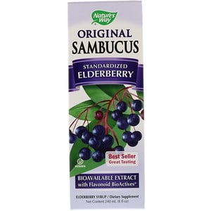
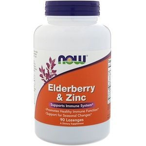

# 【速報】風邪とインフルに「あのベリー」が効くぞ！というメタ分析が出てたよ

「パレオな男」では**風邪にかかったらどうすればいいの？**って話をよく書いてまして、

- [結局、風邪に効くものってなんなの？みたいな話をするよ！](https://yuchrszk.blogspot.com/2018/01/blog-post_30.html)

- [薬を飲むより風邪に効くかもしれない凄い方法とは？](https://yuchrszk.blogspot.com/2017/12/blog-post_26.html)

- [しつこい風邪とアレルギーは「亜鉛トローチ」で治す時代](https://yuchrszk.blogspot.com/2016/11/blog-post_89.html)

といったあたりが代表的な例です。いろんなデータを見てますと、とりあえず[亜鉛トローチ](https://jp.iherb.com/pr/Nature-s-Way-Zinc-Lozenges-Wild-Berry-Flavored-60-Lozenges/2085?rcode=IRO489)を選んでおくのがよさげだなーってのが現状での結論になりましょう。

……などと思っておりましたら、近ごろ「**このサプリも風邪に効くよ！**」っていうナイスな新データが出てきましたんでご紹介しておきます。

## あのベリーが風邪とインフルに効く！

これはフランクリン・インスティチュートが過去137件の「風邪リサーチ」をまとめたメタ分析([R](https://www.sciencedirect.com/science/article/pii/S0965229918310240))で、研究チームはこう申しておられます。

> 風邪の治療にありがちなのが抗生物質の誤用だ。当然ながら風邪の8〜9割はウイルス性であり、抗生物質には意味がない。
>
> 今回の発見は、**一般的な風邪やインフルエンザに対して、抗生物質の代わりに使える効果的で安全な方法がある**ことを示した。

では、その方法がなんだったかと言いますと、

- **エルダーベリーシロップ!**

だったんですな。その名のとおりエルダーベリーって果実から有効成分を抽出したサプリで、日本ではマイナーながら、海外では昔から「風邪に効くんじゃない？」と言われてて、iHerbなんかでも定番のアイテムなんですよ。

[標準化エルダーベリー](https://jp.iherb.com/pr/Nature-s-Way-Original-Sambucus-Standardized-Elderberry-8-fl-oz-240-ml/4318?rcode=IRO489)

Nature's Way

[iHerb](%E2%80%9Chttps%3A//jp.iherb.com/pr/Healthy-Origins-5-HTP-100-mg-120-Veggie-Caps/14472?rcode=IRO489%E2%80%9D)

もちろん地味に臨床テストもおこなわれていて、生体外研究だとインフルエンザウイルス（H1N1）をやっつける働きも確認されてたりします。すごいもんですなぁ。

## エルダーベリーはどんだけ効果があるのか？

で、この新しい研究では、エルダーベリーについて調べたデータから質が良い180人分のデータをまとめて分析したんですな。メタ分析としてはサンプル数が少ないですけど、目新しい研究なんでいたしかたありますまい。

さて、その結果をひとことで申し上げますと、

- **エルダーベリーシロップは風邪とインフルエンザ****の回復期間を短くする！（効果量1.711）**

だったそうです。こんだけの数字が出てれば、かなり期待していいんじゃないでしょうか（実際の数値はかなり個人差がデカいので判断が難しいですが）。

また、そのほかに判明した知見としては、

- エルダーベリーにはシロップとトローチの2種類があるが、どっちでも効果は変わらない

- インフルエンザのワクチンを打った場合でも、エルダーベリーの働きには影響しない

- エルダーベリーは風邪よりインフルエンザのほうが効果が高い

なんてこともわかっております。まぁ、データをよく見てますと、**大半の研究がエルダーベリー企業の出資を受けてる**のが気になっちゃうんですけど、とりあえず試す価値が十分ありそうっすね。

ちょっと検索してみたら、NOWがエルダーベリー＆亜鉛のミックストローチを出してたんで、まずはこれを買ってみるかな……。

[エルダーベリー＆亜鉛トローチ](https://jp.iherb.com/pr/Now-Foods-Elderberry-Zinc-90-Lozenges/555?rcode=IRO489)

Now Foods

[iHerb](%E2%80%9Chttps%3A//jp.iherb.com/pr/Healthy-Origins-5-HTP-100-mg-120-Veggie-Caps/14472?rcode=IRO489%E2%80%9D)
