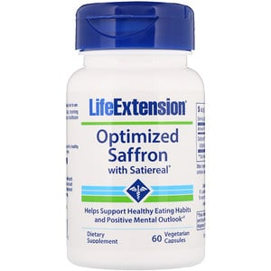

# 【速報】サフランはメンタルの改善に効く！では、具体的にどれぐらい使えばいいのか？のメタ分析

拙著「[超ストレス解消法](https://amzn.to/2T0YF0s)」で「**メンタル改善に効くよー**」として紹介しているサプリのひとつが**サフラン**。日本だとサフランライスでおなじみのスパイスですが、実は古代から不安対策に使われてきた歴史がありまして、近年でも[良い結果が出てたりする](https://yuchrszk.blogspot.com/2017/02/blog-post_92.html)んですな。

で、最近は新たに「サフランがどれだけメンタルに効くかをがっつり調べたぞ！」って論文が出まして、なかなか参考になりました。メンタル系のサプリとしてはそこそこ良い成績なので、取り急ぎ速報としてご紹介しておきます。

---

これは重慶医科大学の論文([R](https://www.ncbi.nlm.nih.gov/pubmed/29849461))で、過去のサフラン研究から質が高めな7件をまとめたメタ分析になっております。個々のデータの質は「まぁまぁ」ぐらいなんですけど、現状のサフラン研究としては最良の部類でしょう。

で、その結論をいきなりお伝えすると、

- プラシーボと比較すると、サフランは確実に大うつ病を改善する！（SMD ＝ -1.22 ）
- **専門の抗うつ剤と比べても、同じぐらいの効果がある！**（SMD ＝ 0.16 ）

って感じでして、ビタミンDの成績にも匹敵しそうな良い成績を出しております。全体的なデータ数が少ないのがアレですが、これは使ってみたくなりますなぁ。

といっても、まだサフランがなぜメンタルに効くのかはわかってないんですが、いま言えそうなのは、

- サフランの生理活性物質が脳の伝達物質のバランスを取ってくれてるのでは？

ってことぐらい。うつ病の人は脳内のホルモンバランスが崩れてるケースがよくありますが、これをサフランが修正してくれるんじゃないか、と。

その点でまだまだ謎の多いスパイスなんですけども、「抗うつ剤で効果が出ないなー」とか「なんか元気が出ないんだよなー」みたいな方は試す価値があるだろうと思われます。なにせ副作用がほとんど確認されてないんで、安全に服用できますしね。

では、具体的にどれぐらいを飲めばいいかというと、

- **1日20〜30mgを6〜8週間は続けよう！**

のようになります。だいたいの研究はこれぐらいで変化が出てるんで、まずは効果が望めるのではないかと。

サフランはサプリでいろいろ出てまして、とりあえずここでは[Life Extensionの商品](https://jp.iherb.com/pr/Life-Extension-Optimized-Saffron-with-Satiereal-60-Vegetarian-Capsules/23953?rcode=IRO489)を取り上げておきます。こいつはSatierealって独自の抽出法を使ってまして、脳の伝達物質を整える働きには一定の評価があったりします。2010年のデータ([R](https://www.ncbi.nlm.nih.gov/pubmed/20579522))でも、「Satierealを飲んだ女性は自然と間食の量が減ったよー」なんて結果が出てますんで、やはり脳の暴走を鎮める働きがあるんだろうなぁと思っております。

[Optimized Saffron with Satiereal](https://jp.iherb.com/pr/Life-Extension-Optimized-Saffron-with-Satiereal-60-Vegetarian-Capsules/23953?rcode=IRO489)

Life Extension

[iHerb](%E2%80%9Chttps%3A//jp.iherb.com/pr/Healthy-Origins-5-HTP-100-mg-120-Veggie-Caps/14472?rcode=IRO489%E2%80%9D)
