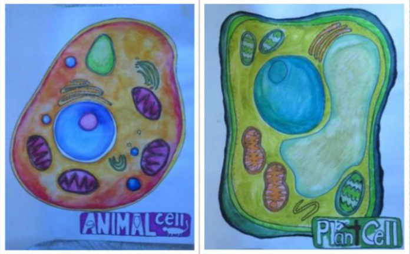
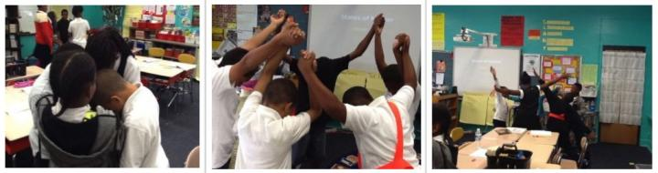

# 【速報】学んだことがほぼほぼ100％頭に残る学習法が発見された件

かの名門ジョンズ・ホプキンズ大学から、「**記憶に残りやすい学習法はこれだ！**」って内容の良い論文が出てましたんで【速報】でシェアしときます。

---

これは350人の小学５年生を対象にした研究で、まずは結論からいきなり引用します。

> 今回のデータは、学習におけるアートの必要性を示している。アートをベースにした教育が必須スキルになることを望むばかりだ。

ってことで、この研究チームは「アートが学習に役立つんじゃないの？」と考えたわけですな。

実験では、まず生徒たちをランダムに2パターンのクラスに割り当てております。

1. 天文学とライフサイエンス
2. 環境学と化学

それぞれのクラスは3〜4週間のカリキュラムで構成されていて、さらに生徒たちを2グループに分けたんですね。

1. 従来どおりの学習クラス
2. アートを取り入れた学習クラス

「アートを取り入れる」ってのがイマイチわかりづらいかもですが、この研究の事例でいうと、

- 元素の種類をラップで覚える

- 細胞の仕組みをポップなイラストにする

- 体を使って分子の動きを表現

みたいになってます。具体的なイメージとしては、まず↓が細胞をイラスト化したもの。

さらに↓が分子の動きをクラスメートと表現したものだそうです。なんか楽しそうですね（笑）

で、研究チームはクラスが終わってから10週間後に記憶の確認テストを行ったんですが、この結果があらビックリ。アートを使った授業を取り入れた生徒は、学んだ内容のほぼほぼ100％を記憶してたというんですな。まぁ歌に乗せて記憶するって手法は昔からあるものの、これはかなり素晴らしい成果ではないかと。

もちろんこの研究には限界があって、今回のデザインでは、

- 果たしてアートそのものが学習に効くの？

- それとも体を動かしたり視覚を使ったのが良かったの？

みたいなポイントはなかなかわかりづらいところではあります。「[何か覚えたいものがあれば、とりあえ絵に描いときなはれ](https://yuchrszk.blogspot.com/2019/02/blog-post_14.html)」みたいな実験も昔からあるんで、おそらくはいろんな感覚を使ったのが良かったのだろうなーって気はしますが。

研究チームいわく、

> 従来の学習方法は、成績が良い生徒と飲み込みが悪い生徒のギャップを広げる方向に働きやすい。しかしアートを取り入れた手法であれば、みんなの学習意欲は高まり、思考能力が伸びる可能性がある。

とのこと。そりゃあ座ってただ学ぶよりは、いろんなことをしたほうがモチベーションは上がりますもんね。

そんなわけで皆さまにおかれましては、自分で勉強するときなどにもアート（というか『遊び』）の視点を取り入れた手法を考えてみちゃいかがかと思う次第です。どうぞよしなに。
