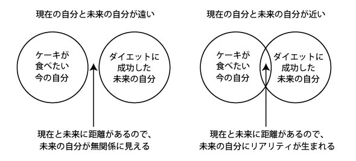

# 【速報】10年後の自分が幸せかどうかを予測する「たったひとつの質問」とは？

「**将来の自分が幸福でいられるかどうか？を手軽に判断できる『質問』が見つかったよー**」って論文がおもしろいかったのと、心理学的にも大事なポイントを押さえていて有用だったんで速報としてメモしときます。

---

これはUCLAの研究([R](https://journals.sagepub.com/doi/10.1177/1948550619843931))で、「将来の幸福度を判断する質問とは？」って問題を調べた内容になってます。それでは、まずその質問をご紹介します。

- **いまから10年後の自分の姿をイメージしてください。その姿はどのようなものですか？**

質問の答えは好きなように考えてもらってOKで、「いまより賢くなってる！」でもいいし「いまより元気がないかも……」でもいいし「より親切な人間になってそうだな」でもいいし、とにかく**自分の感覚に正直に**お答えください。

では、この質問の答えをどのように判断するかと言いますと、以下のようになります。

- 「いまよりも状態が悪くなる」と思った人は、10年後の幸福度が下がりやすい（そりゃそうでしょうな）

- **「いまよりも状態が良くなる」と思った人も、10年後の幸福度が下がりやすい**

- **「10年後もいまと同じだろう」と思った人が、もっとも10年後の幸福度が上がりやすい**

ってことで、なんと「現状維持だろう」と思った人が、もっとも未来の幸福度と相関してたらしんですな。ちょっと驚きですねぇ。

これは4,963人を対象にした研究で、全員に「将来の自分についてどう思います？」って質問をぶつけたあと、10年におよぶ追跡調査を行ったんだそうな。その結果は上述のとおりで、「現状維持」と答えた人ほど10年後に幸せだったんですよ。

なんだか不思議な話のようですが、このような現象が起きる理由としては「[最高の体調](https://amzn.to/2LvzfVo)」にも書いた「**自己連続性**」が関係しております。これは「**未来の自分と現在の自分の心理的な距離がどれだけ近いか？**」を表す概念で、「**現在の自分のイメージと未来の自分のイメージが近い人**」ほどセルフコントロール能力が高いことがわかってるんですよ。

そのメカニズムについては、以前に「パレオな男」で紹介した図解をご覧ください。

って感じでして、ざっくり言うならば、

- 現在と未来のイメージが**遠い**＝将来の自分がうまく想像できないので、未来が他人事になっちゃう

- 現在と未来のイメージが**近い**＝将来の自分がうまく想像できるので、未来を自分の事として考えられる

ってことです。つまり「未来の自分は現在と同じだろうな」と思える状態ってのは、未来の自分を親身になって考えやすいってことでして、そのぶんだけセルフコントロール能力が効くわけっすね。

ただし、当たり前のことですけど、この研究は「将来は現状維持するぞ！」と思えば未来が幸せになるって話ではないのでご注意ください。あくまで直感的に10年後の自分を考えたときに、心の底から「未来の自分もそんな変わらないだろうなぁ」と思えるのが大事ってことですんで。

なので、もし現時点で「将来の自分はまったく別人だろう」と思えるような場合は、

- 将来のイメージが悲観的なとき：[セルフアクセプタンス](https://daigovideolab.jp/blog/1753408)で現在の自分を肯定してみる

- 将来のイメージが楽観的なとき：[クリティカルシンキング](https://yuchrszk.blogspot.com/2018/01/blog-post_71.html)などを使い、より現実に近いイメージを育てる

みたいな対策が必要になってくるんでしょうなぁ。どうぞよしなに。
