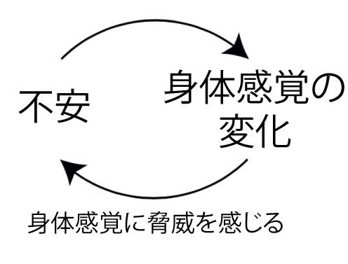
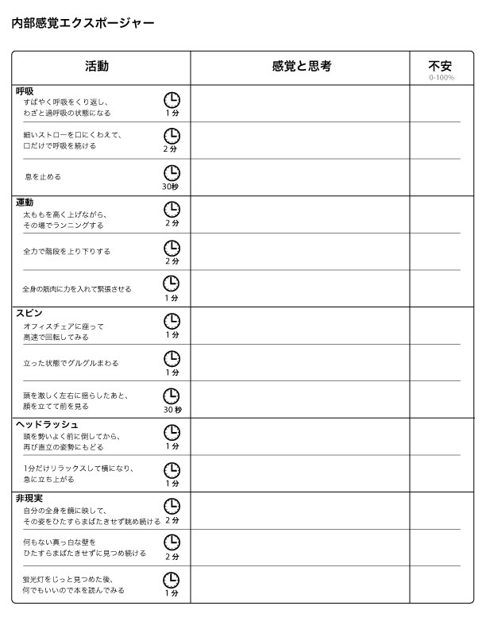

# 不安で本来の力が出ない！を解決する「内部感覚エクスポージャー」トレーニング法とは？

## **不安で本来の力が出ない！を解決するには？**

「[超ストレス解消法](https://amzn.to/2V7ajb1)」でもチラッと書いたとおり、「**自分の肉体の変化に気づく**」っていう感情のコントロール法があるんですよ。

たとえば、会話で緊張してうまくしゃべれないようなシーンがあったとしたら、

- 胸のあたりが圧迫されたような感覚……
- 手が小刻みに震えてるな……

みたいに身体の変化に注意を向けるだけでも不安が減り、ラクに言葉が出るようになるんですね。ちなみに私の場合は、不安になると後頭部が重くなる感じ。

なんで「肉体の変化」に気づくだけでストレスが減るのかと言いますと、そもそも人間の感情は以下のようなループにハマりやすいからです。

つまり、不安を感じて胸がドキドキし始めたのを、脳が「身体に異変が起きた！」と解釈して警戒モードにシフト。そのせいで不安がさらに増大し、その不安がさらなる身体感覚の変化を呼び……みたいな負のサイクルに入っていくという流れです。

が、ここでいったん身体感覚に気づくと、「あ、いま自分は会話の緊張で胸がキュッと締まってるだけなんだな」みたいな自覚が生まれるんですよ。すると、原因が明確になったおかげで脳が安心して、**それ以上は不安が暴走しなくなる**わけっすね。

もっとも、ヒトの不安や焦りってのは強力なパワーを持つので、いざネガティブな感情に巻き込まれると「身体感覚の変化に気づこう！」って作業そのものを**忘れてしまいがち**。ただ不安感にアタフタするばかりで、解決にいたらなくなっちゃうのは実にありがちな話かと思います。

この問題を解決するには、日ごろから**「身体感覚に気づく」ためのトレーニング**を積んでおくのが吉。いざというときに素早く身体感覚の変化に意識を向け、不安の悪循環を断ち切るための訓練をしておくわけですね。

ってことで今回は、身体感覚トレーニングとして定評が高い「**内部感覚エクスポージャー**」 のやり方をまとめておきます。

---

## **そもそも内部感覚エクスポージャーとは？**

内部感覚エクスポージャーってのは、その名のとおり「エクスポージャー」って心理療法のバリエーションのひとつです。エクスポージャーは恐怖症や不安なんかに使われる定番の手法で、たとえば「高いところが怖い！」みたいな感情を克服したいときは、

- レベル１：まずはミカン箱の上に乗ってみる
- レベル２：イスの上に立ってみる
- レベル３：脚立に上ってみる

みたいに少しずつ不安な状況に慣れさせていき、最終的には「高層ビルの上から下を見る」レベルまで上げていく感じっすね。あえて何度も不快な場面に身を置くことで、脳が「高いところはそんな怖くないんだよー」ってのを学んでいくわけです。

内部感覚エクスポージャーは、この考え方を身体感覚に応用したもので、もともとはパニック障害の治療に使われてきたテクニックのひとつ([R](https://amzn.to/2V3xyTc))。しかし、同時に一般的な不安対策にも使えることがわかってきまして([R](https://www.researchgate.net/publication/266559943_Do_Cognitive_Reappraisal_and_Diaphragmatic_Breathing_Augment_Interoceptive_Exposure_for_Anxiety_Sensitivity))、たとえば以下のような人に向いてます。

- 緊張すると何がなんだかわからなくなる
- 不安のせいでうまくコミュニケーションがとれなくなる
- テストやプレゼンでドキドキして本来の力が発揮できない

とにかく、不安が原因でお困りの方には役立つのではないかと思う次第です。

## **内部感覚エクスポージャーのやり方**

で、内部感覚エクスポージャーは↓のような記録用紙を使って行います。

ご覧のとおり「活動」のエリアにミッションがならんでますんで、指示どおりにやっていけばOK。どのミッションも、不安や緊張感によって現れる身体感覚をシミュレートしたものになっております。

つまり、これらのミッションをこなすと**自分が不安になったときの身体感覚だけを再現できる**ため、エクスポージャーとして機能するんですよ。使い方としては、

1. まずはすべてのミッションをひととおりやってみる（身体と相談しつつ1日1〜2個ずつぐらいのペースで）
2. ひとつのミッションを追えたら、「感覚と思考」のエリアに「自分がどう思ったか？」を記入（胸のあたりが嫌な感じになった）
3. 続いて、「不安」のエリアに自分が抱いたネガティブな感情をパーセントで記入（最悪な気分だったら100％）
4. 自分が嫌いなミッションだけを中心にトレーニングする

みたいになってます。人によって「苦手な身体感覚」は異なりますんで、まずはすべてを試してみてから、もっとも嫌なやつを中心に手をつけてってください。私の場合はスピン系の感覚が超ニガテ。

## まとめ

ってことで、内部感覚エクスポージャーを試してみたい方は、 [ここにPDFを置いておいた](https://www.dropbox.com/s/6xxiuz2rr04u5su/exposure.pdf?dl=0)んでよければお使いください。普段から不快な感覚に慣れておくと、いざ不安に襲われたときに気づきやすくなるはずですんで。

また、上記のミッションをやってるあいだは、感覚から気をそらすのではなく、**あえて感覚に注意を向け続けるのがポイント**になります。その点では、**ちょっとした瞑想代わりに使ってみるのもいい**かもですね。

ちなみに、こいつは身体に負担がかかるトレーニングなんで、一部の方はくれぐれも体調に注意しながらやってください。なかでも、

- 心疾患のリスクが高い人（高血圧とかね）
- ぜん息などの問題を抱えてる方
- 妊娠中の方
- 首や背中に痛みを抱えている方

などは手を出さないようにお願いします。ではまたー。
