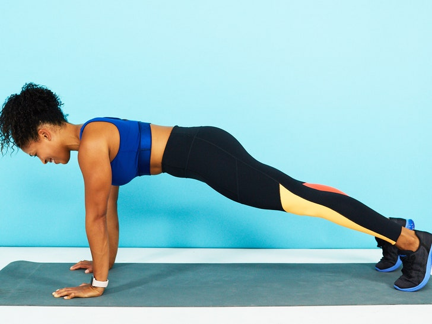
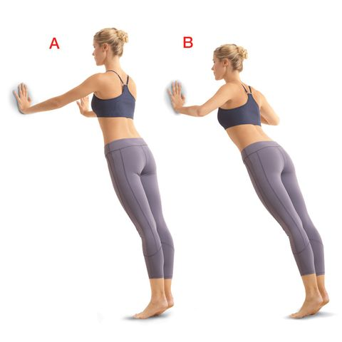
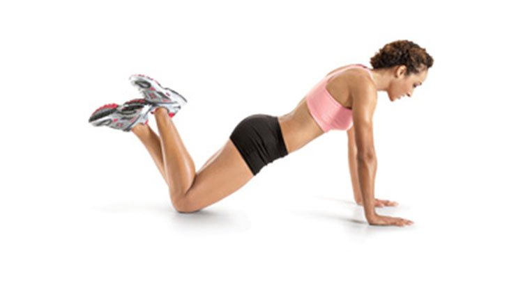
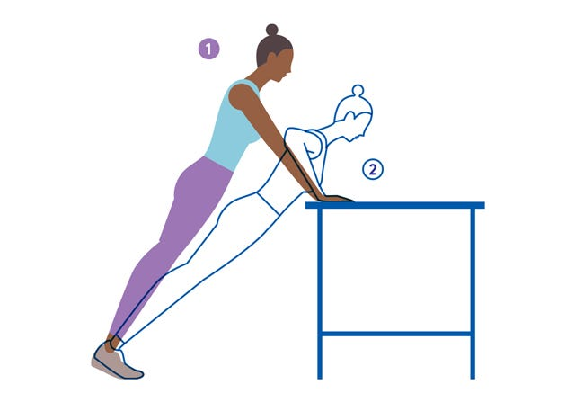
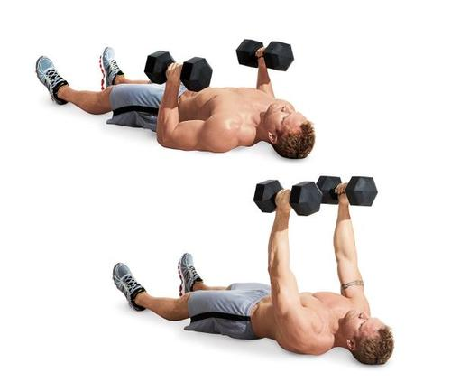

# 筋トレの超初心者に送る「QOL改善用筋トレ」メニュー#2「上半身プッシュ編」

「QOL改善用筋トレ」シリーズの2回目です（[#1](https://daigovideolab.jp/blog/1756275)）。

このシリーズでは、かなりの筋トレ初心者に向けた「**簡単で****正しいトレーニング法**」をまとめてまして、死ぬまで元気でいられるレベルのコンディションを目指すのがゴールになっております。筋肉でバキバキの体を作りたい！という方には向いてないのでご注意を。

で、このトレーニングの方向性としては、

- **超安全優先**
- **超手軽**
- **基本原則だけ守る**

の3つだけを押さえるように設定されてまして、まったくトレーニングをしたことがないご老人でも取り組めるレベルに難易度を調整しました。

前回は人体でも最も大きな下半身の筋肉を鍛えるメニューを紹介したんで、続きましては上半身のトレーニングに移りましょう。全体的なトレーニングのポイントは[前回にまとめてあります](https://daigovideolab.jp/blog/1756275)んで、未読な方はあわせ読み推奨であります。

---

## **２．上半身プッシュ**

下半身の次は、腕や胸を鍛えるための超基本トレーニングです。ベーシックながら効果はデカいので、ぜひ実践していただきたいところです。

### **レベル１．プッシュアッププランク**

まずレベル１は「プッシュアッププランク」です。↓のように、腕を伸ばしてひたすら同じ姿勢をキープしてください。

image credit: [self.com](https://www.self.com/story/pain-during-pushups)

この体勢は、普通の「腕立て伏せ」を行うための前提条件になるものです。まずプッシュアッププランクができないことには、正しい腕立て伏せもできないんですよね。なので、「腕立て伏せが1回もできない！」という方は、まずプッシュアッププランクから始めるのが吉。

ポイントとしては、「**頭からカカトまでのラインを一直線に！**」ってところを心がければOK。両手は肩幅まで広げて、楽な呼吸を心がけるよう意識してくださいませ。

まずは、この姿勢をキープするところから始めて、10秒→20秒→30秒と少しずつ時間を伸ばしてみましょう。最終的には、**プッシュアッププランクが1分キープできれば、このレベルはクリア**です。

トレーニングとしてはあまりに簡単すぎる印象があるかもですが、実は全身の筋肉にほどよい刺激を与えられるナイスメニューなのでバカにできません。というか、プッシュアッププランクと[前回紹介したウォールシット](https://daigovideolab.jp/blog/1756275)がそれぞれ1分できれば、その時点で、日本に住むほとんどの人よりも筋力は高いと考えられますんで（笑）

### **レベル２．ウォール・プッシュアップ**

ここから普通の腕立て伏せに進んでもいいんですが、まだ自信がない時は「ウォール・プッシュアップ」がオススメです。その名のとおり、壁に向かって行うタイプの腕立て伏せっすね。

ポイントは、プッシュアッププランクの感覚を思い出しつつ、全身に力を込めてヒジを曲げ伸ばしするところ。ヒジは90度になるまで曲げてください。この動作を**スムーズに12回できればレベルクリ****ア**なので、次に進みましょう。

image credit: [Women's Health](https://www.womenshealthmag.com/fitness/a20697522/wall-pushup/)

### **レベル３****．ニー・プッシュアップ**

レベル3は、ヒザをついた状態で腕立て伏せをします。↓のような感じで、頭からヒザまでを一直線に伸ばした状態でヒジを曲げ伸ばししましょう。こちらも、この動作を**スムーズに12回できればレベルクリ****ア**なので、次に進みます。

image credit: [The Health Science Journal](https://www.thehealthsciencejournal.com/wall-push-ups/)

### **レベル４．デスク・プッシュアップ**

両手をテーブルについて行う腕立て伏せです。だいたい自分のお尻ぐらいまでの高さがあるテーブルを使ってください。こちらも、この動作を**スムーズに12回できればレベルクリ****ア**なので、次に進みます。

image credit: [Refinery29](https://www.refinery29.com/en-us/56491)

### **レベル５．プッシュアップ**

いわゆる普通の腕立て伏せです。ここまで来れば、おそらく難なく腕立て伏せができるようになってるはず。こちらも**スムーズに12回できれば初心者レベルはクリア**なので、あとは重い本を詰め込んだリュックを背負って負荷を増したり、ジムのマシーンを使ってみたりと、自由に難易度を上げていってくださいませ。

## **上半身プッシュのバリエーション：フロアプレス**

「レベル2のウォールプッシュアップが辛い！」とか「もっと少しずつレベルを上げたい！」という方は、フロアプレスを使ってみるのも手です。下の画像のとおり、床に寝た状態でダンベルを上げ下げする運動で、プッシュアップよりも負荷をコントロールしやすいのがメリットです（水を入れたペットボトルでも可）。

image credit: [IronGrif](https://irongrif.com/exercises/288/dumbbell-floor-press)

フロアプレスで使われる筋肉はプッシュアップとほぼ同じなんで、例えば「レベル2から3に上がったら急に難しくなった……」みたいなときは、軽めのダンベルに切り替えてみるとモチベーションが続いていい感じです。こちらも、同じ重さのダンベルを**スムーズに12回上げ下げできればレベルクリ****ア**なので、少しずつ負荷を増やしていってくださいませ。

## まとめ

っことで、今回は下半身の次に大事な上半身を鍛えるための超初心者向けメニューでした。くりかえしになりますけど、普通のプッシュアップを連続で12回できれば、その時点で大半の日本人よりは筋力があることになりますんで、最後のレベルまで行ったら十分に自分をほめてやってください（笑）
