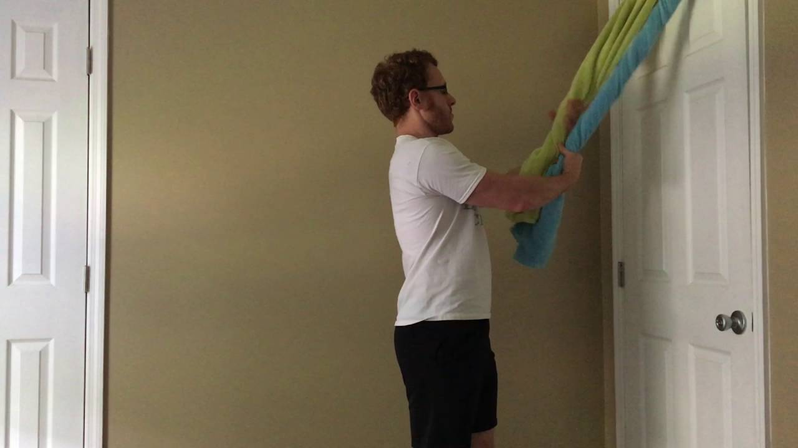
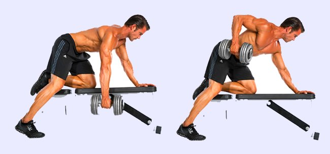
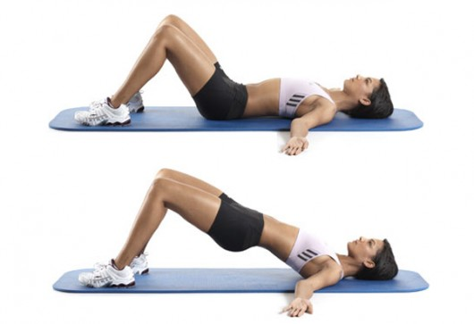
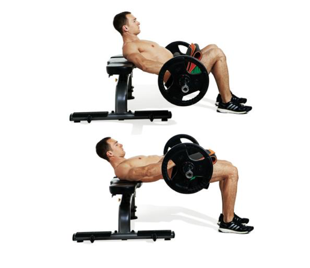

# ニコニコ筋トレの超初心者に送る「QOL改善用筋トレ」メニュー#3「上半身プル&ヒップエクステンション編」

「QOL改善用筋トレ」シリーズの2回目です（[#1](https://daigovideolab.jp/blog/1756275),[#2](https://daigovideolab.jp/blog/1766935)）。

筋トレの超初心者に向けた「**簡単で****正しいトレーニング法**」をまとめておりますこのシリーズ。死ぬまで元気でいられるレベルのコンディションを目指すのがゴールになっております。

前回までは下半身と上半身を鍛える2タイプのエクササイズを紹介してきまして、あとは今回とりあげる「上半身プル」と「ヒップヒンジ」を押さえれば終了です。つまり、****超初心者向け筋トレは全部でたったの4種類だけ****ってことですね。

4種類だけのいいの？と思われる方も多いでしょうが、普通に元気で活動できるレベルの筋肉を目指すなら、こんなもんで十分であります。逆にこれ以上のことをやっても時間のムダでしょう（もちろん見た目を改善したいなら別ですが）。

さらに、超初心者といってもバカにはできませんで、いずれのメニューもちゃんと負荷さえ増やせば、筋トレ歴が長い人でも十分役に立ちます。私の場合も、旅先でジムに行けないときなどは、このシリーズで紹介してるメニューをアレンジしてやったりしますし。

では、具体的なメニューを見ていきましょうー。

---

## **３．上半身プル**

超初心者向けトレーニングの3つめは「上半身プル」です。その名のとおり上半身で物体を引っ張る「プル」の動きが中心になります。

プル系の動作は、前回まで紹介してきたプッシュ系エクササイズとは反対の筋肉を使いまして、特に背中の筋肉を鍛えるには必須。プッシュ系の動きだけだと、どうしても背中は発達しづらいんですよね（プッシュアッププランクでもある程度は鍛えられてますが）。

本来、背中を鍛えるなら懸垂がいいんだけど、このシリーズでは「できるだけダンベル以外の器具を使わない」のを目標にしてますんで、

### **自重オプション：タオルロウ**

とりあえず自重で行きたいなら、タオルロウがおすすめです。

バスタオルぐらいの大きめなタオルを用意し、↓の要領でドアノブにひっかければ準備完了。このタオルを持ったまま自分の体を後方に45度ぐらい傾けたら、腕と背中の筋肉で引っ張り上げていきましょう。

image credit: [forestvance.com](http://forestvance.com/2018/10/what-to-do-instead-of-pull-ups-3-alternatives-w-pics/)

いまひとつ適当なドアノブがないときは、↓のようにドア上部にタオルをひっかけてやるのもあり。ただし、これは素材の強度や素材によってはドアが傷つく可能性もあるんでご注意ください。私も以前に自分の部屋でやってたときは、安いドアだったので上部の板が軽くはがれたりしました。

image credit: [Side Quest Fitness](https://www.youtube.com/watch?v=HtTDy-2GNTE)

この動きも、とりあえずスムーズに12回続けてできればOK。少しずつ負荷を増やしてみましょう。タオルプルの負荷を増やすには、本やペットボトルを詰めたリュックなどを背負うのが一般的であります。

### **ダンベルオプション：ダンベルロウ**

ダンベルをお持ちの方であれば、タオルの代わりにダンベルロウを使うのも手です。↓みたいに上半身を地面と平行に倒し、その状態でダンベルを引き上げるエクササイズっすね。

image credit:[Reddit](https://www.reddit.com/r/Fitness/comments/7lx8al/one_arm_dumbbell_rows_from_the_floor_rather_than/)

こちらもスムーズに12回続けてできればOKなので、少しずつダンベルの重さを増やしていってください。

## **４．ヒップエクステンション**

で、4つめのトレーニングが「ヒップエクステンション」です。お尻の筋肉を鍛えるトレーニングですな。

尻の筋肉は人体でもかなり重要なエリアでして、移動のバランスをとったり、ランニングやジャンプの時に体を支えたりと、いわば人間が動く際の土台のような役割を果たしております。なので、ここが弱っちゃうとまともに階段は上がれないし、すぐに転びやすくなるしで、機能的な体とはほど遠い状態になっちゃうんですよ。嫌ですねぇ。

この筋肉を鍛える手法としては、デッドリフトやリバースランジなんかが有名なんですけど、初心者にはまったくオススメしません。いずれも動きがトリッキーなんで、ちゃんと学んでからやらないとケガをする可能性が大きいもんで。

ということで、ここでは安全性が高くて効果が高い、ヒップエクステンションを推奨しておきます。↓のように、床に横たわった状態からお尻を高くあげる動きですね。

image credit:[terracephysioplus](https://www.terracephysioplus.com.au/blog/bridging-and-hip-extension)

こちらもスムーズに12回続けてできれば負荷が軽すぎだと考えられるんで、その際は、↓のように股間のあたりに重りを置いて負荷を増やしてください。写真では重いバーベルを使ってますけど、別に水を入れたペットボトルとかでいいです。

image credit:[Reno, Nevada](https://www.specialtyhealthwellness.com/exercise-month-hip-extension-barbell/)

## まとめ

そんなわけで、超初心者向けの筋トレを紹介してきたわけですが、あらためてまとめると、

1. 下半身プッシュ：ウォールシット、またはダンベルでスプリットスクワット
2. 上半身プッシュ：プランク、プッシュアップ
3. 上半身プル：タオルロウ、またはダンベルロウ
4. ヒップエクステンション

の4つだけを行えばOKってことになります。4つのメニューでいい！と思えば、筋トレを始めるモチベーションにもなるのではないでしょうか？ エクササイズはそれぞれ1セットで、週に2〜3回もやれば十分。それだけでも、楽しく日常を送れるだけの筋力は身につきますので。

もしそれで物足りなくなったり、「もっと見た目も改善したいな…」といった欲が出てきたら、上記のメニューをひたすら負荷を増やし続けてもいいですし、過去に[このブロマガで紹介したような手法](https://daigovideolab.jp/blog/1729774)に切り替えてみるのもいいでしょう。いずれにせよ、筋トレは長く続けるのが大事なんで、自分が無理なくできるレベルを模索していただければと存じます。
