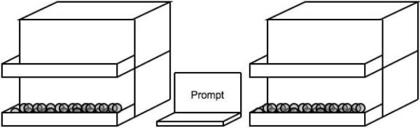
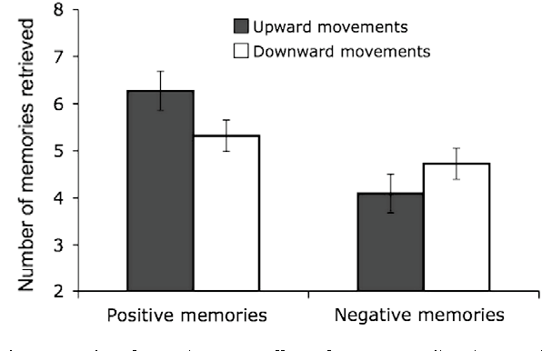

# 【速報】数あるメンタル改善法の中でも最強に手軽なテクニックが見つかったかもな件

「[幸福感を高める方法！](https://daigovideolab.jp/search?channel_owner=paleo&word=幸福感)」みたいなのをよく紹介してるんですけど、近ごろチェックした論文は、数あるメンタル改善法の中でも**屈指のお手軽さ**だったんでメモっときます。

---

これはマックス・プランク研究所などの実験([R](https://www.sciencedirect.com/science/article/pii/S0010027709002820?via%3Dihub))で、研究チームの問題意識はこんな感じ。

> 先行研究では、背筋を伸ばすだけで幸福感や自信が上がり、逆に背筋を曲げると気分が沈むとの結果が報告されている。(中略)今回の実験の目的は、ヒトの感情的な記憶とは無関係な動作でも、想起に影響があるのかを調べることだ。

背筋をシャキッと伸ばしたらなんだか気分が良くなった経験は誰でもありましょうが、このような現象は他の動作でも起きるんじゃないの？みたいなことです。

では、具体的にどのような動作について調べたかと言いますと、

> 多くの言語では、感情を表す時に空間的な比喩を使うことが多い。今回のデータでわかるのは、このようなメタファーが言語のうちだけにとどまらないという点だ。言語的なメタファーは精神の機能に刺激を与え、「天にも昇る心地」という言葉は実際に幸福な思考を喚起する。

みたいな感じです。「ハイになる」みたいに自分の気分を空間関係で表すケースが多いので、もしかしたら**上下の動きをしただけでもメンタルに影響があるんじゃないか**、と。こりゃおもしろい発想ですな。

ってことでこの実験では24人の参加者を集めて、以下のような箱を用意。

この箱、下段にはビー玉が入ってまして、参加者にはこんな指示が出ました。

1. 2秒ごとにビー玉を1個ずつ下段から上段に移してください（まだは上段から下段に移してください）
2. ビー玉を移動させながら、いろんな記憶を思い出すように心がけてみてください

でもって、その後でみんなに「どんな記憶を思い出しましたか？」と尋ねたところ、結果はこんな風になりました。

黒いバーが「ビー玉を上に移したとき」で、白いバーが「ビー玉を上に移したとき」を示しております。あきらかに、**上に向かう動きの時はポジティブな記憶の量が増えて**、下に向かう動きではネガティブな記憶の量が減ってますねー。

この結果がどこまで敷衍できるかはよくわからんですが、ひょっとしたら、

- 坂道を登ってみる
- 上を向いてみる
- 腕を上げてみる

みたいな動きでも、それなりにポジティブな記憶の量は増えるのかなーという気がしますな。

まぁこのタイプの「動作とメンタルが直結してる系」実験は後でひっくり返るケースが多いんで、今回の研究も追試で確認されない可能性も高そうだなーとは思っております（もしくは大した違いがないか）。とはいえ、とりあえず試して害があるわけじゃないので、メンタル改善ツールのひとつとして覚えとくのもいいんじゃないでしょうか。
