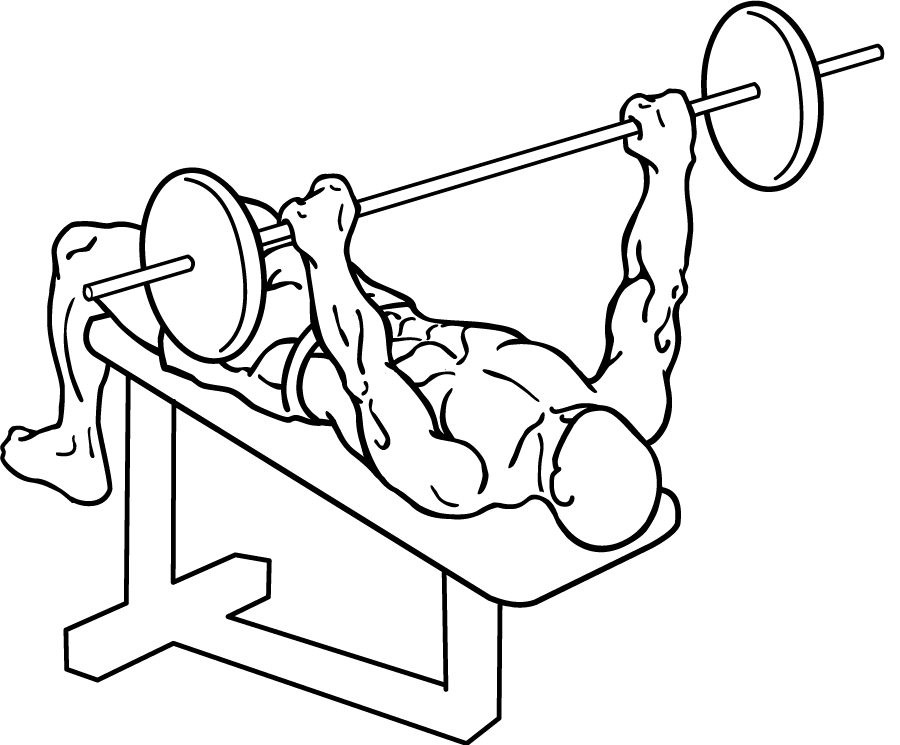
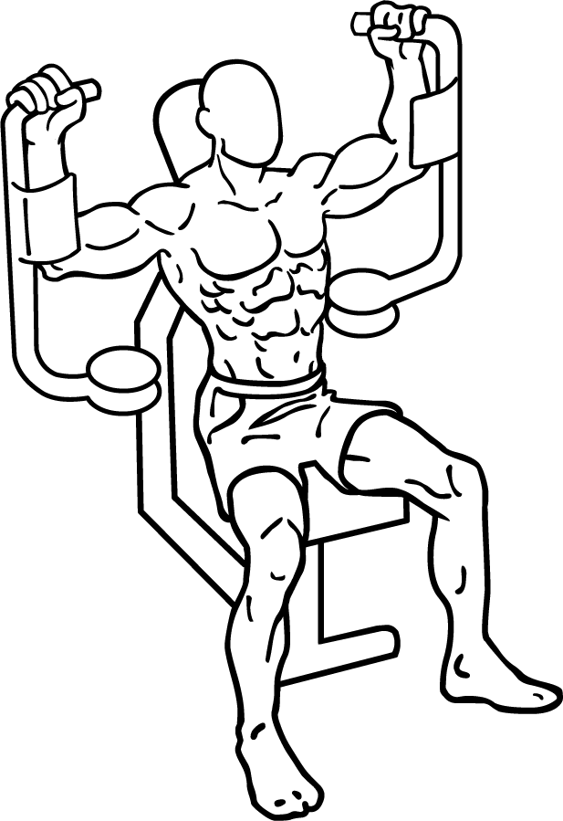
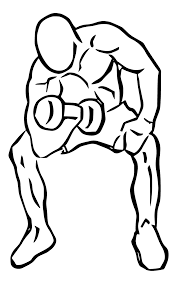
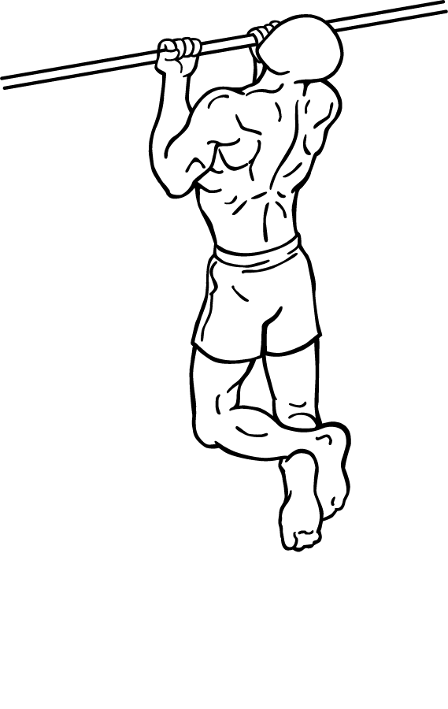
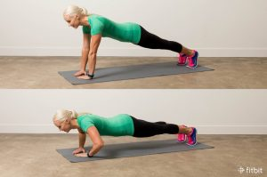
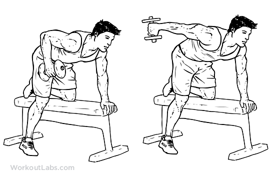
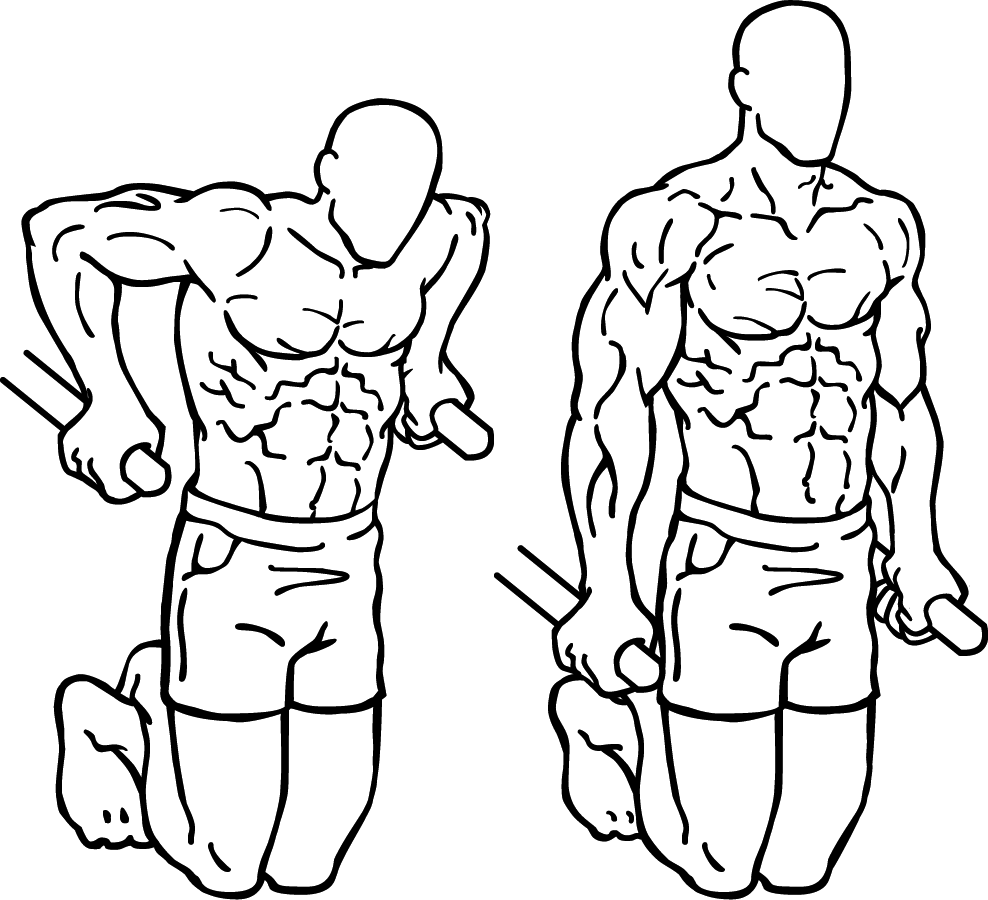

# 米国運動評議会が認めた「胸と腕」を鍛えるベストエクササイズはこれだ！という実験の話

世界でも有名なスポーツ系の資格団体といえば「**米国運動評議会**」（ACE）。ここはエビデンスにもとづいた運動と栄養の知識を伝えてる他、自前でもいろいろと臨床テストをやってて素晴らしいんですよね。

で、ここ数年ACEがやってくれてるのが、「**最強の筋トレメニューってなに？**」みたいな試験です。定期的に10〜20人の男女をラボに招いていろんな筋トレをして、EMGで「もっとも筋肉への刺激が大きかったものはどれだ？」ってところを計測してくれてるんですよ。

というわけで、今回は「**ACEが選ぶ最強筋トレメニューはこれだ！**」みたいなのをご紹介します。「どのメニューをやろうかなー」とお迷いの方は参考にどーぞ。

---

## **1．胸を鍛えるベストトレーニング**

ってことで、ACEの実験([R](https://amzn.to/2Ymmo9O))をベースに、まずは大胸筋を鍛えるためのベストメニューです。ACEの実験では9種類のメニューの効果を比べて、筋肉の刺激レベルを比べております。では、まずトップ3をどうぞ。

#### 1位：バーベルベンチプレス（平均EMG100）

#### 2位：ペックデックマシン（平均EMG98）

#### 3位：前傾ケーブルクロスオーバー（平均EMG93）

image credit:[Scary Symptoms](https://scarysymptoms.com/2014/09/pec-deck-vs-cable-crossover-for-ches/)

というわけで、ド定番のバーベルベンチプレスがトップ。ペックデックマシンもかなり良い位置につけております。まぁここらへんはEMGが誤差の範囲なんで、好みで選んじゃってもOKだと思います。

ちなみに、その他のメニューでいうと、ジムでは定番の[チェストプレスマシン](https://ja.wikipedia.org/wiki/%E3%83%95%E3%82%A1%E3%82%A4%E3%83%AB:Bench-press-2-1.png)は平均EMGが79でだいぶ劣りますね。さらに**ごく一般的な腕立て伏せが61**ぐらいで、やはりベンチプレスと比べちゃうとかなり辛い感じっすね。

個人的にはチェストプレスマシンがなんか好きなんですけど、今後はマシンを使うときはペックデックマシンにしておくか……。

## **2．力こぶを鍛えるベストトレーニング**

お次は力こぶに効くエクササイズのベストです。いわゆる上腕二頭筋ですね。

ACEの研究では７つのトレーニングを比較していて、16人の男女に対して筋肉の刺激レベルをチェックしております。では、トップ3をどうぞ。

#### 1位：コンセントレーションカール（平均EMG98）

#### 2位：ケーブルカール（平均EMG81）

#### 3位：チンアップ（平均EMG80）

というわけで、力こぶについてはコンセントレーションカールがずば抜けてますね。その他の種目（インクラインカールやプリーチャーカール）などはだいたいEMGが69〜76ぐらいの範囲で拮抗してまして、まぁどれを選んでもそんなに変わらない感じです。

また、チンアップ以外の自重を使わないトレーニングについては、1RMの70％の負荷で実験した結果になってますんで、こちらも合わせて参考にしてください。

## **3****．二の腕を鍛えるベストトレーニング**

続いて二の腕に効くトレーニングのベストです。いわゆる上腕三頭筋っすね。こちらはACEがウィスコンシン大学に委託した研究で、やはり男女の被験者に8つの二の腕エクササイズを指示して、筋肉の刺激レベルを調べてくれております。

では、トップ3をどーぞ。

#### 1位：トライアングルプッシュアップ（平均EMG100）

image credit:[Fitbit Blog](https://blog.fitbit.com/how-to-do-a-pushup/triangle-pushup/)

#### 2位：キックバック（平均EMG87）

image credit:[WorkoutLabs](https://workoutlabs.com/exercise-guide/tricep-dumbbell-kickback/)

#### 3位：ディップス（平均EMG87）

というわけで、こちらはトライアングルプッシュアップがずば抜けてますね。残りのメニュー（オーバーヘッドトライセップエクステンションとかバープッシュダウンとか）は、だいたいEMGが62〜76の範囲に収まってるんで、まぁあんま意味ないかなぁという感じです。

こちらも、キックバックのようにダンベルを使うメニューは1RMの70％の負荷でやってますので、ご参照ください。

## まとめ

というわけで、まずは上半身を鍛えるメニューのベストをいろいろ見てみました。次回は、さらに背中、腹、肩のベストを見ていこうと思います。どうぞよしなにー。
