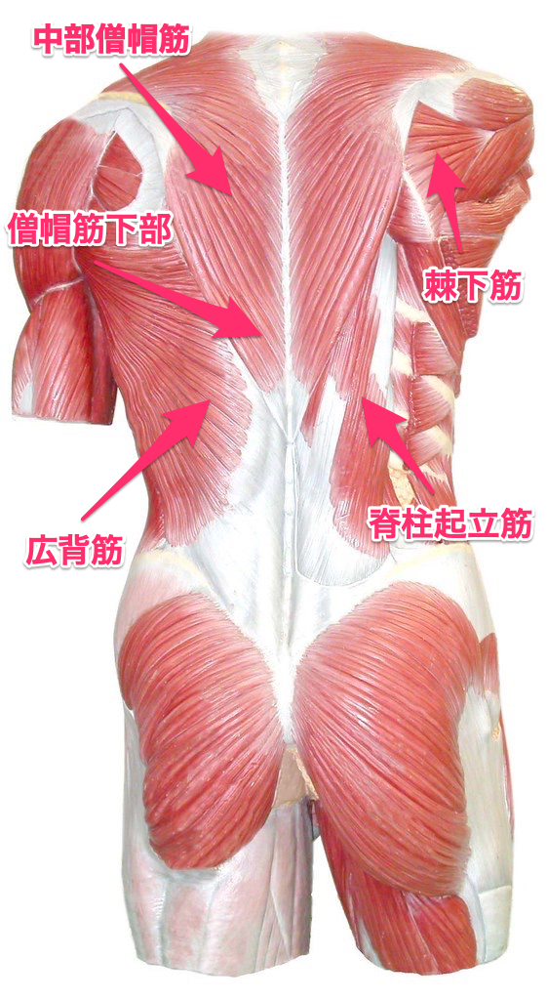

# 米国運動評議会が認めた「背中」を鍛えるベストエクササイズはこれだ！という実験の話

米国運動評議会が認めたベストエクササイズを紹介するシリーズの続きでーす。

軽くおさらいすると、「米国運動評議会」（ACE）は世界でもトップクラスのスポーツ資格団体ですが、自らもいろんな実験をしてエビデンスを集めてるんですよ（ウィスコンシン大学との共同研究が多い）。

で、近ごろは「**もっとも筋肉への刺激が強いトレーニングってどれなの？**」ってのをより分ける作業もしてくれていて、これがまたかなり有用。前回は「[胸と腕のベストエクササイズ](https://daigovideolab.jp/blog/1780533)」を紹介しましたんで、今回は「**背中**」の筋肉に効くメニューをご紹介します。

---

## **背中を鍛えるベストトレーニング**

まずは背中のベストから行きますが、その前にいくつかの前提を押さえておきましょう。背中ってのはかなり複数の筋肉が集まったエリアでして、ざっくり以下のようになってます。

このように背中の筋肉は複雑でして、それぞれ刺激を受けやすいメニューが違うんですよ。なので、「これさえやればOK！」みたいなトレーニングはなかったりするんですな。

なので、ここではそれぞれの筋肉ごとにベストなエクササイズを紹介していきます。まぁコンテストに出るんでもない限り、ここまで細かく分けて鍛える必要もないんですけどね（笑）

ACE実験では19人の男性を対象にEMGを使いまして、8つの背中トレの効果を比べております。では、筋肉ごとのトップ3をどうぞ。

## **中部僧帽筋に効くトップ3**

### **1位：ベントオーバーロウ（％MVC115）**

**<iframe src="https://www.youtube.com/embed/lA2G6nctToI" width="560" height="315" frameborder="0"></iframe>**

### **2位：IYTレイズ（％MVC114）**

**<iframe src="https://www.youtube.com/embed/3JWdi9Ekha0" width="560" height="315" frameborder="0"></iframe>**

### **3位：インバーテッドロウ（％MVC114）**

<iframe src="https://www.youtube.com/embed/5LZa9TzkjRg" width="560" height="315" frameborder="0"></iframe>

ってことで、中部僧帽筋は以上の3つになりました。便宜上ランクをつけましたが、この3つはどれも％MVCはほぼ同じなんで、好みで選んでもらえればいいと思います。個人的にIYTレイズはノーマークだったので、意外な実力にびっくりです。

ちなみに、中部僧帽筋への効果が低かったのは、

- 逆手の懸垂
- 順手の懸垂
- [ラットプルダウン](http://cdn.shopify.com/s/files/1/2177/2899/products/ph1004-lat-pulldown-seated-row_0cd4453e-9acb-49ab-8d1e-e3f96b955db5_600x.jpg?v=1526969971)

などです。ここらへんは％MVCが60〜80ぐらいなんで、トップ3に比べるとかなりの差が出ちゃいますね。

## **僧帽筋下部に効くトップ2**

### **1位：IYTレイズ（％MVC81）**

**<iframe src="https://www.youtube.com/embed/3JWdi9Ekha0" width="560" height="315" frameborder="0"></iframe>**

### **2位：ベントオーバーロウ（％MVC69）**

**<iframe src="https://www.youtube.com/embed/lA2G6nctToI" width="560" height="315" frameborder="0"></iframe>**

ということで、僧帽筋下部はトップ2のみ取り上げました。というのも、数字を見てるとIYTレイズの効果がダントツでして、ほかはほとんど横並びなんで。

中でも僧帽筋下部への効果が低かったのは、

- 逆手の懸垂
- 順手の懸垂
- [ラットプルダウン](http://cdn.shopify.com/s/files/1/2177/2899/products/ph1004-lat-pulldown-seated-row_0cd4453e-9acb-49ab-8d1e-e3f96b955db5_600x.jpg?v=1526969971)
- [シーテッドロウ](http://www.burnthefatinnercircle.com/members/images/1664.jpg)
- インバーテッドロウ

などです。ここでもIYTレイズが来てますねぇ。

## **広背筋に効くトップ2**

### **1位：順手の懸垂（％MVC114）**

<iframe src="https://www.youtube.com/embed/aAggnpPyR6E" width="560" height="315" frameborder="0"></iframe>

### **2位：逆手の懸垂（％MVC110）**

<iframe src="https://www.youtube.com/embed/b-ztMQpj8yc" width="560" height="315" frameborder="0"></iframe>

こちらも懸垂の効果がズバ抜けてたんで、トップ2だけになりました。ここまで不遇のポジションだった懸垂が、ここに来てプロップスを上げてきましたね。

逆に広背筋への効果が低かったのは、

- IYTレイズ
- シーテッドロウ

などでして、背中の上部ではトップだったIYTレイズが、ここに来て陥落しております。やっぱ万能の背中トレってないのね……。

## **棘下筋に効くトップ3**

### **1位：IYTレイズ（％MVC59）**

**<iframe src="https://www.youtube.com/embed/3JWdi9Ekha0" width="560" height="315" frameborder="0"></iframe>**

### **2位：ベントオーバーロウ（％MVC57）**

**<iframe src="https://www.youtube.com/embed/lA2G6nctToI" width="560" height="315" frameborder="0"></iframe>**

### **3位：インバーテッドロウ（％MVC55）**

<iframe src="https://www.youtube.com/embed/5LZa9TzkjRg" width="560" height="315" frameborder="0"></iframe>

というわけで、こちらは中部僧帽筋と似たようなラインナップになりました。といっても棘下筋については全体的に横並びでして、普通の懸垂でも同じぐらいの効果は望める感じ。ただし、

- ラットプルダウン
- シーテッドロウ

の2つだけは効果が低いんで、あえて選ぶ意味はなさそうです。

## **脊柱起立筋に効くトップ1**

### **1位：ベントオーバーロウ（％MVC63）**

**<iframe src="https://www.youtube.com/embed/lA2G6nctToI" width="560" height="315" frameborder="0"></iframe>**

脊柱起立筋については、とにかくベントオーバーロウがずば抜けてるので、トップ1だけにとどめておきます。後に続くのはIYTレイズ、懸垂、インバーテッドロウなどですが、いずれも％MVCは40ちょいなんで、どうも推奨しづらいんですよね。

なかでも成績が悪いのはラットプルダウンで、％MVCは20ちょいぐらい。ジムでは定番のマシンですが、なかなか難しいもんですな……。

## まとめ

というわけで「背中」に効くエクササイズを紹介してきましたが、「どれかひとつ選ぶとしたら？」ってことであれば、****ベントオーバーロウ**をおすすめします**。全体の平均を見ると、ベントオーバーロウがすべてのエリアで高い成績を出してるもんですから。

逆にどのエリアでも成績が低いのがラットプルダウンなんですが、[もっと古い研究](https://yuchrszk.blogspot.com/2015/12/4.html)ですと「**ナローグリップの場合は広背筋に効く**」って結論も出てまして、ここらへんは判断が難しいところです（ACEの研究はワイドグリップを使用してる）。

まぁ全体的にはACE実験のほうがいろんな筋肉の刺激レベルをチェックしてますし、デザイン面でも信頼性はやや高いようには思います。なので、とりあえずベントオーバーロウを中心に回していくのがいいかもですねぇ。個人的にはベントオーバーロウと懸垂を組み合わせる感じでやってこうかなぁ……。
