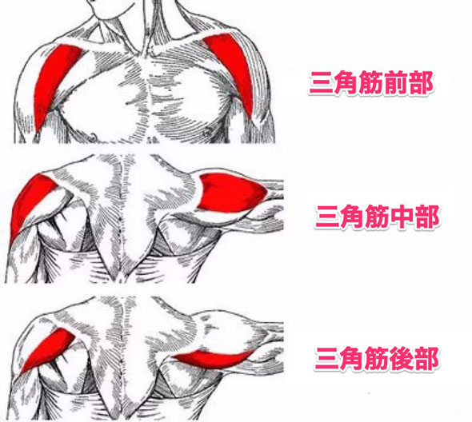
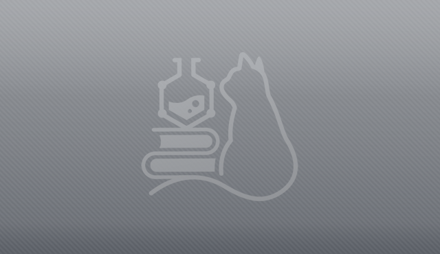
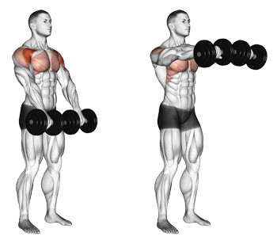
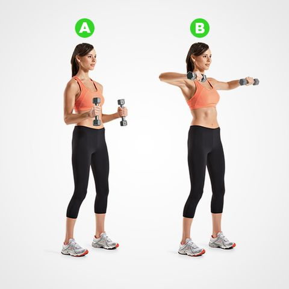
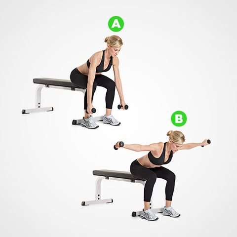

# 米国運動評議会が認めた「肩と尻」を鍛えるベストエクササイズはこれだ！という実験の話

米国運動評議会が認めたベスト筋トレシリーズの続きでーす。前回までは「[胸と腕](https://daigovideolab.jp/blog/1780533)」「[背中](https://daigovideolab.jp/blog/1781121)」にフォーカスしたメニューのベストを取り上げまして、今回は「**肩と尻**」になります。

米国運動評議会って何？信頼性あるの？という方は[前回の簡単な解説](https://daigovideolab.jp/blog/1781121)をお読みいただくとして、ざっくりと世界的に定評のある組織だとお考えください。筋トレをしたいけどどの種目を選ぶべきかわからない！みたいな方には参考になりましょう。

では、どうぞー。

---

## **肩を鍛えるベストトレーニング**

まずは肩のベストから行きますが、その前に前提として筋肉の作りから見てみましょう。というのも、人間の肩には3つの筋肉が集まってまして、ざっくり以下のようになってます。

この3つは、それぞれ効果的なトレーニングが違ってまして、マニアックな人は各部をピンポイントで鍛えたりします。大胸筋とならんで「見た目」に関わる部位でして、特に男性は肩を鍛えるほどモテやすくなります（いちおう[エビデンス](https://journals.plos.org/plosone/article?id=10.1371/journal.pone.0050601)へのリンクも貼っときます・笑）。

ACEの実験は16人の男性を対象にしたもので、全員に10種類のメニューをやってもらった上でEMG（筋電図）で刺激レベルを確かめてくれたんですよ。その結果、以下のことがわかりました。

## **三角筋前部に効くトップ2**

### **1位：ダンベルショルダープレス（****平均****EMG74）**

****

image credit:[Bethany Village](https://bethanylutheranvillage.org/alexs-exercise-of-the-month-seated-dumbbell-shoulder-press/)

### **2位：ダンベルフロントレイズ（平均EMG57）**

image credit:[Burn the Fat Inner Circle](https://www.burnthefatinnercircle.com/members/login.cfm?hpage=Dumbbell-Front-Raises.cfm)

ってことで、三角筋前部については2つだけにしときました。残りのメニューはどれもEMGが横並びなんで、特に取り上げる必要もないなーって感じなんで。

ちなみに、なかでも効果がなかったメニューはと言いますと、

- [45度インクラインロウ](https://www.youtube.com/watch?v=s5DqehlkvIs)（平均EMG6）
- [シーテッド・リア・ラテラルレイズ](https://hips.hearstapps.com/hmg-prod.s3.amazonaws.com/images/workouts/2015/12/the-shoulder-workout-thats-missing-from-your-life-composites1-1449664802.jpg?resize=480:*)（平均EMG6）

の2つがずば抜けてEMGが低めになってました。三角筋前部ってのは、とにかく肩を大きくするために必要なエリアなので、モテボディを目指す殿方はとりあえずショルダープレス一択ですな。

## **三角筋中部に効くトップ3**

**1位：45度インクラインロウ（****平均****EMG84）**

<iframe src="https://www.youtube.com/embed/s5DqehlkvIs" width="560" height="315" frameborder="0"></iframe>

### **2位：ベントアーム・ラテラルレイズ（****平均****EMG77）**

image credit:[Women's Health](https://www.womenshealthmag.com/fitness/a20701521/bent-arm-lateral-raise/)

### **3位：ケーブル・レイズ（****平均****EMG74）**

<iframe src="https://www.youtube.com/embed/taDav7zMGAY" width="560" height="315" frameborder="0"></iframe>

ってことで3つほど並べてみましたが、正直どれも誤差の範囲なんでお好きなものをお使いください。また、三角筋中部に効かなかったメニューは、

- 普通の腕立て伏せ
- [ディップス](https://cdn.stronglifts.com/wp-content/uploads/dips-forearms.jpg)
- ダンベルフロントレイズ

の3つです。三角筋前部には効いたダンベルフロントレイズが、ここではよろしくないみたいっすね。三角筋中部は肩幅を広くするために必要なエリアなんで、こちらも男らしさを上げたい時は鍛えとくと良さげ。

## **三角筋後部に効くトップ2**

**1位：シーテッド・リア・ラテラルレイズ****（****平均****EMG73）**

image credit:[Women's Health](https://www.womenshealthmag.com/fitness/a20701521/bent-arm-lateral-raise/)

### **2位：45度インクラインロウ（****平均****EMG69）**

<iframe src="https://www.youtube.com/embed/s5DqehlkvIs" width="560" height="315" frameborder="0"></iframe>

三角筋後部も、この2つがずば抜けて成績が良かったんでトップ2にしときました。あとはだいたいEMGが30台だったりするんで、あんま意味がないかも。

なかでも三角筋後部に効かなかったものは、

- ダンベルショルダープレス
- ダンベルフロントレイズ
- 普通の腕立て伏せ

の3つで、これはEMGが一桁台を叩き出しております。やはり「これだけやっとけば肩はOK！」みたいなメニューは無いみたいですなぁ……。

## **尻を鍛えるベストトレーニング**

続いて女性からの質問が多い、尻を鍛えるためのベストトレーニングです。お尻もいくつかの筋肉で構成された部位ですが、米国運動評議会の研究では、

- 大臀筋
- 中臀筋

の2つを調べてくれてます。見た目に関してもっとも大事なのは大臀筋で、人体のなかでもかなりデカい筋肉のひとつ。俗にヒップアップと言われる運動は、だいたい大臀筋をターゲットにしております。

この研究は12人の男性が対象で、8種類の尻トレの効果をEMGで調べてくれてます。では、それぞれのベストを見てみましょうー。

## **大臀筋に効くトップ3**

**1位：クアッドプル・ヒップ・エクステンション**

<iframe src="https://www.youtube.com/embed/MEV_gOua-Bc" width="560" height="315" frameborder="0"></iframe>

### **2位：フォーウェイ・ヒップ・エクステンション**

<iframe src="https://www.youtube.com/embed/mSWco3DxklU" width="560" height="315" frameborder="0"></iframe>

### **3位：スクワット**

<iframe src="https://www.youtube.com/embed/xqvCmoLULNY" width="560" height="315" frameborder="0"></iframe>

ってことで、とりあえず3つ並べてみましたけど、まぁ数字的にはどれも同じぐらいなんで、好きなものを選べばいい感じです。個人的には、普通のスクワットが尻も足も同時に鍛えられていいのではないかと。

ちなみに、大臀筋への効きが悪かったのは、

- [レッグプレスマシン](https://www.youtube.com/watch?v=IZxyjW7MPJQ)
- [垂直レッグプレスマシン](https://www.youtube.com/watch?v=_jcr4b05fF0)

の2つでした。まぁそこまで悪いってわけでもないものの、ヒップアップを目指すなら効率は悪いかもですね。

## **中臀筋に効くトップ3**

### **1位：クアッドプル・ヒップ・エクステンション**

<iframe src="https://www.youtube.com/embed/MEV_gOua-Bc" width="560" height="315" frameborder="0"></iframe>

### 2位：ステップアップ

<iframe src="https://www.youtube.com/embed/nAl0t57yPD4" width="560" height="315" frameborder="0"></iframe>

### 3位：ランジ

<iframe src="https://www.youtube.com/embed/7SMzPn4LGjQ" width="560" height="315" frameborder="0"></iframe>

ってことで中臀筋のベストエクササイズでした。こうして見ると、結局のところクアッドプル・ヒップ・エクステンションがヒップアップのベストってことになるかもですなぁ。私はスクワットメインで尻については気にしてこなかったので、ちょっと取り入れたくなりますな。
