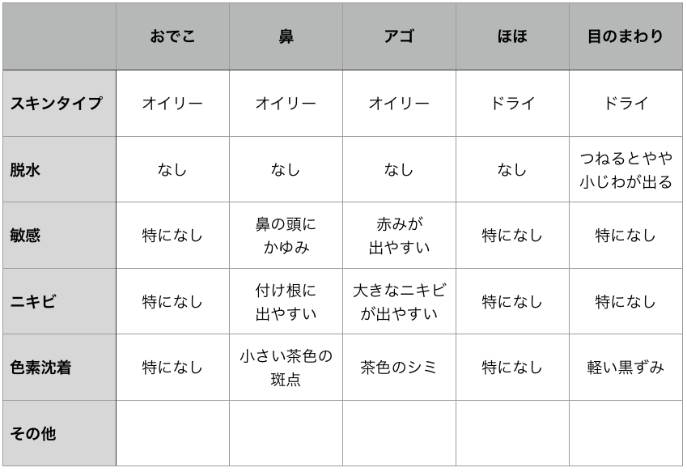

# ザ・スキンケア #2「肌コンディションと肌チェック編」

「**ザ・******スキンケア****」シリーズの続きでーす([#1](https://daigovideolab.jp/blog/1785262))。

前回の話を簡単にまとめると、

- とりあえず「**自分の肌質を知るのが大事！**」
- ドライ、ノーマル、オイリー、混合など、自分の肌タイプをチェックしようぜ！

ってな感じでした。まずは「自分ってどんな肌をしてるの？」を知らないと、最適なケアの方法も見つけようがないですからね。

で、前回は肌タイプの話をしましたんで、今回は肌コンディションについて見ていきましょうー。

---

## **肌コンディションにはどんな種類があるのか？**

肌タイプにはドライやオイリーなどがありましたが、肌コンディションは以下のようなパターンが存在しております。

- 脱水
- 敏感
- ニキビ
- 色素沈着

ざっくり言えば、肌タイプが生まれつきの問題なのに対し、肌コンディションは後から誰にでも起き得る状態を指してます。それぞれがどんな状態なのかを簡単に説明していきましょう。

### 脱水

その名のとおり、肌が十分な量の水分を保持していない状態です。肌バリアが弱まった時に起きやすく、皮膚の下層から蒸発していく水分を、その上にある皮膚層がブロックしてくれない現象を指しております。専門的には「経皮水分蒸散量の増加」みたいに言われるやつっすね。

ちなみに、この現象が起きるケースは他にもあって、

- 天気が寒くて乾燥している場合
- エアコンがガンガン使われてる場合
- クレンジングのしすぎ
- 角質の取りすぎ（スクラブ洗顔とか顔剃りとかピーリングとか）
- 日光の浴びすぎ

などが代表的なところ。ドライスキンだろうがオイリースキンだろうが脱水は起きるのでご注意ください。

脱水のチェックポイントとしては、

- 洗顔のあとすぐに保湿剤を使わないと、肌が引き締まったような感じが続く
- 保湿剤を使うと、あきらかに肌の滑らかさが増した感じになる
- 皮膚が簡単にポロポロと剥がれがち
- 肌をつねったときに、周囲1センチの範囲に細かいシワができる

といった条件を満たしていたら危険信号と考えられます。

### 敏感

いわゆる敏感肌で、ちょっとした化学物質に触れただけで異変が起きちゃうような状態です。こちらも表面の角質層が弱まったせいで起きる現象で、アレルゲンなんかが簡単に内側の層に入り込んでしまうんですよね。

その結果、肌に焼けた感覚や刺すような痛みが起きたり、赤く腫れ上がったりといった異変が発生する次第。ドライスキンな人ほど起きやすいコンディションかと思います。

敏感のチェックポイントとしては、

- スキンケア系の商品を使うと、逆に肌にかゆみや異変が起きる
- 洗剤やバンドエイドで肌に異変が起きる
- 香料が入ったボディウォッシュやローションで肌にかゆみが起きる
- 顔にすぐ赤みが差す
- 気温や湿度の変化によって肌に異変が起きる
- しばらく衣服で肌がこすれるとヒリヒリしてくる

といったあたりがポイントになります。私も基本的に敏感肌の傾向があるんで、注意しておきたいとこです。

ちなみに、ここはあくまで健常レベルの敏感肌を指してまして、アトピー性皮膚炎や酒さといった症状まではカバーしてないのでご注意ください。さすがにこれらの症状は個人のスキンケアでどうにかするのは難しいんで、お医者さんにご相談を（できれば原因療法をうたっているようなお医者さんがいいっすね）。

### ニキビ

これは説明するまでもないっすね。なんらかの原因で皮脂腺が詰まり、そこにバクテリアが発生して炎症を起こしたような状態です。

その原因は多岐にわたりまくってて、

- ホルモンバランス
- 間違ったスキンケア商品
- 食事法
- ストレス

などなど様々です。食事やストレスが原因の場合はスキンケアの効果は低くなりますが、それでもやれることはありますんで、くわしくは後述します。

### 色素沈着

これも説明不要っすね。皮膚の表面に紫や黒のパッチが現れる現象で、

- 太陽光のダメージ
- 加齢
- 体内の炎症
- ホルモンバランスの変化

なんかに影響を受けることが多め。こちらも基本的には対策は難しいものの、やっぱりやれることもありますので。

## **肌タイプとコンディションノートをつける**

肌タイプとコンディションの説明が終わったところで、じっくりと自分の肌をチェックしてみましょう。シリーズの1回目で紹介した「[肌質チェック用の基本3ステップ](https://daigovideolab.jp/blog/1785262)」を使いつつ、以下のエリアごとにタイプとコンディションを調べていってください。

1. おでこ
2. 鼻
3. アゴ
4. ほほ
5. 目のまわり

もっと細かい分け方もありますが、だいたいこの5つのエリアごとに皮脂腺やホルモンの影響が変わるケースが多いんで、これぐらいに分類しとくのが吉。

一例として、私の肌データはこんな感じになってます。

こうしてみると、自分はアゴや口まわりに問題が出やすいんだなーってのがよくわかりますね。また、一番下に「その他」って欄がついてるのは、「大きなシワがある」や「黄ばみがある」などの特に気になるポイントを書いてもらえればOKです。

## まとめ

ってことで、今回で肌チェックは終わりです。これで自分のデフォルトの状態がわかったはずなんで、次回は肌管理の基本的なルーチンを探っていきしょうー。
