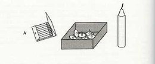
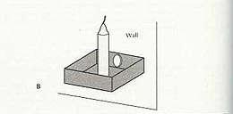

# バイアスを乗り越えて良いアイデアを出しまくる４つの方法#1「アイデア出しをジャマしてくる３つの障害編」

ちょい前に「[バイアスを乗り越えて正しい意思決定を行う方法](https://daigovideolab.jp/blog/1798950)」って話を書いたばかりですが、またもやバイアスネタです。ただし、今回は意思決定じゃなくて「**いかに良いアイデアを出すか？**」とか「**いかに問題を解決するか？**」ってとこにスポットを当てた内容になります。

というのも、「アイデアが出ない！」とか「問題が解決できない！」みたいな状況を引き起こす原因はいろいろあるんですけど、近ごろは「バイアスが邪魔をしてるからだ！」って見方が結構よく言われるようになってきたんですよ。問題を解決するためには発想を広げる必要があるのに、バイアスのせいでものの見方に制限がかかってるんじゃないの？ってことですね。

この考え方で研究を続けてるのがマサチューセッツ工科大学で、今回は同大学の実験データ([R](https://amzn.to/304iWS2))をもとに、「**バイアスを乗り越えて良いアイデアを出す方法とは？**」ってとこを見ていきます。これは個人的にも非常に役立った研究ですね。

---

## **良い発想に制限をかける３つのヤバいバイアス**

さて、まず前提として、研究チームは「**良い発想に制限をかけるバイアス**」を大きく３つ挙げてます。

### 発想を阻害するバイアス1.「機能的固着」

ひとつの機能を提示されると、それ以外に可能性を見出せなくなるバイアスです。

と言われてもわけがわかりませんが、たとえば有名なのは「[ドゥンカーのロウソク問題](https://ja.wikipedia.org/wiki/%E3%83%AD%E3%82%A6%E3%82%BD%E3%82%AF%E5%95%8F%E9%A1%8C)」ってやつでしょう。下のイラストみたいに、マッチ、画鋲、ロウソクが用意された状態で「コルクボードの壁にロウソクを固定して火を着けてください」と指示される、「とんちクイズ」みたいな問題です。

古典的な実験なので答えをご存じの方は多いでしょうが、なにも知らずに問題に取りかかった場合、たいていの人はロウソクを画鋲で刺そうとしたり、溶かしたロウでロウソクをくっけようと試したりするんですな。もちろん、これらは不正解であります。

で、正解は↓みたいな感じ。画鋲が入ってた箱をコルクボードに固定して、そこにロウソクを立てるわけですね。答えを知っちゃうと「そりゃそうだよなー」って感じですけど、何も知らずにこの答えを出せる人は少数派であります。

この問題が難しいのは、そもそも「**箱は画鋲を入れるものだ**」って思い込みに支配されちゃうからです。「箱＝画鋲入れ」っていう機能に思考が固まっちゃって、それ以外の可能性を考え出せないわけですな。これが「機能的固着」の代表例です。良いアイデアが出ない場面ってのは、結構このバイアスが起きてるケースが多め。

### 発想を阻害するバイアス2.「デザイン固着」

こちらは、なんらかの問題に対して、現在のデザイン特性に固執するバイアスです。ってこれもわかりにくいので、研究チームが行なった実験を紹介しときます。簡単に実験デザインを説明すると、

1. 参加者たちにお菓子を入れるジップロックみたいな袋をわたす
2. 全員に「この袋の新しい活用法を考えてください」と頼む

って感じになっていて、「レンガの新しい活用法を考えましょう」っていう定番の発想力テストに似てますね。

すると、だいたいの人の発想は似通ったもんでして、

- 袋の底を硬くして自立するようにする
- 袋の入れ口をデカくしてお菓子を入れやすいようにする

みたいなとこに落ち着いたらしい。こういった現象が起きるのは、たいていの人が「材質」「大きさ」「形」「構成要素」という４つのデザイン特性に注目しちゃうのが原因で、そのほかの特性を見逃しがちになるからであります。これが「デザイン固着」ですね。

この実験では「お菓子の袋」という物質を使ってますけど、「デザイン固着」は抽象的な問題についても起きる現象でしょう。たとえば拙著の「[最高の体調](https://amzn.to/2NdePjb)」は文字どおり体調改善の本としてデザインされてますけど、あそこで書いた「文明病」ってアイデアは人間の基本的な仕組みなので、「創造性アップ」とか「意思決定」とかほかのジャンルにもいろいろ応用が効くんですよね。デザインに固着してると、そこらへんには思いがいたりにくいんじゃないかと。

### 発想を阻害するバイアス3.「目標固着」

最後の「目標固着」は、その名のとおり「目標の表現のしかたによって思考が制限されてしまう」って状態を表現したバイアスのことです。こちらもわかりにくい概念ですが、たとえば研究チームが提示している事例で言いますと、

1. 画用紙を壁に接着してくれない？と頼まれる
2. 画用紙を壁にくっつけてくれない？と頼まれる

って2パターンの頼み方をされた場合、目標固着が起きやすいの1番目です。「接着」って単語は狭い意味合いしか持たないので、自然に糊とかテープみたいな接着系の方法しか頭に浮かばなくなっちゃうんですよ。

逆に「くっつける」って単語はもっと幅が広いので、ほかにもクリップやら釘やらヒモやらガムやらお米やら、いろんな選択肢が浮かぶはずであります。ちょっと目標の表現が変わっただけで、発想の幅は一気にせまくなっちゃうわけです。

これも実によくある話で、ダイエットの目標を立てるときなんかでも、

- 体脂肪を落とす！

って表現だと「カロリー制限」や「運動をする」みたいな方法だけに落ち着きがちなんだけど、ここで、

- かっこいい見た目にする！

という表現を採用すれば、「筋トレ」やら「ファッション改善」やら「整形」やら（笑）、急に対策の幅は広がりますもんね。

## 当座のまとめ

ということで、第1回目は「良い発想に制限をかける３つの代表的なバイアス」について考えてみました。いずれも日常的にド定番のバイアスばかりでして、たいていは自分でも気づかぬうちに思考を制限されているケースが多め。個人的にも目標固着などは耳が痛い問題でして。

で、これらのバイアスを突破するのはかなり難しいものの、研究チームはかなりナイスな対策を考案してくれてます。次回は「解決編」として、これら３つの難問を解く方法をお伝えしていきまーす。
