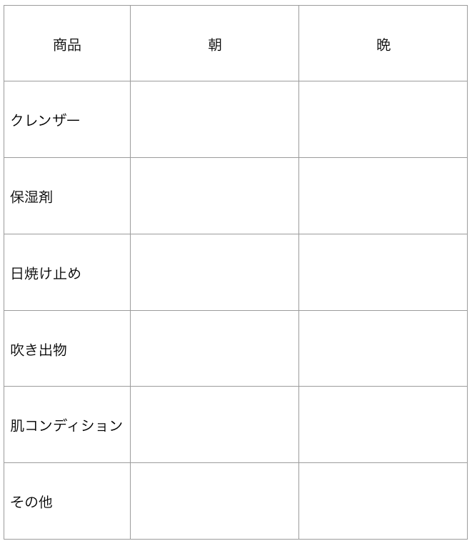

# ザ・スキンケア #4「最適なスキンケア商品を選ぶためのゴールデンルール」

「**ザ・スキンケア**」シリーズの続きでーす([#1](https://daigovideolab.jp/blog/1785262),[#2](https://daigovideolab.jp/blog/1793490),[#3](https://daigovideolab.jp/blog/1801015))。

シリーズ第3回では、「具体的にどんなスキンケアをするか？」って問題に入る前に、「**こんな売り文句にはダマされるな！**」みたいな話をざっくりまとめておきました。スキンケアの世界ってのは、商品の価格を上げようとしていろんな売り文句を駆使するのが常なんで、ぜひ押さえておきたいところです。

ってことで今回は、自分にとって最適なスキンケア商品を選ぶためのTIPSを見ていきます。

---

## **スキンケアにおける3つの超基本プロダクト**

シリーズの[第2回目](https://daigovideolab.jp/blog/1793490)で自分の肌のデフォルト状態がわかったはずなので、ここからは「持ち前の肌をいかに最適に機能させるか？」ってとこに進んでいきましょう。

このセクションでは、自分にとって最高なスキンケアのルーチンを確立するのが最終的なゴール。そのためには、まずは非常にシンプルなルーチンからスタートすることをお勧めします。

具体的には、スタート時には以下の3つさえしっかり導入しておけばOKであります。

1. クレンザー
2. 保湿剤
3. 日焼け止め

この3つがスキンケアの土台になりまして、これらを正しく使わない限りは、スクラブもトナーもミストもマスクもセラムもすべて無駄に終わっちゃうのでご注意ください。逆にいえば、この3つをちゃんと使ってれば、追加のケアが必要になる人はほとんどいないでしょう。

この3つから自分に合う商品さえ見つけてしまえば、あとのルーチンは非常に簡単で、

1. **朝はクレンザー → 保湿 → 日焼け止めの順番でケア**
2. **夜はクレンザー → 保湿の順番でケア**

これさえ守ればなんの問題もないですし、余計なことを心配する必要もなし。もちろん、ここにいろいろ付けたしてってもいいんですけど、なんかトラブルが起きたら常にこの基本にもどればOKってとこだけは意識しておきたいですねー。

## **正しいプロダクトを選ぶには？**

で、自分に最適なプロダクトを選ぶ段階では、必ず以下のゴールデンルールを守ってくださいませ。

- **新しいプロダクトを試すときは1つずつ**：余計な変数を取り除くのは科学の基本。新たなクレンザーや保湿剤を使うときは、必ずひとつずつお試しください。ひとつのプロダクトを試す期間の目安は約2週間で、これだけの時間を使わないと、正しい診断がしづらいんですよね。

- **パッチテストは必須**：大事なことだとはわかっていても、意外と誰もやらないのがパッチテストです。まぁめんどうな作業なのは間違いないんですけど、新しいプロダクトをいきなり顔に塗りたくるのはおやめくださいませ。

とりあえずこの2つを守るのがスキンケアの鉄則。どんなに安全そうな商品でも、人によっては赤みが出ちゃうケースはありますからねぇ。

では、さらに具体的なパッチテストの方法も押さえておきましょう。おおまかなステップは簡単で、

1. ほんの少量を顔の2〜3カ所に塗って一晩だけチェック
2. もしなんの反応も起きなければ、さらに別のエリアにも塗って試す

これだけです。ここでもし肌になんらかの異変が起きた場合は、

- すみやかに商品の使用をやめて肌を治療
- 肌がベースラインに落ち着くまでは、新たなプロダクトの使用をひかえる
- もし他の理由で異変が起きた疑いがある場合（食事やホルモンバランスの変動など）は、もう1回同じプロダクトでパッチテストを行う

のように対処してください。ちなみに、多くの人にとってクレンザーのパッチテストは不要なケースが多いですが、敏感肌の場合はやはりクレンザーでも実践しといたほうがベターです。

## 肌日記はマスト（できれば写真も）

シリーズの次回からは「良いプロダクトの具体的な選び方」を見ていきますが、その過程で必ずやっておきたいのは肌日記です。新しい商品を試すときは、なんでもいいんで以下のような記録紙を用意しておくといい感じ。

それぞれ、「朝の何時にどれだけの量のクレンザーを使ったか？」や「顔のどのエリアにどれぐらいの量で保湿のパッチテストを行なったか？」などを記入。その結果、「肌に吹き出物ができたか？」や「肌のコンディションに変化ができたか？」などを記録していってくださいませ。

最後の「その他」は、

- 新しい商品を試したから肌荒れがおきたんじゃなくて、もしかしたら昨日のお酒が原因かも？
- 乳製品を食べ過ぎて肌荒れが起きたのかも?
- 生理周期のせいで肌が荒れただけかも？

などの内容を書き込むエリアです。肌トラブルは睡眠不足や食事でも起きますので、他にトラブルの原因が疑われるときに使ってください。

でもって、ここでついでにやっとくと便利なのは、顔写真の記録です。なにせ人間は自分の変化に鈍感なので、正しいスキンケアで肌が良い方向に向かったとして、なかなか気づけないものなんですよ。

それではモチベーションも上がりませんので、ぜひ1日1回だけ写真を撮ると吉。その際には、

- 光の具合が同じ時間帯に撮る
- 服の色合いも同じようにそろえる
- カメラアングルもそろえる

といったポイントを守らないと正しい判断ができないのでお気をつけください。これまためんどうな作業ではありますが、後で必ず「やっといてよかった…」と思うはずですんで。

## さらに続く

ということで、今回は「自分の肌に最適なプロダクト」を選ぶために行うべき手順をご紹介しました。次回からはいよいよ良い商品の選び方に入りまして、まずは「**クレンザー編**」からお伝えしていきます。
