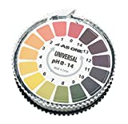

# ザ・スキンケア #5「正しいクレンザーを選ぶために気をつけたい３つのポイント」

「**ザ・スキンケア**」シリーズの続きでーす([#1](https://daigovideolab.jp/blog/1785262),[#2](https://daigovideolab.jp/blog/1793490),[#3](https://daigovideolab.jp/blog/1801015),[#4](https://daigovideolab.jp/blog/1803668))。

シリーズ第4回では、「最適なスキンケア商品を選ぶためにはどんな手順を踏むべきなの？」って問題について考えましたんで、今回から詳論に入りまして、

1. クレンザー
2. 保湿剤
3. 日焼け止め

のビッグスリーから、適切なものを選ぶ方法を見ていきましょうー。今回は「****クレンザー編****」です。

---

## クレンザー選びで気をつけたい３つのポイント

クレンジングはスキンケアの第一歩。よぶんな皮脂や死んだ細胞をとりのぞくためには欠かせないステップですが、残念ながらもっとも肌へのダメージが多い作業でもあります。

それもそのはずで、クレンザーってのは界面活性剤の力で肌を洗い流すのが目的のアイテム。なんだけど、界面活性剤は肌に必要な成分を見抜くことができないんで、天然保湿因子（NMF）まで落としかねないんですよね。その結果、間違ったクレンザーを使い続けると、やたらと肌が乾燥するケースも出てくるわけです。

というわけで良いクレンザーってのは、すべてのメイクや日焼け止めを落としたうえに、ダメージを最低限まで減らしてくれなきゃいけないわけです。難しいですねぇ。

以上をふまえて、良いクレンザーを選ぶポイントは以下のようになります。

### **1．クレンザーはpHが命**

ご存じのとおり、クレンザーでもっとも重要なのはpHです。というのも、人間の肌は弱酸性じゃないとうまく機能しないようにできてまして、アルカリ性なクレンザーを使うと肌の修復システムが乱れ、ニキビが悪化する原因になったりするんですよ。なので、まずは**pHが6以下のクレンザーを選ぶ**のが基本。

ただし、pHが書いてあるクレンザーってほとんどないので、以下のような試験紙でチェックしてみるといい感じです。

[
アズワン pH試験紙 ロールタイプ](//af.moshimo.com/af/c/click?a_id=790466&p_id=170&pc_id=185&pl_id=4062&url=https%3A%2F%2Fwww.amazon.co.jp%2F%25E3%2582%25A2%25E3%2582%25BA%25E3%2583%25AF%25E3%2583%25B3-As-One-1-1254-01-%25E3%2583%25AD%25E3%2583%25BC%25E3%2583%25AB%25E3%2582%25BF%25E3%2582%25A4%25E3%2583%2597pH0-14%2Fdp%2FB00LL3C2QA)

### **2．マイルドな界面活性剤で選ぶ**

というわけで、クレンザーを選ぶ際はできるだけマイルドな成分が入ったものを選ぶのがポイント。いまんとこ、刺激が少ないことで知られる成分は以下のようになります。

- ラウレス硫酸na（コカミドプロピルベタインと一緒に使うとさらにマイルドになる）
- ココイルイセチオン酸Na
- コハク酸系（スルホコハク酸ラウレス２Naとか）
- サルコシン系（ココイルサルコシンNaとか）
- グルコシド系
- ベタイン系
- ココナッツベースの界面活性剤（ココアンホ酢酸Naとか）

日本だと一番使われてるのはラウリル硫酸naでしょうが、人によっては肌荒れが起きまくるのでご注意ください。もちろん、一部で言われる「経皮毒」みたいな現象は起きないものの、肌が弱い方は注意しときたいところです。

また、界面活性剤については、**複数の成分を混ぜたほうが刺激が低くなる**傾向がありますんで、できるだけいろんな洗浄剤が入ったものを選ぶのも良いかと思います。と同時に、保湿の効果を持ったクレンザーは肌のダメージをやわらげてくれますんで、これもまた有効でしょう。

その代表的な例はステアリン酸やミネラルオイル、グリセリン、ソルビトールなどですが、さらにくわしくは後の「保湿剤編」で紹介していきますのでー。

### 3．肌の感覚で選ぶ

クレンザーを選ぶ際は、洗い終わりの感覚も非常に大事。もちろん洗い終わりに痒みや肌荒れが起きるのは論外ですが、妙に「**引き締まった感**」があるのも良くなかったりします。

これは感覚的なものなんで説明が難しいですけど、軽く肌がつっぱったり、やたらとサッパリした感じがあったりするなら、ちょっと洗い過ぎの可能性が否定できず。いままで強めの洗浄剤を使ってた人が弱い商品に切り替えた場合など、「あれ？なんかスッキリしない……」とか思っちゃうケースがよくあるんですけど、それでも肌は十分にキレイになってることのほうが多いんでご安心ください（洗浄剤とは別に、「さっぱり感」を出すための成分が配合されてることもあるんで、成分表のチェックは必要ですが）。

といっても、「それで本当に肌がキレイになったかどうやって確かめるの？」という疑問もありましょうが、そんな時は、

- 濡れたコットンパッドで肌をぬぐってみる

ってチェック方法で十分です。これでコットンに何にも着かなきゃOKでして、それ以上は強いクレンザーを使う必要はありません。

もしこのとき洗い残しがあった場合も、強いクレンザーに切り替えないほうがベターです。強いクレンザーを1回使うよりは、刺激が弱いものを2回使ったほうが肌へのダメージは少ないもんですから。

## その他、クレンジングの注意点

クレンザー選びの基本を押さえたところで、その他、気をつけて欲しいのは以下のようなポイントです。

- **クレンジングツールは不要**：世の中にはクレンジング用のブラシや専用パッドなども売ってますが、基本的には不要です。ツールを使う分だけ皮膚へのダメージも大きくなりがちですし、なによりクレンジングツールって管理がめんどうなんですよ。定期的にキレイにしとかないと、繁殖した雑菌が顔に移るケースもよくありますんで。

- **クレンザーの形式にはこだわらなくてOK**：クレンザーには固形、液体、泡などのタイプがありますけど、それで機能が変わるってことはないです。成分表さえちゃんとチェックしとけば形式にこだわる必要はなし。

- **スクラブ系は常用しない**：クレンザーの一部には死んだ細胞を落とす機能を持ったものがありますけど、言わずもがな、そのぶんだけ肌へのダメージも大きくなります。常用はやめておきましょう。スクラブを使いたいときも、最高で週1回かそれ以下のペースで用いたほうがベター。個人的には使ってませんが……。

- **メイクが落ちないときも2度洗いで**：メイクがなかなか落ちないケースもありましょうが、このときもキツめなクレンザーを使うぐらいなら、刺激が弱いもので2度洗いしたほうが肌のダメージは少なくなります。また別の方法としては、最初にクレンジングオイルでオイリーなメイクを落として、その後でフォーム系のクレンザーを使ってみるのもアリ。

- **メイク落とし布は微妙**：最近は「[水だけでメイクが落とせる！](https://amzn.to/2NylmVG)」みたいな商品もあるんですけど、これはかなり微妙です。確かにケミカルフリーなのはいいんですけど、結局は摩擦の力を使ってメイクを落としてるだけなんで、最終的には界面活性剤を使ったほうが肌には優しいと思われます（比較研究がないので推測ですが）。

- **クレンジングは1日1回**：どんなにマイルドな洗浄剤でも肌を痛めつけるのは同じなんで、クレンジングは1日1回までにお控えください。最大でも2回までにしとくべきでしょうね。

- **お湯は使わない**：あったかいお湯は肌バリアを一時的に壊すため、界面活性剤を肌の奥に浸透させやすくします。その結果、アレルギーや健康な肌の復旧を阻害するケースがあるんですよね。あくまでスキンケアは水でお願いします。

- **クレンジング後はすぐ保湿**：クレンジングが終わった後の肌は激しく脱水が進みやすくなってますんで、水分を拭き取ったらすみやかに保湿剤をご使用ください。

- **ドライスキンの場合はオイル必須**：ドライスキンの方は、できるだけオイルを補充できる商品を選ぶのがベター。クレンジングミルクとかクリームクレンザーとか、そのあたりを選ぶといいでしょう。もちろんオイルクレンジングを使うのもアリです。

- **オイリースキンの場合はジェルかフォームで**：脂肌の人はわりと強めなクレンザーでも肌荒れしづらいので、クレンザーの選択肢は広くなります。とりあえずジェル系かフォーム系を使っとけば問題ないでしょう。

- **肌が脱水しやすい場合は可能な限り弱めで**：一部にはオイリーなのに脱水しやすい肌質を持った方もいたりします。そんな人は強めな洗浄剤は厳禁で、グリセリンやソルビトールなどの成分が入ったものを選ぶのが良いでしょう。

- **敏感肌の場合はモイスチャー入りで**：敏感肌の方は、上記のグリセリンやソルビトールにくわえて、なんらかの保湿効果を持ったものをお選びください。特に敏感肌は水に濡れた状態を放置するのが一番危ないんで、洗顔のあとはすぐに保湿をお願いします。

## 次回は日焼け止め編です

ってことでクレンザー選びのポイントをガーッとまとめてみました。最終的には自分でパッチテストをするしかないものの、以上のポイントを押さえておけば最適な商品にたどりつきやすくなるでしょう。

そして次回は、「最適な日焼け止めを選ぶには？」ってのをテーマにお送りしまーす。
