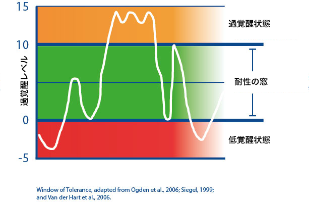

# 最高のパフォーマンスを発揮するためには「耐性の窓」って考え方を押さえておくといいよ！というカリフォルニア大学の話

## **最高のパフォーマンスを発揮するには「耐性の窓」が超大事**

「**なにごとも中庸が大事**」なんてことを申しますが、これは科学的に見てもわりと真理だったりします。

---

たとえば代表的なのはメンタルの負荷でして、適度なストレスなら体にいいし仕事のパフォーマンスも上げてくれるのはご存じのとおり。「[スタンフォードのストレスを力に変える教科書](https://amzn.to/2ZFFlZ1) 」なんかでもおなじみの話ですね、

これは集中力やセルフコントロール能力なんかにも言える話で、もしメンタルの負荷が高すぎれば全身が緊張状態になりすぎて不安が発生するし、逆に負荷が低すぎると退屈が起きてモチベーションが下がっちゃう。いずれにせよ「**ほどよいレベル**」に負荷をおさめるのは超大事。

で、そこで役に立ってくるのが「**耐性の窓**」（Window of Tolerance）って考え方です。

これはカリフォルニア大学のダニエル・シーゲル博士が提唱するアイデアで、「適度な覚醒状態」を意味しております。まずざっくりと図で示すとこんな感じ。

要するに、精神の覚醒レベルが高すぎも低すぎもしない、ちょうどいい段階に収まった状態を「耐性の窓」と呼んでるわけですね。メンタルがこの範囲に入っていると、**緊張でも退屈でもないベストなパフォーマンスを発揮できる**んですよ。

逆にメンタルが上下のどちらかに振れてしまうと、

- 過覚醒状態＝目の前のことにパニック状態になりやすく、感情に流されて行動しがちになる。

- 低覚醒状態＝なんのエネルギーもわかず、ものごとを考える気すら起きない

といった状態にハマることになります。なので、「耐性の窓」を意識するのは非常に大事だったりするんですよ。

## **メンタルを「耐性の窓」に保つためには？**

こうなると当然「**自分のコンディションをつねに耐性の窓の範囲でキープするには？**」ってとこが気になるわけですが、シーゲル博士いわく「**あなたを窓の外に追いやるトリガーを把握しておくしかない**」とのこと([R](https://amzn.to/32mp7Sb))。要するに、「自分は締め切りが近いと過覚醒になるな……」とか「あまりに難しい本を読み始めると低覚醒になりやすいな……」といった原因をあらかじめ理解しておき、自分が耐性の窓から外れたかどうかをモニタリングするのがベストだって話ですな。

そこでシーゲル博士は、「耐性の窓」を維持するためのステップを以下のようにまとめてくれてます。

### ステップ1．

まずは「耐性の窓」への理解を深めるためのステップです。過去1週間で自分が「過覚醒」または「低覚醒」に入った体験をひとつだけ思い出し、

1. トリガー
2. サイン
3. 結果

の３つを書き出しましょう。たとえば、私の場合だったらこんな感じです。

#### **▼過覚醒の例**

1. トリガー＝締め切りが迫ったが後6ページ書かねばならない
2. サイン＝胸のあたりがグッと締まった感覚。食欲が減退し足をしきりに動かす
3. 結果＝どうにか書き終わったが疲労感がハンパない

#### **▼低覚醒の例**

1. トリガー＝実証経済学のムズい本を呼んでたら数式が追えなくなった
2. サイン＝なんかやる気がなくなり、感覚から切り離された感じに
3. 結果＝ とりあえずもっと簡単な統計本を開いてみたりとか

とりあえず、ステップ1では「過覚醒」と「低覚醒」の例をひとつずつ出せばOKであります。

### ステップ2．サインチェック

続いて、「耐性の窓」に入り続けられる時間を長くするために、自分に特有のトリガーを思いつくままに列挙していきます。その際は、過去になんらかのストレスを受けた経験を思い出し、自分が「過覚醒」か「低覚醒」の特徴に当てはまったかどうかをチェックしていくといいでしょう。

それぞれの状態の特徴を以下に並べていきますんで、「自分が過覚醒しやすい場面は？」や「低覚醒にハマりやすい状況は？」と考えて見るといい感じです。

#### **▼過覚醒のサイン**

- なんか軽いパニック状態
- 体が震えたり揺れたりする
- 感情が命ずるままに反応する
- ネガティブな思考がどんどん浮かぶ
- 衝動をこらえることができない
- やたらと身を守ろうとする
- なんだか不安な気分に
- 怒りが収まらない

#### **▼耐性の窓のサイン**

- 他人への共感の気持ちが増す
- 状況に適した行動が取れる
- 自分の感情をコントロールできる
- 根拠のない安心感がある
- 落ち着いているが注意深さもある
- 過去や未来のことをあまり考えない
- 好奇心が増している

#### **▼低覚醒のサイン**

- 体の感覚があまり感じられない
- 感情がマヒしたような感覚
- ほとんどやる気がない
- 自己や他人から切り離された感覚
- 内側が空っぽになった感覚
- 体を動かす気が起きない
- ものごとを考えられない

### ステップ3．耐性の窓思考

最後に、ステップ1とステップ2で書き出した内容をながめながら、以下の質問を自分に投げてみてください。

- もし再び過覚醒に入ったら、耐性の窓にもどるために何ができるだろう？ 深呼吸？ それともシンプルに時間を置けばいい？ 瞑想の訓練をする？

- もし再び低覚醒に入ったら、耐性の窓にもどるために何ができるだろう？ 散歩？ 友人に電話する？筆記開示をする？

思いついく限りの対策をリストアップして紙に書き出してみましょう。あとは、今後の生活で自分が「いま過覚醒に入った」と思ったら、あらかじめ考えた対策を試していけば終了であります。

耐性の窓に入るための対策は人によって効果が激変するので、「これ！」といったものはないのが難しいところ。いくつか試してみて、自分にあった方法を見つけていただければ幸いです。

## まとめ

というわけで、今回はカリフォルニア大学が提唱する「耐性の窓」のお話でした。まぁいろいろ難しいことを考えなくても、「耐性の窓」っていう考え方を知っておくだけでも便利に使えるかと思います。

たとえば、なんかうまくいかないことがあったら、

1. 「これはどれぐらいの過覚醒か？」と考えてみる
2. いまの状態を「耐性の窓にもどすには？」と考えてみる

ってステップをふむだけでもずいぶん違うはず。なにもしないと過覚醒か低覚醒の波に飲まれたままになっちゃいますからねぇ。
