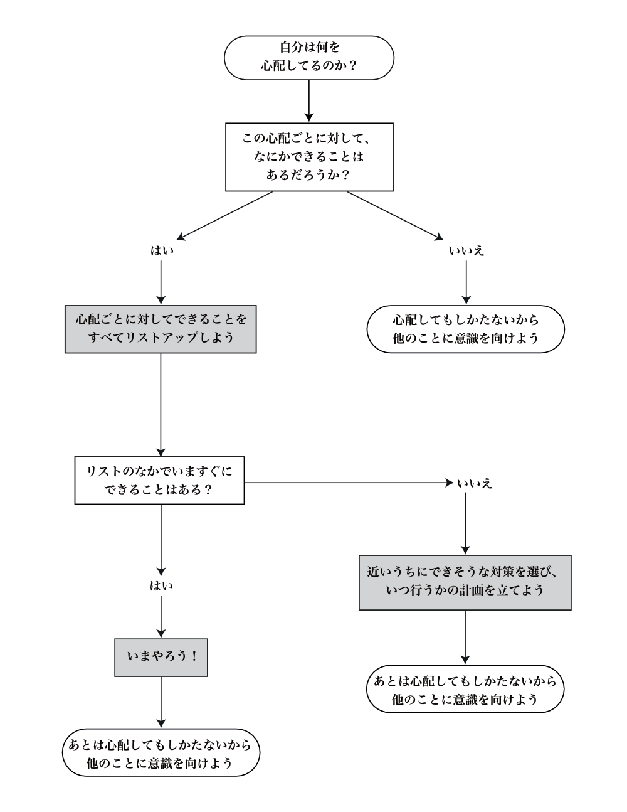

# 見るだけでも軽度の不安がやわらぐ「不安の決定木」テクニックとは？

「**不安よくない！超体に悪い！**」ってのは「[最高の体調](https://amzn.to/2PJe2sR)」でも激しく強調した話。慢性的な不安を感じた人は眠れなくなるし、体内の炎症が悪くなった結果として寿命も縮まるしで、悪いことだらけなんですよね。

---

で、その対策としては「[認知行動療法](https://daigovideolab.jp/blog/1721216)」を使うのがド定番ですけど、「不安で死にそうなのにそんなことやってらんないよ！」という方もおりましょう。なんせ認知行動療法は手間がかかりますからねぇ。

そんなときには「[超ストレス解消法](https://amzn.to/32r8XH6)」などでは呼吸法をおすすめしてますが、ここでもうひとつ有用なのが「**不安の決定木**」って方法です。これは「[１冊でわかる心理学](https://amzn.to/32Ayyh7)」などで有名なギリアン・バトラー博士らが開発したメソッド([R](https://amzn.to/30Z9eRk))でして、

- **概念図を見るだけで不安をやわらげよう！**

って趣旨になってます。いわゆる「読書療法」の流れをくむテクニックでして、文字を読むのを苦にしない当ブロマガの読者さんには最適じゃないでしょうか。

では、まずは「**不安の決定木**」を紹介しましょう。

非常にシンプルな決定木ですねー。あまりに簡単なんで余計な説明もいらないような気がしますけど、いちおう使い方を書いておくと、

1. なにかに不安になったら、「不安の決定木」を見る
2. 「この心配ごとに対して、なにかできることは？」という質問について考えて、「現時的な不安」と「仮説的な不安」の2つにより分ける
3. もし、いまの不安が現実的なものなら、粛々と対策を立てて実行するか、対策を実行する期日を決める
4. もし、いまの不安が現実的なものなら、ほかのことに注意を向ける

みたいな流れになります。不安の対処を冷静に考えていくと、**最終的にはどのルートをたどっても「心配してもしかたないから他のことに意識を向けよう」になる**わけですね。

「不安から意識をそむける」方法は各自の好みによりまして、

- とにかく楽しいことをしてみる
- マインドフルネスを試す
- [筆記開示](https://yuchrszk.blogspot.com/2014/12/blog-post_30.html)を試す

などなど、ご自分に合ったものをご利用ください。

まぁ当たり前といえば当たり前の手順が書いてあるんですけど、不安に取りつかれた人間はこんな基本すら忘れがちになっちゃいますからねぇ。いわば**緊急時の対策をまとめたフローチャート**みたいなものだとお考えください。

あと、「**不安の決定木**」がすばらしいのは、このフローを見るだけでも軽度な心配ごとなら解決しちゃうとこでしょうね。一般的に、人間の不安ってのは「どうすりゃいいのかわからない……」って気持ちが原因でブーストするものなんで、ざっくりした指示書を見るだけでもメンタルは落ち着くものなんですよ。

もちろんトラウマクラスの悩みには対応できないものの、日常的なレベルの不安やストレスであれば、かなり役立つのではないかと。「不安の決定木」のPDFは私のドロップボックスに[置いておきます](https://www.dropbox.com/s/5hmeao2mxoi7p0b/%E4%B8%8D%E5%AE%89%E3%81%AE%E6%B1%BA%E5%AE%9A%E6%9C%A8.pdf?dl=0)んで、適宜ご利用ください。
