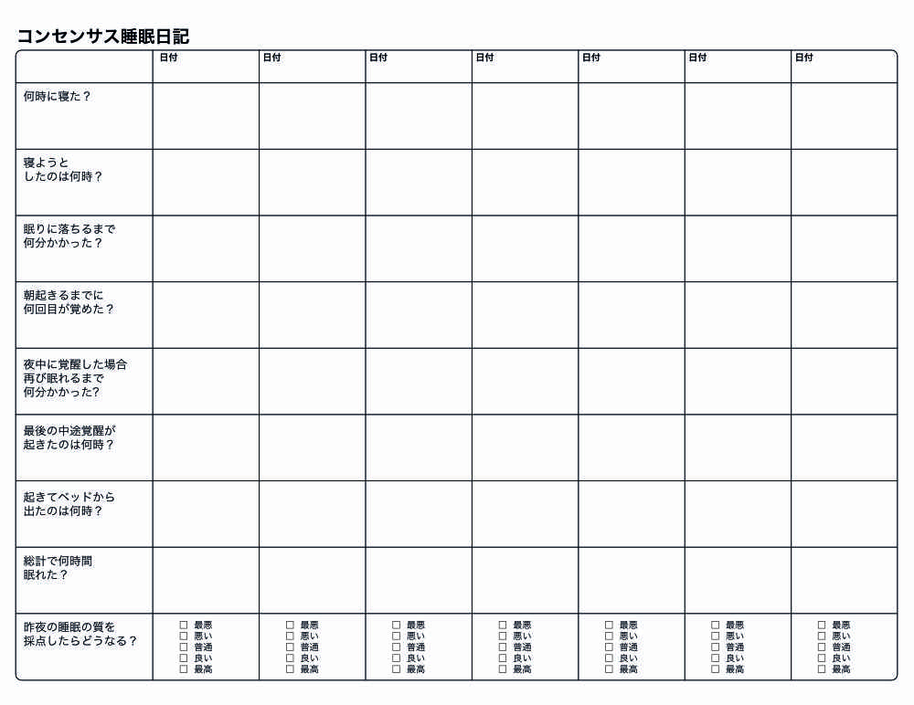

# 毎日の"記録"で眠りの質を自然と改善する「コンセンサス睡眠日記」の使い方

**睡眠を改善したい！**ってときに使えるテクニックは[いろいろある](https://yuchrszk.blogspot.com/2016/02/blog-post_16.html)ものの、多くの専門家がオススメするのが「**睡眠日記**」でしょう。その名のとおり、「何時に寝たか？」とか「夜中にどれぐらい起きたか？」といった情報を記録していく方法のことで、不眠症の治療なんかでよく使われます。

---

もちろん、この記録は自分の睡眠傾向を理解して、今後の対策を立てるために行うものです。が、おもしろいことに、睡眠日記をつけてるだけでもいつの間にかよく眠れるようになったりするんですよ。

なんだか不思議な感じもしますが、「睡眠日記」で睡眠が改善するのは「食事日記」がダイエットに効く理由と同じです。食事日記でなぜ自然と痩せるかというと、

1. 太りぎみな人は「自分はあまり食べてない！」と思ってても、実際はたくさん食べているケースが多い
2. しかし、食事日記をつけると、自分の正しい食事量に意識が向く
3. 意識して食事量を減らすようになる
4. 痩せる！

みたいな流れになってます。日記をつけることで、あいまいだったカロリー摂取量がはっきりするわけですね。

睡眠日記も同じで、よく眠れない人ってのは意外と「何時に寝たか？」とか「どれぐらいで眠りに落ちたか？」といった事態を把握してないケースが多いんですよ。そこに毎日の記録で自覚をうながすことで、自動的に良い睡眠習慣に落ち着いていくわけですね。「メラトニンとか飲んでるけどなんだかまだイマイチ眠れないなー」という方は、睡眠日記を試してみるのが吉でしょう。

ってことで、今回は「睡眠日記」の**”正しい”つけ方**をご紹介します。わざわざ「正しい」と断ったのは、2012年に睡眠治療の専門家が集まって「睡眠日記のつけ方を統一しましょう！」って会議を行ったからです([R](https://www.ncbi.nlm.nih.gov/pubmed/22294820))。従来は睡眠日記にもいろんな流派があったんですけど、「**どの記録法がいいのかちゃんと決めようぜ！**」って問題をちゃんと話し合ったんですね。

その結果、専門家の意見をまとめた「**コンセンサス睡眠日記**」ってのが生まれまして、そのフォーマットはこんな感じです。

まぁわりとシンプルと申しますか、基本的な内容になってますね。中途覚醒について尋ねる質問が多いような印象ですけど、睡眠に問題を抱えた人ってのは、どうしても真夜中に目が覚めちゃうケースが多いですから。

また、睡眠日記をつける際の注意点は、以下のようになります。

- 睡眠日記は、起きたあと数分ぐらいかけてさっさとつける。できれば毎日つけるのが理想。

- 日記は21日間はつけてデータを取りたい。

- １番上の「何時に寝た？」の質問は、「何時に寝床に入ったか？」を書く欄じゃないので注意。自分が眠りに落ちた時間がハッキリわからなければ、「なんとなくベッドに入って30分ぐらいは起きてたかなぁ」ぐらいの感覚でつけてもOK

- 「起きてベッドから出たのは何時？」は目が覚めた時間ではなく、あくまでも寝床から出た時間を書く欄なので注意。もし目が覚めてもベッドでうだうだしていた場合は、ちゃんとベッドから出た時間を記録する

- 最後の「睡眠の質」の判定は自分の主観でOK

- 基本項目のほかにも、以下のポイントも記録しておくとさらに効果が高まる。
  - 日中にどれぐらいうたた寝、または昼寝をしたか？
  - 前日にどれぐらいのアルコールを飲んだか？何時に飲んだのか？
  - 前日にどれぐらいのカフェインを何時に飲んだか？（コーヒー2杯とか緑茶3杯とか）
  - 睡眠のために何らかの薬やサプリを飲んだか？（メラトニン5mgとか）
  - なにか睡眠に影響が出そうなことがあれば、それも記録しておく（締め切りの不安がヤバい、とか）

って感じで、まずは2〜3週間ほど続けていただいて、睡眠の質に変化が出るかどうかを確かめていただければ幸いです。コンセンサス睡眠日記のPDFは[私のDropbox](https://www.dropbox.com/s/0ei9bnq1p0w2t35/sleep_diary.pdf?dl=0)に置いてくので、お悩みの方は適宜お使いください。
