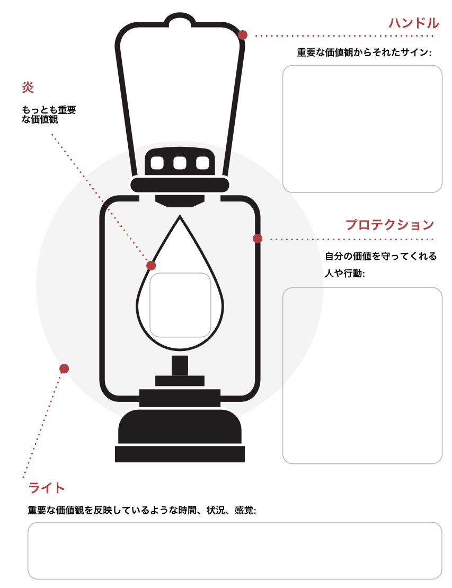

# 自分の価値観に沿った暮らしを送るための「バリューランタン」テクニック

健康に暮らすには「[価値観が大事だよ！](https://amzn.to/2q5btow)」みたいな話を「最高の体調」に書いております。価値観ってのはひとことで言えば、

- **「人生でもっとも重要なものはなんですか？」**

って質問の答えのことです。この解答が自分のなかでビシッと定まっている人は、基本的に幸福度が高かったり、ストレスに強かったりするんですよ。まぁ直感的に考えてみても、自分にとって重要なことがわからなくてフラフラしてるよりは、価値観がビシッとしてたほうが逆境にも強そうですもんね。

---

というわけで、「最高の体調」では価値観に従って暮らすためのトレーニングをいくつか紹介してるわけですが、よく聞くのが「難しい！」というお声です。もともと価値観に沿って生きるのは難しいものなんですけど、本の中で紹介してるテクニックもわりと複雑だったりはするんですよね。

ってことで、「最高の体調」が出たあとも、ちょこちょこと良い感じの「**価値観に従って暮らす方法**」が見つかってまして、今回は「バリューランタン」ってテクニックをご紹介します。

## **バリューランタンの5ステップ**

「バリューランタン」はブレネー・ブラウンって先生が開発した技法で、日本だと「[本当の勇気は「弱さ」を認めること](https://amzn.to/31WyxDo)」や「[立て直す力 RISING STRONG](https://amzn.to/2MZdKLn)」などで有名な先生ですね。

名前どおりこれは「ランタン」のメタファーを使ったエクササイズで、個人の価値観を掘り下げるのが目的になります。具体的には、以下のようなワークシートを使います。

### ステップ1．炎

それでは、まずは以下のインストラクションをお読みください。

> 人生に確実な保証はありません。人生では必ず困難に出会い、さらに失敗を犯します。時に、暗闇が我々を包むでしょう。しかし、もし私たちが内なる光を見つけていれば、私たちは常に光を再び見つけることができるはずです。
>
> このエクササイズでは、あなたは自分の内なる光を探して行きます。

というわけで、まずは以下の質問について考えてみてくださいませ。

- もし人生でもっとも重要なものを２つだけ選ばねばならないとしたら、それは何でしょうか？

価値観はなんでもOKで、創造性、正直さ、自由などを好きに選んでいただければOK。なにも思いつかないときは、とりあえず「人生の目的」を使ってもいいし、「自分が心から満足できる瞬間は何か？」って答えを書き込んでみてもいいでしょう。とりあえず、「価値観」は何度か試して確かめていくものなので、この時点ではあいまいでも構いません。

### ステップ2．プロテクション

次に、プロテクション（炎を囲むガラスの部分）の部分を書き込みましょう。ここでは以下の質問について考えてみてください。

- 自分の価値観を守るために役立つ行動とはどのようなものだろう？

- 自分の価値観をサポートしてくれる人物は誰だろうか？

たとえば、自分の価値観が「創造性」であれば、それを守るのに役立つのは「つねに新たなやり方を考える」かもしれないし「日々の暮らしにユーモアを探す」みたいになるかもしれません。そんな感じで、自分の価値観をブーストしたり、高めてくれるような行動を考えてみてください。

### ステップ3．ハンドル

このステップでは、まず以下のインストラクションをお読みください。

> 時に人生は難しいものです。そんな時、私たちはついランタンを手放してしまい、その存在を忘れてしまいます。あまりにも困難に気を取られて、価値観から目がそれてしまうのです。このような状況においては、誰もが手近なやすらぎに飛びついてしまい、自分にとって大事なことを忘れてしまうのが普通でしょう。
>
> 私たちがランタンを手放してしまうのは、それが一時的に重くなったように感じてしまうからです。しかし、ランタンなしでは私たちの周囲は闇に包まれたままであり、再びハンドルを握り直す必要があります。

というわけで、なにか困難が起きたときは、ついつい価値観がおざなりになってしまうもの。自分が価値観に沿った行動を取れないような状況を探すのが、このエクササイズのポイントになります。

具体的には以下の質問にお答えいただければと。

- 自分が「ランタンのハンドルを手放したな〜（価値観から外れた行動を取ってるな〜）」とわかるのは、どのような時でしょうか？ 価値観から外れた時にどんな行動を取ってしまうでしょうか？

その答えがわかったら、ハンドルの部分に書き込んでみてください。

### ステップ4．ライト

このステップでは、以下の質問について考えてみてください。

- 自分の価値観に沿って行動できた！と思えたのはどんな時だったろうか？

- 価値観に沿って行動できた時、事態はどのように進んだろうか？

- 価値観に沿って行動できた時、どのような感覚を抱いたろうか？

これらの答えを思いついたら、ライトの項目に書き込みます。いわば、自分がもっとも価値観とともに行動できて、内面から輝けたような状況を考えてみるわけですね。

### ステップ5．クロージング

これで自分のキーとなる価値観のアウトラインができましたんで、あとは日常の暮らしでランタンのイメージを思い出せばOKであります。たとえば、

- なにか選択に迷うことがあったら、ランタンを思い出して価値観に沿った選択をしてみる

- なんらかのトラブルが起きたら、ランタンを思い出して価値観から外れない判断をしてみる

みたいなことです。価値観に沿った行動ってのはなかなか難しいもんですが、ランタンのイメージが道標になってくれるわけですね。

もちろん、ランタンを使った結果として「あれ？最初に書き込んだ価値観はなんか違いな？」と思うケースはよくありますんで（私もありました）、その場合は状況に応じて修正していただければと思うわけです。
