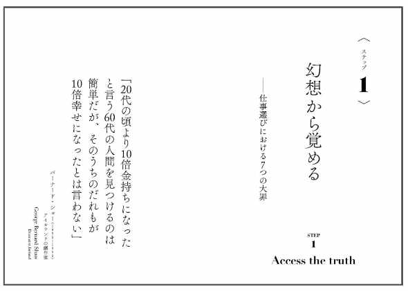

# 【お願い】「科学的な適職」のアンケートにご協力いただけるとうれしいです！

本日の12時に公開した[「科学的な適職」の先行公開](https://daigovideolab.jp/blog/1834388)、すでにかなりの数の感想をいただいてまして、感謝感謝であります。

---

で、つきましてはまたお願いがありまして、もしお時間があれば簡単なアンケートにお答えいただけないでしょうか？

なにをお願いしたいのかと言いますと、

- **本書の「序章」のトビラページに入る名言ってなにがいいと思いますか？**

というご相談です。

というのも、この本って各章のトビラに先人たちの名言を入れてるんですよ。たとえば第１章だったらこんな感じ。

といったように、なんらかのパンチラインをあしらってるんですな。ただ、まだ「序章」についてはどうするか決めあぐねてまして、せっかくなら読者の皆さんに選んでいただくのも楽しいのではないか、と。

つきましては、以下に**「名言」の候補**をいくつか上げておきました。[「科学的な適職」の先行公開](https://daigovideolab.jp/blog/1834388)から「序章」をお読みいただいたうえで、パッと見て「これがいい！」と思ったものをお選びいただければ幸いです。また、「もっといい言葉を知ってるぞ！」という心当たりがおありでしたら、下の記入欄から教えていただけるとこれまたうれしい感じ。よろしくお願いいたします！

- **[「科学的な適職」序章の名言どれがいいですか？アンケート](https://docs.google.com/forms/d/e/1FAIpQLScbFvWqXSdTnIBq3hXF_aV6-pxgWECtXitAd8ORke2-XQEoCA/viewform?usp=sf_link)**
