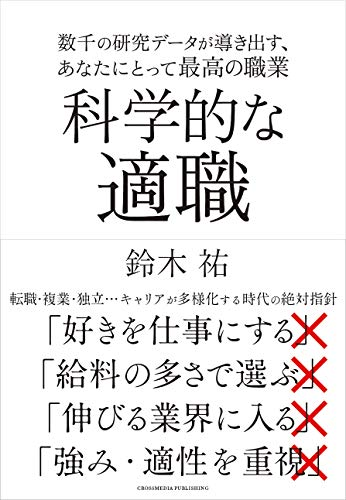
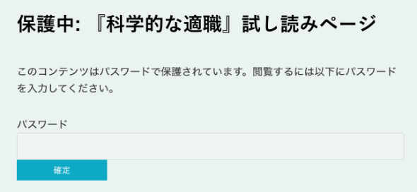

# 「科学的な適職」の一部をブロマガの読者さんに先行で限定公開するぞ！というエントリ

ツイッターで軽く告知したんですが、「[科学的な適職](https://amzn.to/32T0mNs)」って本が12/13に出ることになりまして。

> 「科学的な適職」のAmazon予約が始まりましたー[https://t.co/8hVqpDagmP](https://t.co/8hVqpDagmP)
>
> ― 鈴木祐 (@yuchrszk)
>
> [November 7, 2019](https://twitter.com/yuchrszk/status/1192369200792100864?ref_src=twsrc%5Etfw)

これはタイトルどおり「**人間にとって適職ってなんだろう？**」って問題を深掘りした内容になってます。なんせ私たちの生活は大半が仕事に費やされてますんで、幸福に生きるためには欠かせないテーマでありましょう。

---

[
科学的な適職](//af.moshimo.com/af/c/click?a_id=790466&p_id=170&pc_id=185&pl_id=4062&url=https%3A%2F%2Fwww.amazon.co.jp%2F%25E7%25A7%2591%25E5%25AD%25A6%25E7%259A%2584%25E3%2581%25AA%25E9%2581%25A9%25E8%2581%25B7-%25E9%2588%25B4%25E6%259C%25A8-%25E7%25A5%2590%2Fdp%2F4295403741)（ちなみに、この表紙はまだ決定稿ではありません）

……なんだけど、この本は一般的な就職本とは違ってまして、

- あなたに最適な職業はこれだよ！
- 将来伸びる仕事はこれだよ！
- スキルが身に付く仕事はこれだ！

みたいな唯一の「正解」を教えるような内容にはなっておりません。というか、人生に絶対の正解なんてないので。

では、「[科学的な適職](https://amzn.to/32T0mNs)」がどのような内容になってるのかと言いますと、

- 幸福になりやすい仕事を選ぶのが失敗する理由も深掘りする

- 以上のポイントから、自分が幸せになれる**仕事を正しく選ぶ確率を上げる**

みたな感じです。つまり「**私たちが本当に幸せに近づけるような仕事を選ぼう！**」って話でして、せんじつめれば、

- 人間にとって最大公約数の幸福とは何か？

- 人生で正しい選択をするにはどうすればいいのか？

といった２つのポイントを詰めたものになってます。いわば「適職本」のふりをした「幸福と選択」の本でして、かなり射程が長い内容になってるんじゃないかと。

テーマがデカい分だけ執筆にもかなりのカロリーを使いまして、いまはほぼ抜け殻のようになってます。あまりにも神経を消耗したので、当分のあいだ自分の書籍はやらないつもり（笑）

で、この本の発売はまだ1ヶ月後ぐらいなんですけど、このたび担当の編集さんが「**ブロマガの読者さんになら****一部の内容を****先行公開してもいいですよ**」と言ってくださいまして、本書の序章から１章までの途中をウェブで読めるようにしてくれたんですよ。以下がそのサイトになります。

### [『科学的な適職』試し読みページ](https://business-life.jp/tekishoku)

アクセスするとパスワードを要求されますんで、「tekishoku」と入力していただければ幸いです。１章の途中までの公開になりますが、それなりに参考になるのではないかと。

でもって、さらにお願いなのですが、もしお時間があれば試し読みの感想などを以下のフォームに書き込んでいただけると幸いです。

- **[『科学的な適職』試し読みアンケート](https://docs.google.com/forms/d/e/1FAIpQLSdjKDsWjd1yhbDniQxXXNG3WtdhXTI6WE49LX_60_McnLFvJQ/viewform?usp=sf_link)**
