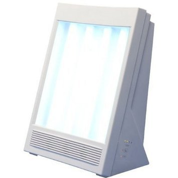
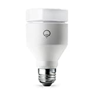

# 睡眠をガッツリ改善するための10日プラン #2「2日目〜4日目朝まで」

「睡眠をガッツリ改善するための10日プラン」([#1](https://daigovideolab.jp/blog/1831187))の続きでーす。

「パレオな男」ではいろんな睡眠法を紹介してるわけですが、あまりにも多すぎて、「本当に効果が高いものはなんなの？」や「どこから手をつければいいの？」ってのがわかりにくいのが難点。そこでこのシリーズでは、「**いまの自分が睡眠を改善するとしたら、こんな方法を使って、こんな手順で修正していくだろうなー**」と思ったものをひとつづきのロードマップとしてまとめたものです

で、前回は1日目の行動をお伝えしましたので、今回は2日目〜3日目にすべきことを見てみましょうー。

---

## 2日目の日中にすべきこと

まずは2日目の日中にすべきことですが、これについては、

- **1日に最低でも30分は眼球から日光を入れる**

って感じになります。なにせ人間の体内時計ってのは、目から入った光をシグナルとして動作してますんで、日中に光を入れとかないとうまく昼夜の切り替えができなくなるんですよ。

光の取り込み方はなんでもOKでして、

- ペットの散歩をする
- 子供と外で遊ぶ
- 外で昼食を食べる
- 車じゃなくてチャリで移動

といった形でなんとか30分ほど目から光を取り込む時間を作っていただければ、と（なので、当然ですがサングラスは厳禁です）。

「どうしても外に出る時間が取れない！」という場合は、ライトセラピー系のガジェットを使うのもアリではあるんですが、ここらへんの機器はどうしても太陽光に勝てないところがありまして、やはり外出の時間を作るのがベストではあります。

[
NatureBright SunTouch Plus Light and Ion Therapy Lamp](//af.moshimo.com/af/c/click?a_id=790466&p_id=170&pc_id=185&pl_id=4062&url=https%3A%2F%2Fwww.amazon.co.jp%2FNatureBright-SunTouch-Light-Therapy-%25E4%25B8%25A6%25E8%25A1%258C%25E8%25BC%25B8%25E5%2585%25A5%25E5%2593%2581%2Fdp%2FB0088WGOTI)

ちなみに、太陽光のシグナルについては、「長く光を目に入れるほど体内時計が強固になる」って見解が出てますので、すでに30分の外出をクリアしている方は、さらに40分、50分と長くしていくのは問題ありません。ただし、その場合、今度は紫外線の問題が怖くなってきますんで、日焼け止めの使用はお忘れなく。

## 2日目の夜にすべきこと

続いて2日目の夜にすべきことですが、ここではやはり、

- **寝床に入る3時間前からアンバーサングラスをかける**

これをぜひ習慣にしていただきたいところ。アンバーサングラスの効果については「[オレンジの眼鏡で睡眠の質はどこまで改善するか？ を調べた研究の話](https://yuchrszk.blogspot.com/2019/08/blog-post_17.html)」をお読みいただければと思いますが、ブルーライトのブロッキング効果が高いもんですから。

私の場合は[カーボンシェイド](https://yuchrszk.blogspot.com/2016/08/blog-post_12.html)を使ってますけど、いまではもっと安いのが出てますんで、現時点ではSpectra479などを推奨しております。

[
Spectra479 ブルーライト 99.9% カット pcメガネ](//af.moshimo.com/af/c/click?a_id=790466&p_id=170&pc_id=185&pl_id=4062&url=https%3A%2F%2Fwww.amazon.co.jp%2FSpectra479-%25E3%2583%2596%25E3%2583%25AB%25E3%2583%25BC%25E3%2583%25A9%25E3%2582%25A4%25E3%2583%2588-99-9%2525-%25E3%2582%25AB%25E3%2583%2583%25E3%2583%2588-pc%25E3%2583%25A1%25E3%2582%25AC%25E3%2583%258D%2Fdp%2FB01GSFTX08)

で、さらに予算に余裕があるならば、LIFXのようなスマート電球を使い、部屋の照明を真っ赤に変えてしまうのもおすすめ。

[
LIFX LED電球 一般電球形 1100lm（暖色/寒色を含む1600万色）](//af.moshimo.com/af/c/click?a_id=790466&p_id=170&pc_id=185&pl_id=4062&url=https%3A%2F%2Fwww.amazon.co.jp%2FLIFX-LED%25E9%259B%25BB%25E7%2590%2583-%25E4%25B8%2580%25E8%2588%25AC%25E9%259B%25BB%25E7%2590%2583%25E5%25BD%25A2-1100lm%25EF%25BC%2588%25E6%259A%2596%25E8%2589%25B2-%25E5%25AF%2592%25E8%2589%25B2%25E3%2582%2592%25E5%2590%25AB%25E3%2582%25801600%25E4%25B8%2587%25E8%2589%25B2%25EF%25BC%2589LIFX%2Fdp%2FB078STCFSB)

というのも、ヒトが光を取り込むレセプターはもちろん眼球がメインなわけですが、実は**人間の肌にもレセプターって存在**するんですよ。これをふせぐためには、やっぱ室内の明かりも調整しとくに越したことはないかなー、と（もちろん眼球のレセプターを守るのが最優先ではありますが）。私の場合は19時が過ぎたあたりから1500kのキャンドルライトレベルになるよう設定しております。

## 3日目朝の効果測定

2日目の介入でどんな変化が起きたのかも、ぜひとも記録に残しておいてくださいませ。チェックの方法は、[初日の効果測定で使った質問](https://daigovideolab.jp/blog/1831187)を再利用していただければOKであります。

## 3日目の夜にすべきこと

さて、それでは3日目にはどんなことに取り組んでいただきたいのかと言いますと、

- **寝床に入る30分前のリラックスルーチンをひとつだけ決める**

って感じになります。基本的には睡眠に入る30分前からは頭脳を使う作業はいっさい断つのが理想でして、その間はひたすら神経を鎮める作業に使うのがポイント。これをやっとかないと、せっかく決めた就寝時間を守れたのに、ベッドに入っても眠れないようなケースになりがちですんで。

ルーチンについては「脳の回転速度が落ちる」って条件を守れればなんでもよくて、

- ハーブティーを飲む（カモミールとか）
- とにかく気が鎮まる音楽を聴く（[マックス・リヒター](https://amzn.to/353UEtI)とか）
- ストレッチをする
- ヨガをする

などなど、好みによって決めていただければ幸いです。また、「30分」ってのはあくまで最低ラインなんで、もっと余裕があればさらに15〜20分ほど早めにスタートしていただくと、さらに効果が上がるかと思われます。

ちなみに私の場合は、昔は音楽などをよく聴いてたんですが、最近は就寝の30分前から「ひたすらボーッとする」ってのがルーチンになってます。瞑想のように呼吸に意識をもどしたりもせず、ただただ虚空を見つめてボーッとしているので側から見たらかなり怖いんですけども、最近は本の執筆が増えて脳の負荷がすごいもんで、「ひたすら何もしない」ってのを徹底しないと神経が休まらないんですよね……。

この「30分前のリラックスルーチン」は非常に重要な習慣なので、1日目で取り上げた「**「この時間に寝る」という決まりを生活の最優先事項として位置づける**」って考え方と同じように、

- リラックスルーチンの時間を30分確保したうえで、1日のスケジューリングをする

ぐらいに心がけておくことをオススメします。みんな意外とリラックスタイムを甘くみがちで、ついゲームやテレビみたいに神経をたかぶらせる行動をしがちなものですから。

で、4日目の朝も同じように[初日の効果測定で使った質問](https://daigovideolab.jp/blog/1831187)で効率をチェックしていただければ終了です。
