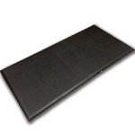

# 「体を悪くしないためのスタンディングデスクの正しい使い方」をピッツバーグ大学が検証してくれたよーという話

## **スタンディングデスクの最新研究はどうなっているのか？**

スタンディングデスクについてのご質問をいただきました。

---

> WIREDで下記のような「スタンディングデスクには意味がない」という主張の研究結果を紹介する記事がたくさんあります。むしろ立ってる方が有害という主張もあります。
>
> [スタンディングデスクの効果は「わからない」：複数の研究結果](https://wired.jp/2016/03/24/standing-can-also-be-bad-for-you/)
>
> [スタンディングデスクには意味がない？ 座りすぎと健康の関係を研究してわかった「もっと重要なこと」](https://wired.jp/2019/06/07/standing-desk-benefits/)
>
> パレオさんやダイゴさんはスタンディングデスクとステッパーを勧めていますが実際のところどうなんでしょうか？立ったままだと微妙だけど、スタンディングデスク+ステッパーで歩き続けた場合は違うのかなと思いますが。
>
> パレオさんのブログのスタンディングデスクの記事の研究は少し古くて、WIREDニュースの方が新しい研究結果です。最新の研究やメタ分析ではどうなのか気になります。

とのこと。そういえば「パレオな男」ではスタンディングデスクの最新研究についてあんま触れてなかったので、このご質問はタイムリーでいい感じですね。

で、質問にもあるとおり、スタンディングデスクに関する研究はまだ未知な側面も多くて、否定的な見解が出されることもしばしばだったりします。特に2016〜2017年あたりには否定的なニュースをよく見かけた気がしますね。

## **スタンディングデスクの近年の動向とか**

ただ、これもなかなか判断が難しくて、実は近年になっても「**やっぱスタンディングデスクっていいんじゃない？**」って結果もよく出てたりはするんですよ。たとえば2018年4月に出たもの([R](https://www.emerald.com/insight/content/doi/10.1108/IJWHM-10-2017-0078/full/html))だと、

1. 48人の参加者を「普通の机」と「高さを変えられる机」の2グループに分ける
2. そのまま1年間作業を続けてもらい、どんな違いが出たかを見る

ってデザインになってます。1年をかけて調べた研究はちょっとレアなんで、そこそこの参考になるんじゃないでしょうか。

でもって、その結果をざっくりまとめてみると、スタンディングデスクを使ったグループは、

- 1日のうちの座っている時間が17％ほど減少した。この現象は3ヶ月目から確認され、1年後の時点でもトレンドが続いていた

- 47％のユーザーが背中や腰の不快感の改善を報告した

- 65％のユーザーが1年後の時点で生産性と集中力の増加を報告した。また、彼らの多くがより活動的になり、活力が増えた

- 65％のユーザーが、仕事のあとにも健康的な活動を行うようになった

みたいになってまして、これはなかなか悪くないんじゃないでしょうか。

……なんだけど、すでにお気づきの方も多いでしょうけど、この研究はほとんどの指標を「参加者の証言」に頼ってるのが難点。やっぱこれだけで判断するのはどうかなーって気がするわけですね。

## **精度が高めの研究はどんな見解なのか？**

では、**さらに精度の高いデータはないのか？**ってとこが気になるわけですが、幸いにも2019年に良い感じのスコーピングレビュー([R](https://www.sciencedirect.com/science/article/abs/pii/S0003687019300304?via%3Dihub))が出てたりします。

これは具体的にピッツバーグ大学などによる調査で、**スタンディングデスクに関する先行研究から53件を分析**した内容になってます。スコーピングレビューなので系統的レビューほど精度は高くないものの、いまのとこスタンディングデスクの効能を調べたデータとしてはトップクラスでしょう。

ということで、大量のレビューを通じてなにがわかったのかと言いますと、こんな感じです。

### ▼スタンディングデスクのいまいちポイント

- スタンディングデスクを使ってもダイエットにはならない（立って作業をしたところで消費カロリーはたかが知れている）

- スタンディングデスクを使っても集中力や生産性が上がるかどうかはわからない（文献によって差がありすぎて断定できない。少なくとも、生産性が下がるようなことはなさそう）

- 気分の改善が起きるのかもよくわからない（こちらも文献によって結果がまちまちすぎる）

### ▼スタンディングデスクのナイスポイント

- 多くの文献は、一貫して身体の不快感の改善効果を示している（腰痛とか肩こりの改善効果ですな）

- 血圧も7〜13 beats per minuteの範囲で改善する（ただしこれが臨床的に意味があるのかはわからない）

- 座りすぎを改善する効果は間違いなくある

そんなわけで、ざっくり言えば、ダイエットに使うのは難しいが身体の不快感にお悩みの方には有用で、あとは結果がバラバラすぎて判断が難しい……ぐらいが本論の結論であります。

この結果について、ピッツバーグ大のエイプリル・チャンバースさんのコメントはこんな感じ。

> スタンディングデスクを買う人の多くは体重を減らすのを目的にしているだろうが、この効果は望めない。現在の体重を維持するためのツールとしてなら使えるかもしれないが、効率的な減量ツールとして使うのは無理だろう。

確かに立ち作業だけだと消費カロリーはほんのちょっとしか上がらないので、減量したいなら[歩きながら仕事をする方向](https://yuchrszk.blogspot.com/2017/02/blog-post_10.html)に切り替えた方がいいのかもですな（まぁトレッドミルデスクの研究は本当に少ないので、なんともいえないんだけど）。

いっぽうで身体の不快感の改善については好意的な評価をしていて、

> 今回の研究で分かった素晴らしい事実は、**身体の不愉快さを減らす効果については、ほとんどの文献を通して改善が確認された**ことだ。
>
> ここで確認された生理学的変化は劇的なものではないが、人によっては、健康レベルに大きな変化をもたらす可能性がある。

とのこと。私もスタンディングデスクで腰痛がかなり改善した経験がありまして、これには共感しちゃうところですね。

## なぜスタンディングデスク研究の結果はバラバラなのか？

さて、こうなると不思議なのは、それぞれの実験ごとの結果のバラつきぶりでしょう。もちろん文献ごとに一貫した結果が出ないケースはよくあるんですが、スタンディングデスクについてはその傾向が特に激しい印象なんですよね（マインドフルネスも似たところがありますが）。

たとえば、スタンディングデスクと生産性についても、

- [1日に1時間36分だけ立って仕事をするだけでも生産性は46％アップ](https://yuchrszk.blogspot.com/2016/06/113646.html)

- [スタンディングデスクを24週間使うと頭がグンと良くなる](https://yuchrszk.blogspot.com/2016/03/24.html)

といった報告が少なくないにもかかわらず、一方では「なんの変化も見られなかった」みたいなデータも多いのはなぜなのか、と。

これは簡単には解決できない問題ですが、チャンバースさんの見解はこうなってます。

> 座りっぱなしが良くないのは間違いないが、同時に立ちっぱなしが良くないのも間違いない。
>
> スタンディングデスクとは、あくまで作業中に同じ姿勢を取り続ける行為をふせぐためのガジェットだ。しかし、**残念ながらその最適な用法はまだ分かっていない**。
>
> 果たして、私たちはどれぐらい頻繁に姿勢を変えるべきなのか？ いったいどれぐらい座って、どれぐらい立ち続けるべきなのか？ その答えは、おそらく個人の健康状態によって変わるだろう。

要するに、一番よくないのは「同じ姿勢のまま固まっちゃうこと」であり、この問題にハマってしまうと、せっかくのスタンディングデスクのメリットも相殺されてしまうのではないか、と。事実、2011年のレビュー([R](https://pdfs.semanticscholar.org/e644/fee06fbed7ff76997ab36ad14d051a573400.pdf))でも「1日中立ちっぱなしの労働者は筋肉と骨に問題が出る」って現象を報告してまして、「立てばすべて解決だ！」とはいかないのは当然でしょう。

## スタンディングデスクを正しく使う4つのポイント

以上の話をふまえたうえで、ピッツバーグ大学は「**スタンディングデスクを使うときはこんなポイントに注意してね！**」と提案しておられます。

### ポイント1. とにかく姿勢を変える

チャンバースさんいわく、**「私たちの体にとって最適なのは、座り続けたり立ち続けたりすることではなく、ちゃんと動くことだ**」とのことで、とにかく同じ姿勢の弊害を強調しておられます。

といっても、まだ姿勢を切り替えるベストな時間はよくわかってないので、とりあえず現時点では、

- 30分おきに立ったり座ったりを切り替えよう！

みたいな見解になってます。これは仕事に集中すると忘れがちなポイントなので、ポモドーロテクニックと組み合わせて、

1. 25分集中して座り仕事
2. 5分休んだら、今度は立って25分集中して仕事

のサイクルをくり返すのもありでしょうね。私の場合はステッパーをふみながら仕事をしているので、これはあんま関係ないポイントですが。

### ポイント2. 姿勢には気を配る

いかに立って仕事をしていようが、その際に背筋が丸まってたら身体の不快感が出てしまうのは自明の理。立ち仕事に切り替えた場合は、胸を張った姿勢をキープしてくださいませ。

チャンバースさんいわく、

> 座り仕事と立ち仕事を交互にくり返すと、たとえ立ち仕事の時間が短くとも、座っているときの姿勢が改善される傾向がある。

とのこと。立ち仕事を良い姿勢で行えば、その影響は座り仕事にも引き継がれるんだそうで、これはなかなかうれしいポイントじゃないでしょうか。

### ポイント3. 慣れないうちは疲労軽減マットを使う

立ち仕事に慣れない人は、ついついスタンディングデスクで全身が緊張しがちなんで、疲労軽減マットを使うのも手。疲労経験マットってのは↓みたいな商品のことで、この上に立って作業すればだいぶ緊張感が緩和されるんですよ。

[
八幡ねじ 疲労軽減マット](//af.moshimo.com/af/c/click?a_id=790466&p_id=170&pc_id=185&pl_id=4062&url=https%3A%2F%2Fwww.amazon.co.jp%2F%25E5%2585%25AB%25E5%25B9%25A1%25E3%2581%25AD%25E3%2581%2598-%25E7%2596%25B2%25E5%258A%25B4%25E8%25BB%25BD%25E6%25B8%259B%25E3%2583%259E%25E3%2583%2583%25E3%2583%2588-%25E3%2583%2596%25E3%2583%25A9%25E3%2583%2583%25E3%2582%25AF-900X450-1%25E6%259E%259A%25E5%2585%25A5%25E3%2582%258A%2Fdp%2FB00SYR8OSQ)

正直、私は使ったことがないので体感をお伝えすることができないんですが、「なんかスタンディングデスクで体が痛むなー」みたいな症状にお悩みの方は試していただくといいかもしれません。

### ポイント4. スタンディングデスクだけに依存しない

くりかえしになりますが、身体に悪いのは「同じ姿勢の固定」なんで、「スタンディングデスクさえ使ってればOKだ！」みたいな発想に陥るのは危険であります。この問題については、「[NEATを増やして体脂肪を減らすためのガイドライン](https://yuchrszk.blogspot.com/2015/05/neat_29.html)」を参考に、ぜひとも日常的な活動量を増やすことを考えていただければと思います。

## まとめ

そんなわけで長くなりましたが、いったん話をまとめると、

- スタンディングデスクをダイエット目的に使うのは現実的ではない

- 生産性の向上についてはまだメリットが不明だが、効果が出ないときはスタンディングデスクを正しく使えていない可能性がある

- 立ちっぱなしも体にはよくないので、とにかくこまめに体を動かすことを心がける（ここが一番大事）

ぐらいの話です。スタンディングデスクの最適な使い方についてはまだ知見の積み重ねが必要ですが、とりあえず現時点ではこんな感じですねー。
