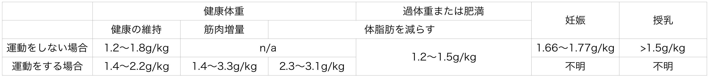

# プロテイン完全ガイド #1「ベストなタンパク質摂取量について改めて考えるの巻」

このブロマガについて「**マニアックな話が多すぎます！**」というご意見が増えてきたので（笑）、ちょっと基本にもどって**プロテインの話**でもしようかと思います。皆さまご存じ、筋肉はもちろん美肌やメンタルの安定にも欠かせない三大栄養素のひとつですな。

---

「パレオな男」でも散発的にプロテインの話は書いてたんですが、

- 近年のデータは意外と取り上げてなかった
- 体系的にプロテインのことをまとめてなかった

ってのがありまして、あらためて現時点での知見をさらって行こうかと思った次第です。

で、第1回目の今回は、プロテインについてもっともよく聞かれる「**毎日どれぐらいのタンパク質をとればいいんですか？**」って問題を深掘りしていきます。

## **厚労省が勧める超基本のタンパク質摂取量**

まず厚労省がお勧めする1日のタンパク質の目標量を見てみますと、2020年版はこんな感じになってます([R](https://www.nikkei.com/article/DGXMZO41611380S9A220C1CR8000/))。

- 18〜29歳＝男性65g、女性50g、または総カロリーの13〜20％
- 30〜49歳＝男性65g、女性50g、または総カロリーの13〜20％
- 50〜64歳＝男性65g、女性50g、または総カロリーの14〜20％
- 65〜74歳＝男性60g、女性50g、または総カロリーの15〜20％
- 75歳以上＝男性60g、女性50g、または総カロリーの15〜20％

この数字は日本人のタンパク質摂取量と健康レベルをくらべて出したものなので、とりあえずここを守っていれば生存に必要なラインは満たせるはずであります。

が、いっぽうでこのガイドラインは「体を壊さないためにはこれぐらいは取ろう！」ってラインを示していて、決して**最適なレベルを教えてくれてるわけじゃない**のが難点ではあります。たとえばタンパク質の最適なターンオーバー（新陳代謝）や免疫機能を万全に保つためには、もうちょい多めな量が必要じゃないかと考えられるわけです。

## 新たな検査法を使った場合の最適なタンパク質量

事実、ここ数年は複数の研究([R](https://www.ncbi.nlm.nih.gov/pubmed/17921376),[R](https://www.ncbi.nlm.nih.gov/pubmed/26962173),[R](https://www.ncbi.nlm.nih.gov/pubmed/25320185),[R](https://www.ncbi.nlm.nih.gov/pubmed/24429540))が「**従来の推奨量って、少なめに出てない？（特に65歳以上の高齢者は）**」って結論を出していて、

- **体重1kgあたり1.2gのプロテインがベターでしょ！**

と言った数値が一貫して出てたりするんですよ。

なんでこの数値がベターなのかと言いますと、上にあげた4つのレファレンスは、いずれもIAAOっていう新しい調査法を使ってるからです。従来のテストでは「窒素バランスを見る」って方法を使ったんですが、これは検査のためにかなりの時間が必要で、その間に体が低タンパク質に適応しhcアウケースが少なくなかったんですよ。

他方で、IAAOは必要なタンパク質量を測定するのに24時間しかかからないんで、窒素バランスよりは正確性が高め。その意味で、IAAOを使ったデータを参照したほうが実りが多いのではないかと思われるわけです。

## 運動をしている人のベストなタンパク質量

ただし、この1.2gって数値はそんなに運動してない人を対象に出たものなので、日々HIITやバーピーにいそしんでいるであろう皆さまの場合は、もっと多めのタンパク質が必要になります。運動量が多い人のタンパク量についてはまだそこまでの知見はないんですが、

- アメリカスポーツ医学会は、エクサイズからの最適なリカバリーに**1日1.2〜2.0g/kg**を推奨([R](https://www.ncbi.nlm.nih.gov/pubmed/26891166))

- 国際スポーツ栄養学会議も、**1.4〜2.0 g/kgのタンパク質を推奨**([R](https://www.ncbi.nlm.nih.gov/pubmed/28642676))

といったガイドラインを出してるんで、よく運動をする人が日々のパフォーマンスを維持したいなら、ここらへんを目指しておくのがいいでしょうね。

健康の最適化が目的なら上の数値でも問題ないですが、ここから「筋肉量アップ」や「筋力アップ」を目指すなら、さらに上の量をとっていきたいところです。この問題については2018年のメタ分析([R](https://www.ncbi.nlm.nih.gov/pubmed/28698222))がとても参考になりまして、49の先行研究をまとめた上で、

- **筋肉を増やすために必要なタンパク質は平均で1日1.6 g/kg。ただし人によっては1日2.2 g/kgが必要になる**

との結論を出しております。

## さらに運動上級者に向けたベストなタンパク質量

もっとも、このメタ分析であつかわれたデータは大半が筋トレビギナーを対象にしていてて、筋トレ歴が長い人をあつかったデータは4件しかふくまれてないのでご注意ください。その意味で、筋トレをスタートしてすでに1年が過ぎたような人は、**IAAOを使った最近のデータ**を参照したほうがいい気もしております。

具体的にどんな数値が出てるのかと言いますと、

- アスリートの女性を対象にしたテストでは、トレーニングの日には**1日1.4〜1.7 g/kg**が必要との結果が出ている([R](https://www.ncbi.nlm.nih.gov/pubmed/28692631),[R](https://www.ncbi.nlm.nih.gov/pubmed/30395050))

- 男性の持久系アスリートを対象にしたテストでは、トレーニングの翌日には**2.1〜2.7 g/kg**が必要との結果([R](https://www.ncbi.nlm.nih.gov/pubmed/30779631))

- アマチュアのボディビルダーを対象にしたテストでは、筋トレから2日の段階で**1.7〜2.2 g/kg**のタンパク質が必要だった([R](https://www.ncbi.nlm.nih.gov/pubmed/28179492))

というわけで、データによって数字に散らばりがあるものの、ざっくり1.4〜2.7g/kgぐらいを目指すイメージでしょうか。

ただし、以上のデータは「カロリーの摂取量が十分な場面」だけを想定してまして、たとえば腹筋を割るためにカロリー制限をしなければならないときなどは、さらにまた違った数値が必要になってまいります。具体的には、以下のような感じ。

- マクマスター大の2011年論文だと、カロリー制限中のアスリートは**1.8〜2.7 g/kg**が望ましいとのこと([R](https://www.ncbi.nlm.nih.gov/pubmed/22150425))

- さらに最近のデータでは、筋肉をできるだけ落とさずに減量をするには**2.3〜3.1 g/kg**のタンパク質が必要との報告が出ている([R](https://www.ncbi.nlm.nih.gov/pubmed/24092765))

というわけで、バキバキな体を作りたい場合は1日3g/kgという大量のタンパク質も視野に入れる必要がありましょう。

## 太り気味な方のタンパク質量は意外と低い

さて、ここまでは割とアクティブな人を対象にした数字を見てみてきたので、今度は過体重または肥満の方々に向けたタンパク質摂取量にも触れておきましょう。

現時点で体重が重め方がダイエットしたい場合は、実はそこまで大量のタンパク質は不要でして、複数のメタ分析([R](https://www.ncbi.nlm.nih.gov/pubmed/16469983),[R](https://www.ncbi.nlm.nih.gov/pubmed/23097268),[R](https://www.ncbi.nlm.nih.gov/pubmed/26883880))なんかを見てますと、

- 過体重または肥満の場合は、**1日1.2〜1.5 g/kgのタンパク質**で体脂肪の減少が最大化するよ！

ってな結果が報告されてたりします。ここらへんは意外と指摘されないポイントじゃないでしょうか。

## 妊娠中のタンパク質ガイドライン

最後に、妊娠中や授乳中の女性が必要なタンパク質量についても触れておきましょう。こちらについてもIAAOを使ったテストがいくつか出てまして、おおよそ以下のような報告が出てたりします。

- 妊娠11〜20週目は1.66 g/kg、妊娠32〜38週目は1.77 g/kgが良い([R](https://www.ncbi.nlm.nih.gov/pubmed/25527661),[R](https://www.ncbi.nlm.nih.gov/pubmed/27422521))

- 授乳がスタートしたら1.5 g/kgが良い([R](https://www.ncbi.nlm.nih.gov/pubmed/2309644),[R](https://www.ncbi.nlm.nih.gov/pubmed/8669411))

といった感じになります。こちらもおおまかな目安にしていただければと。

## まとめ

というわけでいろいろ書きましたが、最後に以上の話をまとめてざっくり表にしておきますんで、ご自分のライフスタイルに合わせてご調整いただければと。

ってことで、次回はプロテインパウダーについてのお話をまとめていく予定です。どうぞよしなに。
