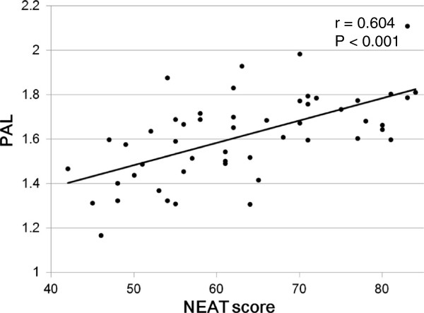

# 運動よりも大事なNEATレベルを高めるために使える36の質問

---

## **NEATを増やすのがなぜ大事なのか？**

「[パレオダイエットの教科書](https://amzn.to/2LdwUvA)」では、「**エクササイズしなきゃなぁ……と悩む前にまずはNEATを増やそうね！**」ってポイントを強調しているわけです。

NEATは「非運動性熱産生（Non-exercise activity thermogenesis）」の略で、スポーツみたいに意識的な運動で消費されるエネルギーではなく、家事やら通勤といった日常生活の中で無意識のうちに体を動かすことで消費されるエネルギーを意味しております。

全体の消費エネルギーのうち、NEATがしめる割合はだいたい15〜50％ぐらいと言われていて([R](https://www.ncbi.nlm.nih.gov/pubmed/28630601))、かなりのカロリーが日常の活動で使われているのは間違いないところ。実際、肥満の人ほどNEATが少ないって傾向はよく確認されていて、ある研究([R](https://science.sciencemag.org/content/307/5709/530))だと、太った人がNEATを増やすと1日352±65kcalを追加で消費できるようになるんだとか。無理してキツい運動をするならば、まずは先にNEATの増加をめざすほうが気楽に健康になれるのではないかと思う次第です。

NEATを高める具体的な方法は「[パレオダイエットの教科書](https://amzn.to/2LdwUvA)」に詳述しましたが、そこで気になるのが「**自分の現在のNEATってどれぐらいなんだろう？**」ってとこじゃないでしょうか。なんせNEATってのは「どれだけ掃除したか？」とか「どれだけ階段を使ったか？」みたいな細かい活動の積み重ねなんで、正確な数字を割り出すのが超難しいんですよ。

## 自分のNEATレベルをある程度まで判断する方法

といったところで今回は、「**自分のなんとなくのNEATレベル**」を判断する方法についてご紹介しようかと思います。ネタ元は自治医科大学の研究([R](https://www.ncbi.nlm.nih.gov/pubmed/25075310/))でして、いくつかの質問に答えるだけで、”ある程度”までNEATのレベルを判断できる尺度を作ってくださったんですよ。

具体的には、二型糖尿病に悩む日本人の男女51人を対象にした研究でして、全員について「NEAT尺度」の妥当性を確かめたところ「**NEAT尺度のスコアはPALと相関していた！**」という結論だったんですね。

PALってのは「身体活動レベル（physical activity level）」の略で、人が毎日行う活動のリストをベースに「日ごろからどれぐらい体を動かしているか？」を判断する方法のこと。そのリストは研究によって微妙に違うんですけど、だいたい以下のように判断します。

- 車イスを使用しているか、または寝たきり＝PAL1.2
- 座り仕事がメインで、自由時間もほとんど体を動かさない＝PAL1.4-1.5
- 座り仕事がメインだが、自由に散歩したり体を動かすことができる。ただし日常的にはほとんど体を動かさない＝PAL1.6-1.7
- 立ち仕事がメイン＝PAL1.8-1.9
- 体を使う仕事についているか、または余暇で積極的に体を動かしている＝PAL2.0-2.4

基本的には2.4を上回ると「アスリートレベル」なんで、願わくばPALが1.8〜2ぐらいは目指しておきたいところではないかと。

## NEATレベルを判断する36問

それでは、自分の「NEATレベル」をもとにPALを割り出す手法を見ていきましょう。まずは以下の36問にお答えください。

**1.** **職場までどれぐらい歩いて通勤してますか？**

1. ほとんどない（または、そもそも通勤していない）
2. 普通（歩く時間が30分以下）
3. 多い（片道30分より多く歩く）

**2. どれぐらい電車やバスを使いますか？（タクシーや自家用車はふくめない）**

1. ほとんどない（または、そもそも通勤していない）
2. 普通（週に1〜2回）
3. 多い（ほとんど毎日）

**3. 仕事中にどれぐらい歩きますか？（自分の感覚で判断）**

1. ほとんどない
2. 普通
3. 多い

**4. 歩行スピードはどれぐらいですか？**

1. 他人に追い越されるぐらい
2. 他の人と同じぐらい
3. たいていの人より速い

**5. 階段はどれぐらい使ってますか？****（自分の感覚で判断）**

1. ほとんどない
2. 普通
3. 多い

**6. 食料品や日曜品を買うために、どれぐらい外出しますか？**

1. ほとんどない（1日1回以上）
2. ときどき（週に1回以上）
3. 多い

**7. 歩いて外食に行く回数はどれぐらいですか？（ランチもディナーも含む）**

1. ほとんどない（週に1回以下）
2. ときどき（1日1回の外食を週に2〜5日ぐらい）
3. 多い（1日2回以上の外食を週に2〜5日ぐらい）

**8. ゴミ出しはどれぐらいやってますか？**

1. ほとんどない
2. ときどき（週に1回ぐらい）
3. 多い（週に4回以上）

**9. コンサート、映画、カラオケなどにどれぐらい出かけますか？**

1. ほとんどない
2. ときどき（月に1回ぐらい）
3. 多い（週に1回以上）

**10. どれぐらい子供と外で遊びますか？**

1. ほとんどない
2. ときどき（月に1回ぐらい）
3. 多い（週に1回以上）

**11. どれぐらい散歩に出かけますか？（犬の散歩なども含む）**

1. ほとんどない
2. ときどき（週に1回以上）
3. 多い（1日に1回以上）

**12. 負荷が軽い掃除をどれぐらいやってますか？（ゴミを拾うなど）**

1. ほとんどない
2. ときどき（週に1回以上）
3. 多い（1日に1回以上）

**13. 負荷が大きい掃除をどれぐらいやってますか？（掃除機をかけるとか床をふくとか）**

1. ほとんどない
2. ときどき（週に1回以上）
3. 多い（1日に1回以上）

**14. 負荷がかなり大きい****掃除をどれぐらいやってますか？（窓をふくとか車を洗うとか）**

1. ほとんどない
2. ときどき（月に1回以上）
3. 多い（週に1回以上）

**15. 料理の支度****はどれぐらいしますか？（料理だけでなくサービングも含む）**

1. ほとんどない
2. ときどき（週に1回以上）
3. 多い（1日に1回以上）

**16. 食事のあいだ、おかわりをしたり食器を取るために体を動かしますか****？****（自分の感覚で判断）**

1. ほとんどない
2. ときどき
3. 多い

**17. 食後にテーブルの上を片付けますか****？**

1. ほとんどない
2. ときどき（週に1回以上）
3. 多い（1日に1回以上）

**18. 食後に食器を洗いますか？**

1. ほとんどない
2. ときどき（週に1回以上）
3. 多い（1日に1回以上）

**19. 洗った食器を自分で拭いて棚に戻していますか？**

1. ほとんどない
2. ときどき（週に1回以上）
3. 多い（1日に1回以上）

**20. どれぐらい洗濯をしていますか？（洗い物を洗濯機に入れて取り出すまでを想定）**

1. ほとんどない
2. ときどき（週に1回以上）
3. 多い（1日に1回以上）

**21. どれぐらい洗濯物を干していますか？（洗い物を干してから畳むまでを想定）**

1. ほとんどない
2. ときどき（週に1回以上）
3. 多い（1日に1回以上）

**22. どれぐらいシーツやベッドカバーを洗っていますか？**

1. ほとんどない
2. ときどき（週に1回以上）
3. 多い（毎日）

**23. 布団の天日干しをどれぐらいしていますか？**

1. ほとんどない
2. ときどき（週に1回以上）
3. 多い（1日に1回以上）

**24. アイロンがけをどれぐらいしていますか？**

1. ほとんどない
2. ときどき（週に1回以上）
3. 多い（1日に1回以上）

**25. トイレや風呂場の掃除をどれぐらいしていますか？**

1. ほとんどない
2. ときどき（週に1回以上）
3. 多い（1日に1回以上）

**26. 家や庭の掃除をどれぐらいしていますか？**

1. ほとんどない
2. ときどき（週に1回以上）
3. 多い（1日に1回以上）

**27. 庭の草取りやガーデニングをどれぐらいしていますか？**

1. ほとんどない
2. ときどき（週に1回以上）
3. 多い（1日に1回以上）

**28. 植物への水やりをどれぐらいしていますか？**

1. ほとんどない
2. ときどき（週に1回以上）
3. 多い（1日に1回以上）

**29. ペットの世話をしていますか？**

1. ほとんどない
2. ときどき（週に1回以上）
3. 多い（1日に1回以上）

**30. 小さな子供の世話をしていますか？（服を着せたり一緒に遊んだりなど）**

1. ほとんどない
2. ときどき（週に1回以上）
3. 多い（1日に1回以上）

**31. 小さな子供を抱き上げることはありますか？（抱っこをしたり肩車をしたりなど）**

1. ほとんどない
2. ときどき（週に1回以上）
3. 多い（1日に1回以上）

**32. 高齢者や病人の世話をしていますか？**

1. ほとんどない
2. ときどき（週に1回以上）
3. 多い（1日に1回以上）

**33. どれぐらいお風呂に入りますか？（またはシャワーを浴びますか？）**

1. ほとんどない
2. ときどき（週に1回以上）
3. 多い（1日に1回以上）

**34. 裁縫や工作をすることはありますか？**

1. ほとんどない
2. ときどき（週に1回以上）
3. 多い（1日に1回以上）

**35. 楽器を演奏することはありますか？**

1. ほとんどない
2. ときどき（週に1回以上）
3. 多い（1日に1回以上）

**36. 自転車に乗ることはありますか？**

1. ほとんどない
2. ときどき（週に1回以上）
3. 多い（1日に1回以上）

## NEATの計算方法とPALの使い方

すべての採点が終わったら、自分がつけた答えの点数をすべて合計してくださいませ。このNEATスコアとPALの対応は、研究では以下のグラフのようになります。

ざっくりどんな風になるかと言いますと、

- NEAT40点＝PAL1.4
- NEAT50点＝PAL1.5
- NEAT60点＝PAL1.6
- NEAT70点＝PAL1.7
- NEAT80点＝PAL1.8
- NEAT90点＝PAL1.9
- NEAT100点＝PAL2.0

みたいな感じで判断していただくといいでしょう。特にこの質問は「NEATを増やすにはどうすればいいのだろう？」と悩んだときのチェックリストに使うのもいいですよね。自分の生活を振り返って「もうちょい掃除をしてNEATを稼ぐか……」みたいな（私のような子供がいない人間には当てはまらない項目も多いですが）。

また、ちょっとした応用として「今日の活動のためにどれぐらいカロリーが必要なんだろう？」ってのを知りたい時にもPALは使えたりします。具体的な方法としては、

1. まずは自分の基礎代謝を把握する（[BMR Calculator](https://www.calculator.net/bmr-calculator.html)を使うと楽）
2. 基礎代謝に自分のPALをかける

って感じです。たとえば基礎代謝が2000でPALが1.5なら、2000×1.5＝3000が「運動をなにもしない場合の今日の消費カロリー」だと判断できるわけですね。もちろんかなり大まかな計算にはなっちゃうんですが、なんとなくの活動レベルを知っておくと、生活のカスタマイズを行う際になにかと楽でいいんじゃないでしょうか。
