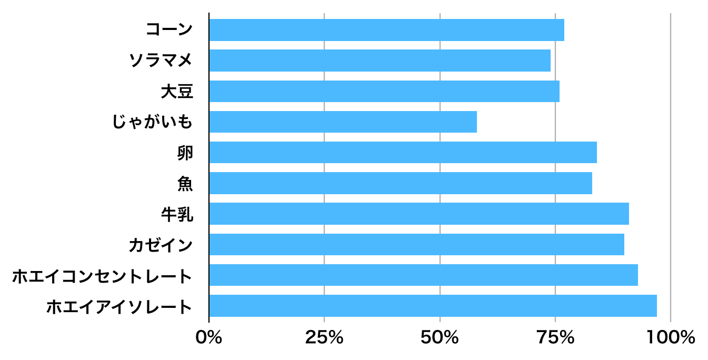

# プロテイン完全ガイド #2「プロテインパウダーのメリットについて改めて考える」

[前回](https://daigovideolab.jp/blog/1838827)に引き続きプロテインの話でーす。1回目は必要なタンパク質量の話をしましたが、今回は「**そもそもプロテインパウダーのメリットとデメリットって何？**」ってのをテーマにお送りします。

ご存じのとおり、このブロマガでもパレオな男でもホエイプロテインは推奨してきたわけですが、やはり何事にもメリットとデメリットはあるもんでして、やはりそのへんは押さえておきたいポイントじゃないかと。もちろんパレオダイエッターとしては「ホエイプロテインも加工食品だから、タンパク質は食事から取ろう！」と言いたい気もするわけですが、やっぱサプリならではの利点もありますからねぇ。

---

## **プロテインパウダーは肉の代用になるのか？問題**

ってことで、プロテインのプロコンを見ていくにあたり、まずは「**そもそもプロテインパウダーって食品の代わりに使えるの？**」ってポイントをまとめてみましょう。ビタミンにせよミネラルにせよ、体には欠かせない成分なのにサプリだとなぜか有意差が出ないってケースはままありますんで、食品との違いは知っておきたいところです。

が、実際のところ、「**プロテインパウダーと食品のタンパク質に違いはあるの？**」って疑問について調べたものって少なくて、かろうじて近い物としてはスキッドモア大学などのチームによる2016年論文([R](https://www.ncbi.nlm.nih.gov/pubmed/27187451))で、過体重の男女30人で食品とプロテインパウダーの違いを比べてくれております。

わりと癖が強い研究なので一般化がムズいんですけど、この結果だけ見る限りでは、

- **食品とプロテインパウダーの間で、フィットネスや体型に与える影響に違いはない！**

みたいになってます。まぁ細かいことにこだわらなければ、別にプロテインパウダーと食品の違いに拘泥する理由もないのかもしれません。

もっとも、一部の研究ではちょっとおもしろい結論も出ていて、

- 全乳とスキムミルクを比べた場合、全乳のほうが体のタンパク質合成量は増えた（つまり加工度が低い牛乳のほうが筋肉が増えるのかもしれない）([R](https://www.ncbi.nlm.nih.gov/pubmed/16679981))

- 黄身もふくめた卵と卵白のみを比べたら、卵を丸ごと食べた方がやはりタンパク質合成量は多かった([R](https://www.ncbi.nlm.nih.gov/pubmed/28978542))

といったあたりはやや気になる感じではあります。当然ながら、筋肉の増加にはアミノ酸以外の栄養素も関わるんで、そりゃあいろんなビタミンも取れたほうが有利ではありましょう（たとえば牛乳には[MGFM](https://yuchrszk.blogspot.com/2018/02/mgfm.html)って成分が入っていて、こいつが身体機能に良い影響を与えている可能性もある）。

そんなわけで現時点の結論はと申しますと、

- プロテインパウダーでも食品と劣らないレベルで筋肉の発達に役立つ可能性は高い

- ただし体を万全に機能させるって点では食品に分がある

ぐらいのもんでして、実に穏当なところに落ち着いた感じですかね。

## **プロテインパウダーのメリットとは？問題**

さて、上では「食品とパウダーに大きな違いはないけど、やや食品が有利か？」って話をしたわけですけど、だからといって「**タンパク質は完全に食品からとるべし！**」って話にはならないのがプロテインの難しさでありましょう。

もちろんパレオダイエットを徹底するなら食品のみを使うのが理想ながら、やはりプロテインパウダーを飲まねばならないケースもあるはず。具体的なポイントとしては、ざっくり以下のとおりです。

### なんせ手軽

20〜30gのタンパク質を取ろうと思ったら、そこそこのサイズの肉を調理しなきゃいけないので、体重1kgあたり1.6gを取るためにはプロテインパウダーを使った方が圧倒的に楽。

### なんせ安い

肉や魚からタンパク質をとるよりも、良質なプロテインパウダーを使った方がなんだかんだでコストがかからない。

### なんせ低カロリー

肉や魚からタンパク質をとると自動的に糖と油がついてくるんで、どうしてもカロリーはなりがち。たとえば、全乳パウダーとホエイプロテインのカロリーを比べても、100あたりざっと150kcalの違いがありますからねぇ。その点で、日々のカロリーを気にしている方にとってプロテインパウダーはかなり有用でしょう。

### なんせ生物学的利用能が高い

生物学的利用能ってのは超ざっくり言えば「**どんだけ体内でちゃんと消化吸収されるか？**」みたいなポイントでして、プロテインパウダーはここが非常に優秀なんですよ。具体的には以下のグラフみたいな感じ([R](https://www.ncbi.nlm.nih.gov/pubmed/26369006))。

基本的に豆類のような植物けのタンパク質は生物学的利用能が低くて、だいたい75％前後ぐらい。肉や魚はそれより数値がいいけどだいたい80％ぐらいのあたりになってます。それに比べてホエイプロテインは、コンセントレートもアイソレートもどちらも90％代をたたき出していて、いかに吸収率がいいかがわかりますねー。

また、食品から取るプロテインの弱点といえば他にもありまして、

- 植物系の食品は、タンニンやトリプシンインヒビターといった抗栄養素も入ってて、こいつがタンパク質の消化と吸収をさまたげちゃうこともわかっている([R](https://www.ncbi.nlm.nih.gov/pubmed/23107545))

- 豆にせよ肉にせよ、基本的にはよく噛まないと消化吸収率は低下する([R](https://www.ncbi.nlm.nih.gov/pubmed/22065771))。その点プロテインパウダーは何もしなくても十分な栄養が手に入る

といったあたりもポイントでしょう。この点では、「食事からちゃんとタンパク質を吸収できてるか自信がない……」とか「めんどうなことは考えずに確実にタンパク質を摂取しておきたい！」というニーズがある方にもプロテインパウダーは有用だと申せましょう。

### なんせ食後の満足感が高い

タンパク質は、糖や脂肪よりも食後の満腹感が大きいのは有名な話。脂質にくらべてタンパク質を増やしたほうが、確実に食欲の調整に効くんですよね。

そのメカニズムはやや複雑なんですけど、すごーくざっくり言うとタンパク質が脳の食欲コントロールセンターに働きかけるからだと考えられています([R](https://www.ncbi.nlm.nih.gov/pubmed/25771038))。もうちょいマニアックな説明をすると、

- 分解されたアミノ酸が視床下部のNPYやAgRPってシグナルを減らし、逆にPOMCやα-MSHのシグナルは増やす。いずれも空腹に関する神経回路と関わっており、脳にアクセスして食欲をコントロールする（別に覚えなくてもいいですけども）

- さらにタンパク質は[AMPK](https://yuchrszk.blogspot.com/2017/05/ampk.html)のシグナルを減らし、mTORの活性を増やす([R](https://www.ncbi.nlm.nih.gov/pubmed/16690869))。どちらも人体のなかでは燃料センサーのや件を果たしており、結果として食欲が制御される

みたいな話です。まぁ固有名詞は別に覚えなくても問題ないですが、とりあえず「タンパク質は体内のいろんな食欲センサーを調整してるんだなー」ぐらいにとらえていただければ幸いです。

ちなみに、プロテインパウダーの「食欲コントロール作用」は2種類の方向に役立ちまして、

- ダイエットしたい人が空腹をまぎらわすために使える

- 逆に食欲がなくて満足なタンパク質を取れない人のサポートにも使える（普通に肉を食べるよりは楽なので）

といったあたりはまことに有用ではないかと。特に高齢者の方などはタンパク質の必要量が多くなるわりに食欲が減りがちなんで、筋肉量を維持するためにもプロテインパウダーは使えるでしょうね。

## まとめ

ってことで今回の話をまとめると、

- やはり肉や魚からタンパク質を取った方が”やや”優勢だが、そこにこだわりすぎて必要量が満たせなかったら意味がない

- 特にプロテインパウダーは生物学的利用能と食欲コントロールの機能が高いので、そこだけを目当てに使うのもあり

みたいな感じになります。と、これだけ見るとプロテインパウダーはいいことだらけのようですが、もちろんいくつかの問題点もありますんで、次回はそのあたりをみていこうかと思います。
