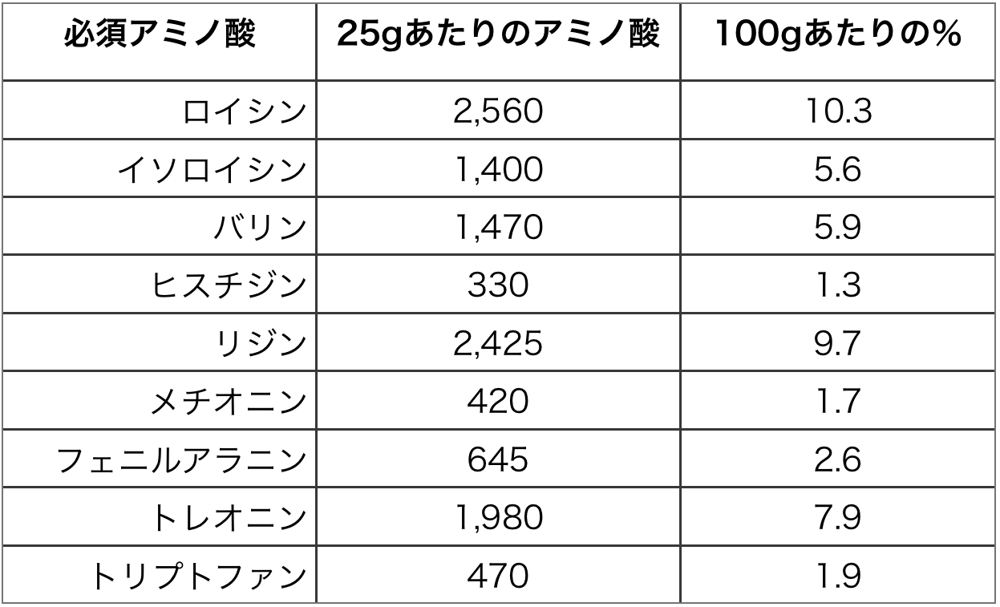

# プロテイン完全ガイド #3「プロテインパウダーのデメリットについて改めて考える」

またもプロテインの話でございます([#1](https://daigovideolab.jp/blog/1838827),[#2](https://daigovideolab.jp/blog/1843303))。[前回](https://daigovideolab.jp/blog/1843303)は「**プロテインパウダーを使うメリットとは？**」って問題を押さえましたんで、今回は逆に「**プロテインを飲むデメリットってあるの？**」って問題についてあれこれ考えていきまーす。

---

## **プロテインの汚染問題について考える**

といっても、前回も述べたとおり、プロテインパウダーそのものの機能については目立ったディスアドバンテージはないんで（というかメリットはかなり多い）、ここでは大きく以下の2つのポイントに絞ります。

1. 汚染
2. 水増し

ひとつ目の「汚染」はこのブロマガではおなじみの観点で、「**プロテインパウダーの製造過程で重金属やらプラスチックが混ざってないか？**」ってポイントのことです。

これはわりと昔から問題視されてるポイントで、プロテインパウダーの品質を調べた調査([R](https://www.ncbi.nlm.nih.gov/pubmed/24027186))などを見てると、

- 市場のプロテインの70％から検出可能レベルの鉛が見つかった

- 74％から検出可能レベルのカドミウムが見つかった

- 55％から検出可能レベルのBPAが見つかった

みたいな怖い結果が出てたりします。ここらへんの問題については、国内の製品を総合的に調べたデータがまだ少ないので、日本製プロダクトがどんなものかは未知数。メーカーが検査する義務もないので、どうにも判断が難しいんですよねぇ（テスト費用も高いので、わざわざ検査するケースも少ない）。

じゃあどうやって判断すりゃいいの？ってことですが、もちろんこの[ブロマガで紹介したプロダクト](https://daigovideolab.jp/blog/1758049)を選んでいただくのもアリですが、ほかの見分け方をざっくり考えてみると以下のようになります。

- **とりあえずメーカーのサイトを見てみる**：クオリティコントロールに厳しいメーカーさんの場合は、汚染を防ぐためのプロセスを公開してるケースも多かったりします。とりあえずメーカーサイトを訪ねてみて、品質管理へのこだわりが公開されてないかを見てみるのが吉。

- **FDAの警告書を見てみる**：アメリカ食品医薬品局は定期的にサプリの品質チェックをしていて、違反が見つかったら[公式サイトで公開](https://www.fda.gov/inspections-compliance-enforcement-and-criminal-investigations/compliance-actions-and-activities/warning-letters)してたりします。気になるプロダクトが警告を受けてないか、ここで検索してみるのも手ではあります。

- **第三者の認証機関を信じる**：サプリ系にはいくつか有名な検査機関がありまして、チェックをパスした商品には認証シールを与えてたりします。有名なところをあげてみると「[NFS](http://www.nsf.org/consumer-resources/what-is-nsf-certification)」や「[USP](https://www.usp.org/verification-services/verified-mark)」「[GMP](https://ispe.org/initiatives/regulatory-resources/gmp)」などがありまして、ここらへんの認証がついてればとりあえず安全（これはプロテイン以外にも言えることですが）。

まぁ中には認証を受けてない優良プロダクトも多いので一概には判断しづらいところではありますが、上記のポイントはとりあえず知っておいて損はないでしょう。

## プロテインの水増し問題について考える

で、次に問題となるのが「水増し」でして、ひとことで言うならば、

- そこまで重要じゃないアミノ酸を足して、パウダー内のタンパク質量を多く見せるパターン

のことです。どういうことかと申しますと、たいていの場合、プロテインの品質をチェックするときってアミノ酸がふくむ窒素の量を測るんですよ。窒素がこれぐらい検出されたから、この商品はこれぐらいのタンパク質がふくまれるんだなーって感じで。

なんだけど、実はこの手法って簡単にチートが可能でして、たとえば[グリシン](https://yuchrszk.blogspot.com/2013/09/blog-post_3.html)とか[タウリン](https://yuchrszk.blogspot.com/2018/03/blog-post_13.html)といった**安価なアミノ酸を混ぜ込んでおけば**、検出される窒素の量を増やせちゃうんですよ。残念ながら、これらのアミノ酸は筋肉の発達には貢献してくれないので、このタイプのプロテインを飲むと銭失いになりかねないんですな。

さらに、もうひとつ窒素の量を増やす方法としては、[クレアチン](https://yuchrszk.blogspot.com/2018/05/blog-post_70.html)や[ベータアラニン](https://yuchrszk.blogspot.com/2018/06/blog-post_24.html)などの窒素をふくむ成分を混ぜ込んで、あたかもタンパク質の総量が多いかのように見せかけるパターンもあったりします。こちらもコストを下げつつ見かけのタンパク量を増やせるんで、わりとよく使われる技法のひとつ。

つまり、たとえばラベルに「タンパク質25g！」と書いてあったとしても、その実態は15gがホエイで残りはグリシンとタウリンが5gずつ入ってるだけだったような可能性は十分にありますんで、気をつけておきたいところです。なかなか判断が難しい問題ですが。

## **プロテインの水増し問題について考える**

というわけで、この水増し問題を乗り越えるためにどうすべきかというと、ざっくり以下の対策が考えられましょう。

### 1. とりあえずロイシン（Leucine）の量に注目する

筋肉の発達に欠かせないアミノ酸といえばロイシン。プロテインを存分に活かそうと思ったらロイシンの総量をチェックするのが吉でありましょう。良心的なメーカーであれば、プロテインを構成するアミノ酸の量もちゃんと書いてるはずなんで。

ざっくりした基準としては、

- **プロテインの総量のうち11％はロイシンが入ってて欲しい！**

- ついでに、バリン、ロイシン、イソロイシン（いわゆるBCAAs）が全体の25％を占めてて欲しい！

ぐらいの感じになります。つまり、25gのプロテインあたりだいたい2.7gがロイシンだったほうがいいし、さらに6.25gはBCAAsが入ってたらいいわけっすね。

### 2. 成分表にアミノ酸が追加されてないかも見ておきたい

良心的な商品の場合は、成分表のイメージはこんな感じになります。

- ホエイプロテインアイソレート、ステビア、スクラロース

基本的なプロテインに多少の甘味料かフレーバーがついてるぐらいで、成分表示はだいぶシンプルなはず。一方でヤバいプロテイン表示は、

- プロテインブレンド（ミルクプロテインコンセントレート、ホエイプロテインアイソレート、ホエイペプチド）、**アミノマトリックス（タウリン、グリシン）**、ステビア、スクラロース

みたいな感じで、追加のアミノ酸がふくまれてたり「プロテインブレンド」という謎の表記が使われてたりします。あと海外製品の場合は「proprietary blend」って独自の表現を使ってたりしますんで、このような文字列を見かけたら要注意だとお考えください。

### 3. 典型的なアミノ酸バランスと比べる

たいていの場合、水増しが行われてないプロテインは、アミノ酸が以下の構成に近くなってるはずであります。なので、ひとまずはこの数字に近いものを選んでおくのが吉でしょう。

## まとめ

ってことで、今回は「プロテインのデメリット」……というか、ヤバいプロテインを選ばないためのガイドラインをお伝えしました。汚染と水増しはあんま指摘されないポイントかと思いますので、覚えておくといい感じです。

で、次回はさらに「ホエイプロテインそのもの」について深掘りしていこうかと思っております。どうぞよしなに。
