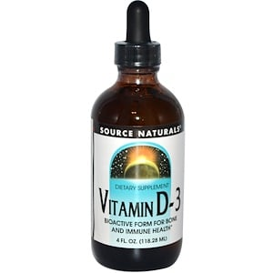
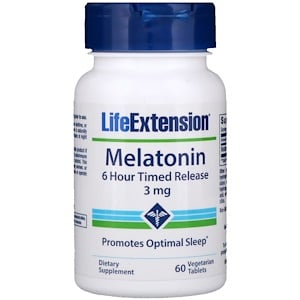
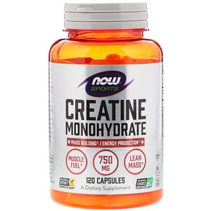
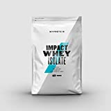
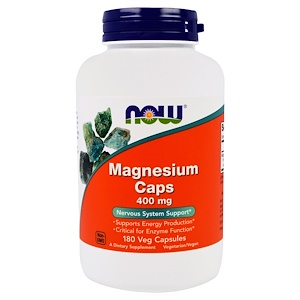
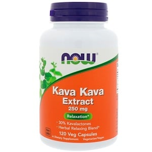
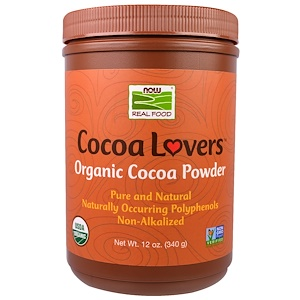
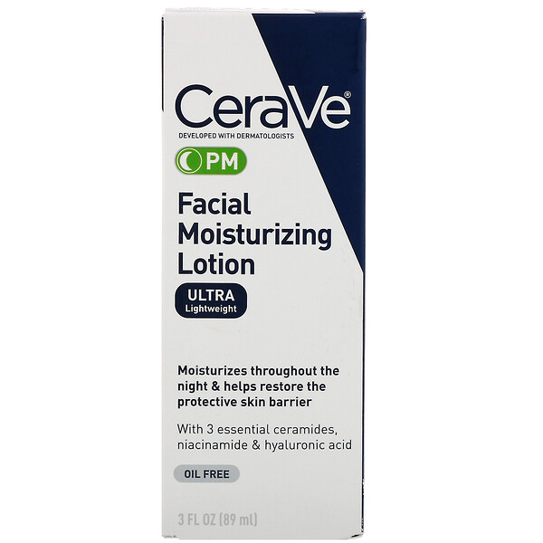
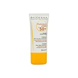

# 2019年版 いまスタメンで使っているサプリ＆食品

ってことで今年ももう終わり。このブロマガにご登録いただいた皆さまには、まことにお世話になりました。

---

というわけで2019年ラストのエントリは、いつもは「パレオな男」でやってた「[スタメンサプリ](https://daigovideolab.jp/search?channel_owner=paleo&word=スタメン)」をこちらでまとめる形にしてみようかと思います。

というのも、いま個人的に使ってるサプリって、このブロマガで取り上げた「**ベストなサプリ**」シリーズで取り上げた商品ばっかなんですよ。で、当たり前ですけど、皆さんに紹介した商品は自分でも使ってるんで、無料のブログで紹介しちゃったらこれを読んでる皆さんに悪いですからね。

いままでの「ベストサプリ」シリーズにどんなのがあったかと言いますと、

- [メラトニン](https://daigovideolab.jp/blog/1702900)
- [カカオニブとココアサプリ](https://daigovideolab.jp/blog/1680704)
- [ココア](https://daigovideolab.jp/blog/1673382)
- [ダークチョコレート](https://daigovideolab.jp/blog/1675611)
- [クレアチン](https://daigovideolab.jp/blog/1730693)
- [カテキン系サプリ](https://daigovideolab.jp/blog/1727383)
- [マグネシウム](https://daigovideolab.jp/blog/1689050)
- [リコピン](https://daigovideolab.jp/blog/1736888)
- [ビタミンK](https://daigovideolab.jp/blog/1694258)
- [アシュワガンダ](https://daigovideolab.jp/blog/1729407)
- [ビタミンD](https://daigovideolab.jp/blog/1683818)
- [レスベラトロール](https://daigovideolab.jp/blog/1705645)
- [NAC](https://daigovideolab.jp/blog/1744334)
- [ロディオラ](https://daigovideolab.jp/blog/1732528)
- [亜鉛](https://daigovideolab.jp/blog/1748627)
- [テアニン](https://daigovideolab.jp/blog/1746638)
- [ココナッツオイル＆MCTオイル](https://daigovideolab.jp/blog/1738966)
- [オリーブオイル](https://daigovideolab.jp/blog/1674608)
- [アセチルL-カルニチン](https://daigovideolab.jp/blog/1752830)
- [ヨヒンベとアルギニン](https://daigovideolab.jp/blog/1768855)
- [クルクミン](https://daigovideolab.jp/blog/1780818)
- [シナモン](https://daigovideolab.jp/blog/1778880)
- [マカ](https://daigovideolab.jp/blog/1768911)
- [リコピン](https://daigovideolab.jp/blog/1810160)
- [ガーリック](https://daigovideolab.jp/blog/1791155)
- [プロテイン](https://daigovideolab.jp/blog/1758049)
- [ショウガ抽出物](https://daigovideolab.jp/blog/1820385)
- [トリプトファン](https://daigovideolab.jp/blog/1804716)

みたいなのがありまして、こうして見るといろいろ書いてきたもんですなぁ。では、このなかからいま自分が主に使ってるものを並べていきます。

## **定番サプリ**

まずは毎日のように使っている定番中の定番からです。

#### ▼ビタミンD

[Source Naturals, ビタミン D-3](https://jp.iherb.com/pr/Source-Naturals-Vitamin-D-3-4-fl-oz-118-28-ml/20849?rcode=IRO489)

Source Naturals

[iHerb](https://www.blogger.com/u/1/%E2%80%9Chttps://jp.iherb.com/pr/Healthy-Origins-5-HTP-100-mg-120-Veggie-Caps/14472?rcode=IRO489%E2%80%9D)

もはや説明するまでもないぐらい取り上げてますが、相変わらず[ビタミンD](https://yuchrszk.blogspot.com/2016/01/d.html)は継続してとっております。正直リキッドタイプってめんどうなんですけど、まぁ機能と安全性を考えるとこれがいいのかな、と。

#### ▼メラトニン

[Life Extension, メラトニン, 6時間徐放](https://jp.iherb.com/pr/Life-Extension-Melatonin-6-Hour-Timed-Release-3-mg-60-Vegetarian-Tablets/47831?rcode=IRO489)

Life Extension

[iHerb](https://jp.iherb.com/pr/Life-Extension-Melatonin-6-Hour-Timed-Release-3-mg-60-Vegetarian-Tablets/47831?rcode=IRO489)

メラトニンといえばかつてはナイトレストってのを使ってたものの、実感としてタイムリリース型の方がぐっすり感があったため現在ではこちらを使ってます。

#### ▼クレアチン

[クレアチンモノハイドレート](https://jp.iherb.com/pr/Now-Foods-Sports-Creatine-Monohydrate-750-mg-120-Capsules/485?rcode=IRO489)

Now Foods

[iHerb](https://www.blogger.com/u/1/%E2%80%9Chttps://jp.iherb.com/pr/Healthy-Origins-5-HTP-100-mg-120-Veggie-Caps/14472?rcode=IRO489%E2%80%9D)

おなじみ[トレーニング用サプリ](https://yuchrszk.blogspot.com/2017/01/blog-post_18.html)で、2018年は使ってなかったものの、2019年は中盤から[運動量を増やした](https://yuchrszk.blogspot.com/2019/12/blog-post.html)のもありまして、スタメンに返り咲きました。ちなみに、「使ってる商品がブロマガで紹介したのと違くない？」というご指摘もありましょうが、取り上げたのがずーっと在庫切れなもんで（笑）

## **不定期に使うサプリ**

続きましては、特別な状況下で不定期に使ってるサプリです。

#### ▼プロテイン

[マイプロテイン ホエイプロテイン アイソレート ノンフレーバー 1kg](//af.moshimo.com/af/c/click?a_id=790466&p_id=170&pc_id=185&pl_id=4062&url=https%3A%2F%2Fwww.amazon.co.jp%2Fdp%2FB00L4ACMAQ)

いままではタンパク質は鶏胸肉をメインにしてたものの、近年は昔よりも外食に誘っていただくケースが増えましたんで、手軽なタンパク調整用に使っております。最近は入手がしやすいマイプロテインがメイン。

#### ▼マグネシウム

[Now Foods, マグネシウムカプセル](https://jp.iherb.com/pr/Now-Foods-Magnesium-Caps-400-mg-180-Veggie-Caps/662?rcode=IRO489)

Source Naturals

[iHerb](https://jp.iherb.com/pr/Now-Foods-Magnesium-Caps-400-mg-180-Veggie-Caps/662?rcode=IRO489)

こちらも使用の理由は上と同じで外食時のサポート用です。マグネシウムを外食で取るのって意外と難しいんで。

#### ▼ポリフェル

[Polyphel（ポリフェル）](https://jp.iherb.com/pr/Now-Foods-Magnesium-Caps-400-mg-180-Veggie-Caps/662?rcode=IRO489)

パレオな商品開発室

手前味噌でございますが、パレオな商品開発室で出したアントシアニンサプリも定期的に使っております。ちょっとした出張とか長期の海外旅行とか、そうそう簡単にブルーベルーが手に入らないような状況下では非常に役立ちますねー。

#### ▼カヴァカヴァエキス

[カヴァカヴァエキス](https://jp.iherb.com/pr/Now-Foods-Kava-Kava-Extract-250-mg-120-Veg-Capsules/665?rcode=IRO489)

Now Foods

[iHerb](https://www.blogger.com/u/1/%E2%80%9Chttps://jp.iherb.com/pr/Healthy-Origins-5-HTP-100-mg-120-Veggie-Caps/14472?rcode=IRO489%E2%80%9D)

[不安解消に定評がある](https://yuchrszk.blogspot.com/2016/05/blog-post_8.html)ハーブエキスです。私が使ってるのは主に睡眠用ですが、常用すると肝臓に悪いので、どうにも感情が高まって気が休まらない時だけ使用してます。

#### ▼ココア

[Now Foods, リアルフード、ココアラバーズ](https://jp.iherb.com/pr/Now-Foods-Real-Food-Cocoa-Lovers-Organic-Cocoa-Powder-12-oz-340-g/5023?rcode=IRO489)

Now Foods

[iHerb](https://jp.iherb.com/pr/Now-Foods-Real-Food-Cocoa-Lovers-Organic-Cocoa-Powder-12-oz-340-g/5023?rcode=IRO489)

サプリというか食品ですが、なんせ食物繊維とポリフェノールを同時に取れる優良食なんで、やっぱ定期的に口にしてますねー。

## 美容系

最後は美容系です。例年はワセリンをメインに使ってましたけど、最近はちょっといろんなものも試してみようってことで、「[ザ・スキンケア # 11「推奨プロダクト編」](https://daigovideolab.jp/blog/1826228)」で取り上げたものをいくつか使ってます。

#### ▼保湿

[CeraVe, PMフェイシャルモイスチャライジングローション](https://jp.iherb.com/pr/CeraVe-PM-Facial-Moisturizing-Lotion-3-fl-oz-89-ml/96135)

セラヴィ

[iHerb](https://jp.iherb.com/pr/CeraVe-PM-Facial-Moisturizing-Lotion-3-fl-oz-89-ml/96135)

私はわりとドライスキン気味なんで、セラヴィのローションなどを試しに使ってたりします。いろいろ試したら自分には合ってたみたいで、わりといい感じにモチモチしてたりします。

#### ▼日焼け止め

[
ビオデルマ フォトデルムUVスポット50+ 30g](//af.moshimo.com/af/c/click?a_id=790466&p_id=170&pc_id=185&pl_id=4062&url=https%3A%2F%2Fwww.amazon.co.jp%2Fdp%2FB00CLIV8JG)

まぁ「パレオな男」で紹介している[バジャーのサンスクリーン](https://jp.iherb.com/pr/Badger-Company-All-Season-Face-Stick-Sport-Sunscreen-SPF-35-Unscented-65-oz-18-4-g/23456)も相変わらず使ってますが、リゾートみたいに日差しが強いところでは50＋を使ってたりします。そんな変なものも入ってないので、非常によろしいのではないでしょうか。

## まとめ

以上、2019年時点でのスタメンサプリでした。以前は食品も紹介してましたけど、[2018年の内容](https://yuchrszk.blogspot.com/2018/12/2018-15.html)とほぼ変わらないので割愛します。おそらく来年はもうちょい運動量を増やしていくかもなんで、それに適したサプリを選んでいく予定であります。

というわけで、本年度はお世話になりました。また来年もよろしくお願いしまーす。
