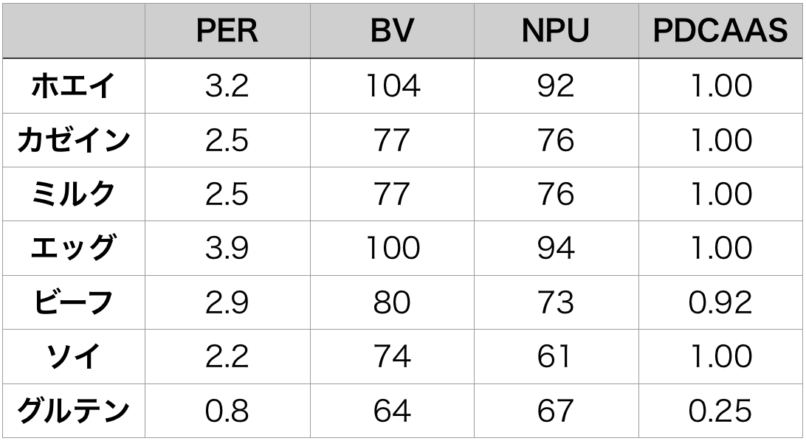

# プロテイン完全ガイド #4「ホエイプロテインFAQその1」

あらためてプロテインについてガッツリ考えるシリーズの第4回です([#1](https://daigovideolab.jp/blog/1838827),[#2](https://daigovideolab.jp/blog/1843303),[#3](https://daigovideolab.jp/blog/1844773))。前回は「ヤバいプロテインを選ばないためのガイドライン」について考えてみましたが、今回はさらに的を絞って「**ホエイプロテイン**」について知っておきたい話をまとめておこうかと。

---

## **あらためてホエイプロテインの凄さを確認してみよう**

さて、ホエイといえば、言わずと知れた**プロテインパウダーの王**でして、市場に出回るプロテインのおよそ8割を占めてたりします。それもそのはずで、プロテインってのは主に2つの指標で質を判断するんですが、

1. バイオアベイラビリティ：飲んだプロテイン がどれだけ全身に作用するかどうか
2. EAAの構成：必須アミノ酸がどれぐらい入ってるか

この両方の基準において、ホエイプロテインは他のプロテインを確実に凌駕するんですよ。

具体的に、メジャーな指標をもとにいろんなプロテインの質を評価すると、こんな感じです。

それぞれの指標の意味を簡単に説明しますと、

- PER（タンパク質効率比）＝食べたタンパク質1gあたり何g体重が増加したかを示す値
- BV（生物価）＝摂取したタンパク質の利用効率を表す指標
- NPU（タンパク正味利用率）＝成長中の動物に与えたタンパク質1gについて体重が何g増加したかを示す値
- PDCAAS（たん白質消化吸収率補正アミノ酸スコア）＝必須アミノ酸のバランスと、それがどれぐらい吸収されやすいかを示す指標

ってことで、まぁここらへんは覚えなくてもいいんですけど、とにかく「ホエイは強いんだなー」ってとこがわかれば十分であります。

さらに、ホエイは必須アミノ酸の割合が大きくて、なかでもロイシン（筋肉発達に重要なアミノ酸）の量が多い([R](https://www.ncbi.nlm.nih.gov/pubmed/26224750))のがポイント。具体的には、

- ホエイ＝必須アミノ酸が54％ぐらいで、ロイシンがだいたい13〜14 ％
- その他のタンパク源＝必須アミノ酸が40〜45％ぐらいで、ロイシンがだいたい7〜8 ％

みたいになってて、この数値にはカゼインも卵もかなわないところっすね。

つまり、すべてをひっくるめると、

- **ホエイプロテインは必要なアミノ酸が多い上に吸収率も高い！**

ってことでして、そりゃあ筋肉の発達には役立つだろうなーって感じであります。

## ホエイの筋肉増加以外のメリット

ホエイには、アミノ酸のほかにも**生理活性ペプチド**が入ってたりします。これはアミノ酸が2個以上つながったもので、体内で分解されずにいろんなメリットをもたらしてくれることがわかってるんですよ([R](https://www.ncbi.nlm.nih.gov/pubmed/25880525),[R](https://www.ncbi.nlm.nih.gov/pubmed/25387326),[R](https://www.ncbi.nlm.nih.gov/pubmed/16076145))。

なかでもホエイがナイスなのは、

- 心疾患リスクを下げる
- 免疫システムに良い

って可能性が高い生理活性ペプチドをふくんでるとこでして([R](https://www.ncbi.nlm.nih.gov/pubmed/27579006))、「母乳で育った子供の心疾患や肥満リスクが低いのはそのせいじゃない？」などと言われてたりもします（まぁここらへんはまだまだ謎が多いんだけど）。

では、ざっくりどんな生理活性ペプチドが入っているかと言いますと、

- **β-ラクトグロブリン**：血圧を下げて免疫システムを改善する可能性がある。
- **α-ラクトアルブミン**：血圧を下げて認知機能に働きかける可能性がある。同時に免疫システムの改善や抗酸化性能も持つ。
- **免疫グロブリン**：免疫システム改善に役立つ…かも
- **血清アルブミン**：抗酸化作用が高い
- **ラクトフェリン**：食欲を低下させる可能性がある

といったところです。ここらへんもまたホエイプロテインの嬉しいポイントでしょう（まだ効果量に関してはよくわからんとこですけど）。

## ホエイプロテインに関する定番の疑問#1

ってことで、ホエイプロテインに関する基礎知識を押さえたところで、ここからはホエイについてよく尋ねられることについてまとめていきたいと思います。

### ホエイプロテインって変性してないの？

プロテインパウダーも加工食品ではあるので、「**パウダーの製造過程でタンパク質が変性しちゃうんじゃないの？**」ってのはやはり気になるところ。たいていのプロテインは加熱殺菌した牛乳を使いますんで、そこでなんらかの問題が起きるのでは？って考えもやはり浮かびましょう。

で、一般的な殺菌がどんなふうに行われるかと言うと、

1. 72℃で15秒だけ加熱
2. そこから急速に冷やす

といった感じでして、俗にHTST（高温短時間殺菌）と呼ばれる手法ですね。果たして、これでタンパク質が変性するのかと言いますと、

- 現時点では問題なし！

って感じだと思われます。くわしい解説は避けますが、これはかなり複数の研究([R](https://www.ncbi.nlm.nih.gov/pubmed/27060826),[R](https://www.ncbi.nlm.nih.gov/pubmed/25704975),[R](https://www.ncbi.nlm.nih.gov/pubmed/26026762),[R](https://www.ncbi.nlm.nih.gov/pubmed/25958286))で認められてる話なんで、まずは信頼してもいいかな、と。

もっとも、ミルクの殺菌にはもうひとつ「低温殺菌」を使ってるケースもありまして、こちらは63℃で30分ほど熱を加える感じになってます。プロテインパウダーのなかにはこっちを使ってるメーカーもあるはず。

やや低温とはいえ30分の加熱は気になってしまうところですが、現時点では2つのデータ([R](https://www.ncbi.nlm.nih.gov/pubmed/28316470),[R](https://onlinelibrary.wiley.com/doi/abs/10.1111/j.1745-4603.1981.tb00545.x))がありまして、これらを見てる限りでは、

- だいたい10〜20％ぐらいは変性してるかも

ぐらいのことは言えそうであります。まぁそうはいっても、この変性でアミノ酸の意味がなくなるわけじゃないんですが、上にあげた生理活性ペプチドのご利益はやや低くなってる可能性があるかなーって感じですね。

### オーガニック系のホエイプロテインってアリ？

数あるプロテインのなかにはオーガニックを売りにしてるものも[いくつかありまして](https://amzn.to/2PEQrYx)、何となくいいのかな〜？って雰囲気を漂わせてるわけです。

が、オーガニックな牛と従来のやり方で採取されたミルクを比べたデータ([R](https://www.ncbi.nlm.nih.gov/pubmed/28372247))などをみてますと、「**ホエイプロテインの組成に目立った違いはなし！**」みたいな結論でして、そこまでこだわる必要もないんじゃないかなーという気がしております。また別の研究を見ても、

- オーガニックにより、いくつかの生理活性ペプチドが増える可能性があるが、一方で減る生理活性ペプチドもある([R](https://www.ncbi.nlm.nih.gov/pubmed/22549884))

- オーガニックとコンベンショナルな牛乳に、意味のある違いはなさそう([R](https://www.ncbi.nlm.nih.gov/pubmed/28624284))

みたいな結果が出てまして、なにがしかの違いはあるかもしれないものの、基本的には気にしなくてよさげ。もちろんオーガニックについては倫理的な側面もあるんで、いちがいに無意味とは申しませんが、とりあえず栄養価については同じようなもんかな、と。

## **ホエイプロテイン編#2に続く**

というわけで、思いつくままに書いてたらそこそこの文字数になったんで、次回もホエイプロテインの話は続きます。具体的には、「ホエイでアレルギーが出たら？」とか「プロテインのフィルタリング法ってどこまで大事なの？」とか「コンセントレートとアイソレートはどっちがいい？」みたいな話をしようかと思いまーす。
