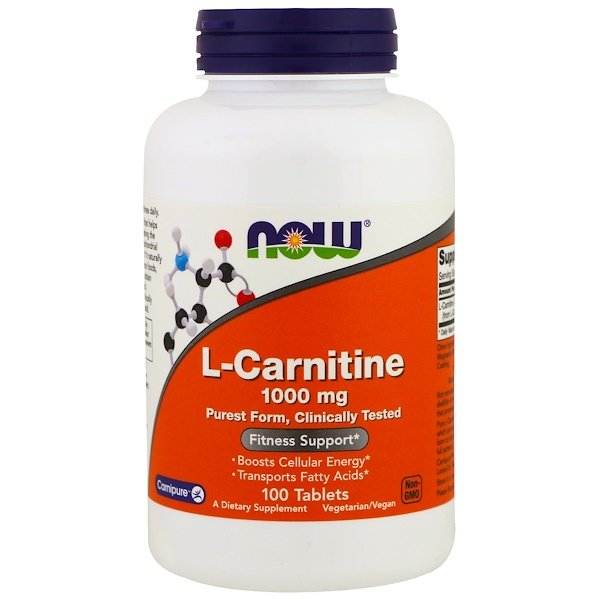

# 【最新版】アンチエイジングに役立ちまくる「健康系メタ分析」4選

メタ分析のありがたさは[皆さまご承知のこと](https://yuchrszk.blogspot.com/2016/01/blog-post_12.html)と存じます。もちろんメタ分析で出た結果とてうのみにできないのは大前提ながら、やはり情報の海を泳ぐ指針になるのは確かでしょう。

というわけで、ここ最近も健康の分野でいい感じのメタ分析がいくつか出てましたんで、特に現実への適用がしやすそうなものをピックアップしておきます。わりとアンチエイジングに役立つ話が揃ってるんじゃないかと。

---

## プロテインでぐっすり眠れるようになるか？

睡眠の質を上げる食事法として、「パレオな男」では「[夕食にちゃんと糖質を取ろうねー](https://yuchrszk.blogspot.com/2016/11/blog-post_13.html)」みたいな話を書いてきたわけですが、新たなメタ分析([R](https://www.ncbi.nlm.nih.gov/pubmed/31906452))は「**高タンパクで睡眠は改善するか？**」ってポイントを調べてくれていて有用でした。

プロテインと睡眠の関係はあまり耳にしないかもしれませんけど、糖質と同じくアミノ酸も睡眠ホルモンの産生に欠かせないんですよ。事実、「パレオな男」でも過去に「[高タンパクで睡眠が改善するかも？](https://yuchrszk.blogspot.com/2016/04/blog-post_10.html)」なんて[RCT](https://yuchrszk.blogspot.com/2016/01/blog-post_12.html)を取り上げたことがありまして、可能性はそこそこ高いんですね。

ってことで、この最新のメタ分析では19件のデータをまとめてまして、そのうち15件は観察研究で、残り4件がRCTという内訳になってます。まだまだデータとしては少ないものの、貴重な研究だと言えるでしょう。

でもって、分析の結果はこんな風になってます。

- 観察研究のデータからは、睡眠の良い人ほどタンパク質の摂取量が多い傾向が確認された

- より精度高いRCTのデータでは、睡眠時間が長いグループ（1日7時間以上）のタンパク質摂取量が総カロリーの30%だったのに対し、睡眠時間が短いグループ（1日7時間未満）は18.3%だった

- 睡眠の質が高いグループのタンパク質摂取量が総カロリーの22.5%だったのに対し、睡眠の質が低いグループは16.7%だった

- 眠りにつくまでの時間が短いグループのタンパク質摂取量が総カロリーの31.1%だったのに対し、眠りにつくまでの時間が長いグループは20%だった

というわけで、ぐっすり眠れている人たちは、ほぼほぼ日中に大量のタンパク質を摂取している傾向があったそうな。

というわけで、観察研究とRCTの両方が「高タンパクは睡眠の質を上げる！」って可能性を示唆していまして、この結論はまず間違いないんじゃないかと。いちおう研究チームは「逆相関の可能性もあるから気をつけてね！」とは言ってるんですが（つまり、高タンパクが良い眠りにつながるのではなく、よく眠る人ほどタンパク質を欲するのでは？って話ですね）、まぁ個人的には「それはないだろう！」と思っております。普通にメカニズムを想像すれば、高タンパクが睡眠改善をもたらすと考えるのが自然ですからね。

もっとも、今回のメタ分析だけだと「睡眠の質を高めるためにはタンパク質をどれだけ摂ればいいの？」ってとこまではわからないわけですが、全体的なデータからざっくり推定を出すと、

- ****1日の総摂取カロリーの25〜30%をタンパク質にしておく！****

ぐらいに考えておけば良さそうであります。1日2000kcalが必要な人の場合は、だいたい1日150gのタンパク質をとる計算ですね。とりあえず、タンパク質は筋肉だけではなく睡眠にも必須！ってのは覚えておきたいところです。

## **減塩はほぼ確実に心臓病リスクを下げる。現時点でまったくリスクがなくても下げる**

**減塩は意味があるのか？**と問われれば「そりゃあるでしょ」と思うかもしれませんが、これには反論もあって、一部のお医者さんからは「減塩しても意味なくない？」といった異議も出てたりするんですよ。

というのも、[PURE研究](https://www.ebm-library.jp/circ/trial/doc/c2005343.html)っていう大規模な調査では、塩分は取りすぎても減らしすぎても体を壊す！みたいな結論が出てるもんですよね。減塩と言うと常識のようですが、意外と決着がついてなかったりするわけですね。

ってことで、近ごろ「**減塩は心臓病に効くの？**」って問題をガッツリ調べたメタ分析([R](https://www.mdlinx.com/journal-summaries/blood-pressure-hypertension-dietary-sodium/2020/02/25/7611391))が出まして、これが非常にいい感じです。

このメタ分析のなにが良いかというと、「PURE研究よりも精度が高い試験のデータを使ってる」ところです。PUREではナトリウム排泄量を推定するために短時間の尿検査データしか使ってませんで、これだと「正確な濃度は判定できないのでは？」と以前から言われてたんですよ。

そこで、このメタ分析で抽出された133件のRCTでは、ナトリウム排泄量の推定に24時間蓄尿検査（ 1日の尿をすべてためてその一部を提出する）を採用したデータだけをあつかっていて、現時点ではかなり信頼レベルが高い内容になってるんですね。

被験者の総数は12,197人で、分析の結果何がわかったかと言いますと、

- ナトリウムの排泄量が50mmo下がると、**いまの時点で血圧が異常な人も正常な人でも、どちらも最高血圧が下がる**

- 最高血圧のベースラインとそれぞれの改善値は以下のとおり
  - <120 mmHg; –0.39 (95% CI, –.061 to –0.18)
  - ≥120 〜 <130 mmHg; –1.21 (95% CI, –1.87 to –0.55)
  - ≥130 〜 <140 mmHg; –2.23 (95% CI, –2.89 to –1.57)
  - ≥ 140 〜 <150 mmHg; –3.23 (95% CI, –3.88 to –2.59)
  - ≥150 〜 <160 mmHg; –2.68 (95% CI, –3.55 to –1.81)
  - ≥160 mmHg; –2.97 (95% CI, –4.34 to –1.60)

みたいになってます。うーん、これはなかなか強力なデータですね。

では、具体的に1日の塩分のリミットをどう考えればいいかと言えば、WHOなどは「1日のナトリウムは2gまで（つまり食塩で5g）」と推奨してまして、まずはこのレベルをお守りいただくのが良いかと思われます。1日5gの食塩ってのは、スナック菓子なんかを食べると余裕で超えますんで、くれぐれもご注意ください。

## ポートフォリオ・ダイエットは、割と確実に病気のリスクを下げる

「**ポートフォリオ**・**ダイエット**」ってのは耳慣れない言葉かもしれませんが、すごく簡単に言うと、

- **もっと植物をいっぱい食べようぜ！**

って食事法のことです。以前から血管の若返りに効くと言われていて、具体的な食べ方としては、

- 毎日42gのナッツ類かピーナッツを食べる
- 毎日50gの豆類からタンパク質をとる（豆腐とか納豆とか）
- 毎日20gの水溶性食物繊維をとる
- 毎日2gの植物ステロールをとる

ってポイントさえ守ればOKであります。いずれも昔からコレステロールの低下には定評がありまんで、おそらくポートフォリオ・ダイエットも効くだろうなーとは考えられてきたんですよ。

で、新たなメタ分析([R](https://doi.org/10.1016/j.pcad.2018.05.004))は、ポートフォリオ・ダイエットの効能についてガッツリと調べてくれていて、参考になります。

これはMEDLINEやEMBASEなどからポートフォリオ・ダイエットに関する7件をまとめたもので、439人分のデータをまとめた内容になってます。実験の質は全体的にそこそこなんですけど、ポートフォリオ・ダイエットに関するデータは少ないのでよろしいのではないでしょうか。

その結論をざっくり抜き出すと、こんな感じになります。

- ポートフォリオ・ダイエットを続けるとLDLコレステロール（いわゆる悪玉）が17％低下する

- 心臓病のリスクが13％下がる

- ついでに総コレステロール、中性脂肪、血圧、CRP（体内の炎症マーカー）も改善する

というわけで、この数値を見る限り「**ポートフォリオ・ダイエットは臨床的に意味があるレベルでアンチエイジングに効く！**」と言って良さそうなレベルに達しております。まぁこのブロマガの読者さんであれば、ポートフォリオ・ダイエットの基準を満たすレベルの野菜はすでに食べてそうな気もしますが、わかりやすい食事のガイドラインとして参考にしていただければ。

## L カルニチンもそこそこ確実に病気のリスクを下げる

L カルニチンといえば肉に入ってるアミノ酸の一種。俗に「[ダイエットに効く](https://yuchrszk.blogspot.com/2016/10/blog-post_97.html)」などと言われてる成分で、脂肪の代謝や血管の健康に大事な働きをしております。

そのため、昔から「[心疾患リスクを下げるのでは？](https://yuchrszk.blogspot.com/2017/04/blog-post_20.html)」と言われてきたんですけど、近ごろ良い感じのメタ分析([R](https://www.clinicalnutritionjournal.com/article/S0261-5614%2819%2930038-X/fulltext))が出ておりました。おそらくカルニチンと心疾患リスクについて調べたメタ分析は初めてなんで、とてもよろしいのではないでしょうか。

こちらは24件のRCTのデータをまとめたもので、その内訳を並べておくと、

- 大部分の試験はイタリアで実施されていて、残りはメキシコや韓国、中国、台湾で行われている

- 試験に使われたLカルニチンの用量は1日500mg〜4,000mg

- 試験期間は4週間〜48週間の範囲

みたいになってます。全体的なデータの質は「そこそこ」って感じですが、とりあえず研究としては大きな一歩ということで。

で、その結論を大きくまとめるとこんな感じになります。

- Lカルニチンのサプリは、総コレステロールの低下（平均14mg/dL）、LDLコレステロールの低下（平均7.7 mg/dL）、HDLコレステロールの増加（平均0.8 mg/dL）を有意に改善する

- ついでに、空腹時血糖やHbA1Cなど血糖コントロールの数値も有意に改善したが、これは12週間以上の試験でのみ観察された

- Lカルニチンでコレステロールを改善するためには、1日1500mg以上が必要と思われる

ということで、個人的には「思ったより良い成果が出ている……」って印象でした。コレステロールにお悩みの方なら試す価値があるかもですねー。

[Now Foods, L-Carnitine, 1000 mg, 100 Tablets](https://www.iherb.com/pr/Now-Foods-L-Carnitine-1000-mg-100-Tablets/2507?rcode=IRO489)

Now Foods

[iHerb](https://www.iherb.com/pr/Now-Foods-L-Carnitine-1000-mg-100-Tablets/2507?rcode=IRO489)
