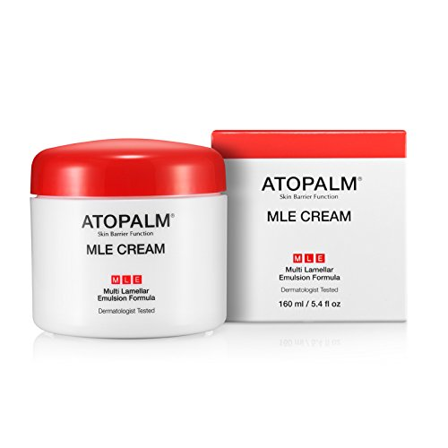

# 老化の最大原因「慢性炎症」を徹底的に改善するために"あれ"が超役に立つぞ！というお話

こないだ「[正しいスキンケアの方法](https://daigovideolab.jp/blog/1826228)」みたいな話をまとめたわけですが、そのあとで「**これは大事だ！**」と思えるデータが出てきましたんで紹介しときます。

---

## **保湿剤だけで体内の炎症は抑えられるか？**

この研究([R](https://www.ncbi.nlm.nih.gov/pubmed/30835878))は南方医科大学によるもので、まずは実験の目的をひとことでまとめると、

- **保湿剤だけで体内の炎症は抑えられるか？**

みたいな感じです。美容系のサイトなんかを見てると、「保湿剤は水分を閉じ込めるだけだから、本当にアンチエイジングするにはもっと別の活性剤が必要だ！」みたいな手法をよく見かけますんで、これはなかなか重要なテーマではないかと。

活性剤ってのは、例えば[レチノールやビタミンC](https://yuchrszk.blogspot.com/2015/12/ac-1.html)などのことで、保湿剤みたいに「人体の機能を保護する」だけじゃなくて、「人体になんらかの働きかけをする」成分を意味してます。保湿剤が「守り」なら活性剤は「攻め」ですな。

というわけで、これがどんな実験だったかと言いますと、

1. 介護付き住宅で暮らす63人の高齢者が対象（年齢は58〜95歳で中央値は70代半ば）で、炎症性の病気にかかっていない人を選んでいる
2. 実験の1週間前になったら、全員が石鹸をふくむスキンケア製品の使用を止める
3. その後で被験者を半分に分けて、一方にアトパームの保湿クリーム3mLを1日2回以上塗布し、残りの半数には何もしない
4. 1ヶ月後の様子をチェックする

みたいになってます。なんで被験者を高齢者にしぼったかと言いますと、シンプルに「歳を取るほど体内の慢性炎症がヒドくなるから」です。ご存じのとおり、[慢性炎症](https://yuchrszk.blogspot.com/2015/01/blog-post_16.html)は体内の老化をもたらす大きな要因で、2型糖尿病、骨粗鬆症、アルツハイマー病のような病気の発症に大きく関わっております。

でもって、そこでなぜ研究チームが「保湿」に注目したのかと言うと、言わずもがな「**皮膚は免疫系の最前線**」だからであります。皮膚のバリアが破れてたら外敵が体内に入り込み放題になるんで、ここの機能が正常じゃないと、体内の炎症は一向におさまらなくなっちゃうんですよね。事実、アトピー性皮膚炎や乾癬みたいな炎症性の皮膚疾患は、血液中の炎症性マーカー（サイトカイン）の量の変化と相関する傾向がありまして、やっぱお肌の手入れは大事。

## **保湿剤だけで若者と同じレベルまで炎症が改善**

さらに、もうひとつ、この実験で使われている「アトパームの保湿クリーム」ってのはグリセリンベースの保湿剤で、そこにホホバやオリーブ果実油を混ぜ込んだ感じ。わりと世界で人気の高いブランドですね。

[アトパーム MLE クリーム (65mL)](https://amzn.to/3aFxHzv)

ここで大事なのは、この研究には**アトパームが資金提供をしてない**ってところです。美容系のRCTって企業から資金が出てるケースがほとんどなんで、今回のデータはわりと貴重なんですよ。

さて、結果を確かめるにあたっては、研究チームはテスト期間の直前と直後に全ての被験者と11人の若いボランティア（平均年齢32.7歳）から血液サンプルを採取。このデータに加えて、慢性炎症と強く関連する3つのサイトカイン（IL‐1β、IL‐6、TNFα）、さらには皮膚水和、皮膚pHおよび経皮水分損失(TEWL)などをチェックしてます。

その結果がどうだったかと言いますと、

- アトパームを使ったグループは……
  - 皮膚の水分量が大幅に増え、皮膚pHとTEWLは減少した（つまり肌が水々しくなったってことですな）
  - サイトカイン濃度もIL1βとIL-6が大幅に減り、**若いボランティアと同程度のレベル**になった。（TNFαも40%以上減ったものの、この結果は統計的に有意じゃなかったみたい）

だったそうな。保湿を心がけただけで体内の炎症が30代と同じレベルになるってのは、かなりすばらしい成果ですねー。体内の炎症を防ぐためにも保湿は欠かせないわけですな。

## 推奨のワセリンとか

まぁこれはまだ予備研究なんで追試で否定されちゃう可能性もあるんですが、他の研究でも似たような報告が出てるんで割と有望なんじゃないかと。言ってみれば、保湿ってのは健康維持におけるライフスタイルの改善みたいなもんでして、薬を使わずに人体が持つ機能を存分に働かせるのが主軸ですからねぇ。保湿で炎症が改善する可能性は十分にあるでしょう。

あと、この研究ではアトパームを使ってますが、「パレオな男」でもよく言ってるとおりワセリンでも十分な効果は得られるだろうと思っております。おすすめのプロダクトとしては、

- [【第3類医薬品】プロペトピュアベール](https://amzn.to/38Dfilq)
- [日興リカ サンホワイト](https://amzn.to/39EpFHc)

のどちらかを選んでおけば間違いないでしょう（特にサンホワイトは不純物が少ないので推奨）。どうぞよしなにー。
