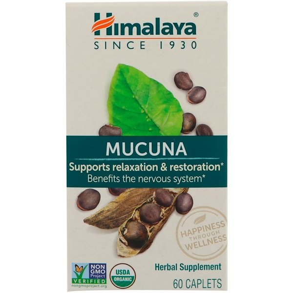
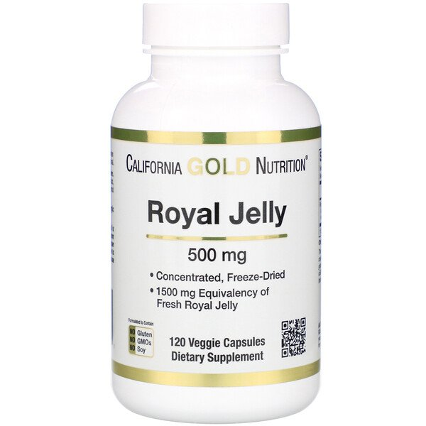
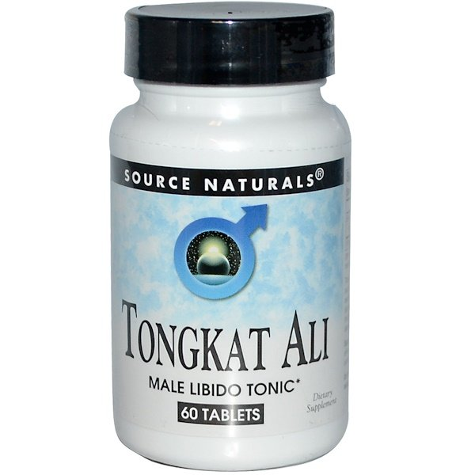
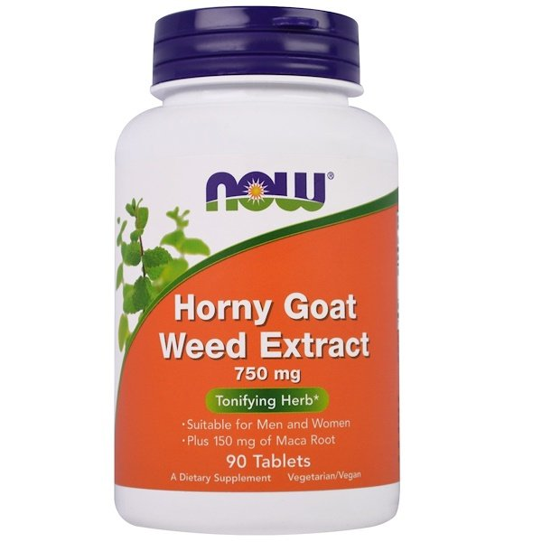

# テストステロン大全 #7「男性ホルモンアップに効くサプリとは？その2」

テストステロン大全([#1](https://daigovideolab.jp/blog/1863215),[#2](https://daigovideolab.jp/blog/1865005),[#3](https://daigovideolab.jp/blog/1866693),[#4,](https://daigovideolab.jp/blog/1869807)[#5](https://daigovideolab.jp/blog/1873116),[#6](https://daigovideolab.jp/blog/1874818))の続きでーす。前回からテストステロン増加に役立つサプリをいくつか並べてまして、今回も割と有望そうなものを選んでみました。

---

### ジンジャールート

ショウガすばらしさについては「パレオな男」でも[たびたび触れている](https://yuchrszk.blogspot.com/2018/07/blog-post_12.html)ところ。体に良いと言われる野菜のなかでもかなりデータが多くて、常食すべき食品のひとつかと思うわけです。

で、**ショウガのメリットといえば抗炎症作用がメイン**なわけですが、実は「テストステロン値も上昇させてくれるのでは？」とも言われてるんですよ。というのも、ショウガには男性ホルモン性の化合物がふくまれてまして、動物実験([R](https://www.ncbi.nlm.nih.gov/pubmed/16751998))なんかだと「ジンジャーの抽出物を飲んだラットがムラムラし始めた！」なんて報告も出てたりするんですよ。おもしろいっすねぇ。

ヒトを対象にした試験としては2012年のもの([R](https://www.semanticscholar.org/paper/The-effect-of-Ginger-on-semen-parameters-and-serum-Mares-Najam/793a8d1b630307362a757f7ea7af849d5401e7e0))がありまして、不妊症の男性218人にショウガを90日間ほど服用してもらったところ、

- **テストステロン値が17%アップ！**

って結果が出たそうな（ついでにLHとFSHもそれぞれ43%と17%ずつ上がっている）。まぁあくまで不妊の男性を対象にしたテストなんで、それ以外の人に当てはまるかは謎なんですが、ショウガの健康効果は間違いないので、日ごろの食事で摂取量を増やすもよし、[サプリを使ってみる](https://daigovideolab.jp/blog/1820385)のもまたよしといったところでしょう。

### ムクナ

わりとマイナーなサプリですが、アーユルヴェーダなどでは昔から媚薬として使われてきたハーブの一種で、「パレオな男」では「[ドーパミンの増加に効くかも？](https://yuchrszk.blogspot.com/2017/08/17.html)」として取り上げたことがありました。ムクナにはL-Dopaっていうドーパミンの材料が豊富にふくまれてるんですよね。

で、ドーパミンの分泌は基本的にテストステロン産生の増加と関連してるんで、ムクナがテストステロンを増やす可能性は十分にあるわけです。現時点で有望なデータをいくつか紹介すると、

- 不妊に悩む男性120人に1日5gのムクナパウダーを飲んでもらったところ、精子の濃度が有意に上昇した([R](https://www.ncbi.nlm.nih.gov/pmc/articles/PMC2816389/))

- 健康な男性75人と不妊の男性75人に、90日間続けて1日5gのムクナパウダーを与えたところ、両グループでテストステロンレベルが有意に増加した（不妊症の男性が38%、健康な男性が27%)([R](https://www.ncbi.nlm.nih.gov/pubmed/18973898))

みたいな感じで、全体的には不妊男性を対象にしたテストが多いんだけど、一部では健康な男性にも効果が見られていて、こいつはなかなか良い感じもしますな。ドーパミン産生も狙えるし、これはちょっと試してみるかな……。

[Himalaya, ムクナ](https://jp.iherb.com/pr/Himalaya-Mucuna-60-Caplets/3732?rcode=IRO489)

Himalaya

[iHerb](https://jp.iherb.com/pr/Himalaya-Mucuna-60-Caplets/3732?rcode=IRO489)

### ローヤルゼリー

ローヤルゼリーは働きバチの体内から抽出される白い液体で、日本では健康食品としてかなりメジャーな存在かと思います。かつて「パレオな男」では「[コレステロールや糖代謝の改善には無意味っぽい](https://yuchrszk.blogspot.com/2017/10/blog-post_88.html)」みたいな話を書いたんですが、テストステロン値については「意外と有望かも？」と思わせるデータがいくつか出ております。

- 岐阜大学が61人の健康な男性を対象にしたテスト([R](https://www.ncbi.nlm.nih.gov/pubmed/22995464))では、1日3,000mgという高用量のローヤルゼリーを6か月にわたって飲んでもらったところ、プラセボ群にくらべてテストステロンが14％ほど増加した

- 不妊症の男性を対象にしたイラクの研究では、ハチミツにローヤルゼリー25mgを混ぜたものを3か月ほど服用させたところ、テストステロン濃度が20%上昇した([R](https://www.iasj.net/iasj?func=fulltext&aId=47761))

ってことで、実験ごとの使用量が違いすぎるのが難しいとこですが、わりといい感じでは無いでしょうか。

では、なんでローヤルゼリーでテストステロンが上がる（かもしれない）のかというと、くわしいところはまだ謎だったりします。現時点では、

- ローヤルゼリーが下垂体腺を刺激してるから？
- ローヤルゼリーがテストステロンの変換をうながす酵素を刺激するから？

といったメカニズムが考えられてますが、正直よくわからんって感じっすね。こっちも自分で試してみるかな……。

[California Gold Nutrition, ロイヤルゼリー](https://jp.iherb.com/pr/California-Gold-Nutrition-Royal-Jelly-Concentrated-Freeze-Dried-500-mg-120-Veggie-Caps/62298?rcode=IRO489)

California Gold Nutrition

[iHerb](%E2%80%9Chttps%3A//jp.iherb.com/pr/Healthy-Origins-5-HTP-100-mg-120-Veggie-Caps/14472?rcode=IRO489%E2%80%9D)

### トンカット・アリ

トンカット・アリは、昔からテストステロンブースターと言われてるハーブ。まだそこまでヒトを対象にした試験は進んでないんですが、いくつかの動物実験([R](https://www.ncbi.nlm.nih.gov/pubmed/21569213),[R](https://www.ncbi.nlm.nih.gov/pubmed/11693547))をみてますと、性欲の亢進や勃起の質の改善などが報告されていて、「意外と使えるのか？」って気がしてくるわけです。

ヒトを対象にしたデータとしては2012年のもの([R](https://www.ncbi.nlm.nih.gov/pubmed/23243445))がありまして、109人の男性に300mgのトンカット・アリを12週間ほど飲み続けてもらったところ、プラセボと比較して精液の流動性が44%、量が18%改善したそうな（残念ながらホルモンの測定はなし）。

また、2013年の研究([R](https://jissn.biomedcentral.com/articles/10.1186/1550-2783-10-28))では、ストレスを受けた被験者に1日200mgのトンカットアリを4週間ほど飲み続けてもらったら、**プラセボと比ベテテストステロンが37%高く、コルチゾールレベルが16%低くなった**とのこと。これはなかなか有望な数字っすね。

まー、もうちょいヒトを対象にしたデータが出てこないと判断はムズいんですが、個人的には悪くなさそうな印象を持っております。

[Source Naturals, トンカットアリ、タブレット60錠](https://jp.iherb.com/pr/Source-Naturals-Tongkat-Ali-60-Tablets/1504?rcode=IRO489)

Source Naturals

[iHerb](https://jp.iherb.com/pr/Source-Naturals-Tongkat-Ali-60-Tablets/1504?rcode=IRO489)

### ホーニー・ゴート・ウィード

ホーニー・ゴート・ウィードは中央アジアなどに自生する植物で、漢方薬の世界では強力な催淫剤として使われてきた歴史を持っております。直訳すると「**発情ヤギ草**」って感じでして、いかにも効きそうな感じっすね。パレオな男では「[コルチゾール上昇を防ぐ可能性が高いハーブ](https://yuchrszk.blogspot.com/2017/11/8.html)」としても取り上げたことがありましたな。

このハーブにはイカリインっていうフラボノイドが高濃度で含まれまして、こいつがテストステロン濃度を上昇させてくれるかも？と考えられてたりします。ただし、残念ながら現時点では**ヒトを対象にしたデータはなくて**、生体外か動物実験がメイン。いくつか例を挙げると、

- 2017年の生体外研究([R](http://www.asiaandro.com/archive/1008-682x/5/15.htm))では、イカリインが天然のPDE‐5およびPDE‐4阻害剤として働き、これがテストステロンの産生増加と関連することが認められた（バイアグラやシアリスのようなED治療薬はPDE-5を阻害するんで、つまりホーニー・ゴート・ウィードは天然バイアグラみたいなもんなわけっすな)

- ラットを使った研究([R](https://www.ncbi.nlm.nih.gov/pubmed/16751992))では、体重1kgあたり80mgのイカリインを飲ませたところ、**テストステロン濃度が3倍になった**。研究チームは、イカリインは体内でテストステロンに似た働きをするのでは？と考えている

みたいになります。まぁヒトを対象にした研究はこれからの段階なんで、現時点で「手放しでおすすめ！」ってわけじゃないんですが、わりと良い線いってる気がしますね。

[Now Foods, ホーニーゴートウィードエキス](https://jp.iherb.com/pr/Now-Foods-Horny-Goat-Weed-Extract-750-mg-90-Tablets/14524?rcode=IRO489)

Now Foods

[iHerb](https://jp.iherb.com/pr/Now-Foods-Horny-Goat-Weed-Extract-750-mg-90-Tablets/14524?rcode=IRO489)

## **まとめ**

というわけで、いろいろ紹介してみましたが、個人的に試したいのはトンカット・アリとローヤルゼリーですかね。まぁ今回取り上げたものは、全体的にまだエビデンスはかなりゆるいので、いずれも「絶対のおすすめ！」ってわけではありません。もっと良いデータが出るまでは、とりあえずスーパーでショウガを買って積極的に食べていくのがいいかもっすね。
