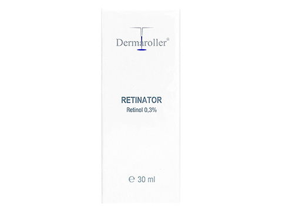

# 最強スキンケアアイテム？「レチノール」を正しく使いこなすにはどうすればいいの？問題

「最近レチノールの話がありませんが、まだ使ってますか？」やら「レチノールがうまく使えません……」みたいなご質問をいくつかいただきましたんで、今回はレチノールのお話です。

---

## **そもそもレチノールとは？**

レチノールってのはビタミンAの誘導体でして、**アンチエイジングの効果には一定の評価がある**成分であります。具体的に確認されているメリット([R](https://www.ncbi.nlm.nih.gov/pmc/articles/PMC3225141/))としては、

- シワを減らす
- 肌の色素沈着を減らす（シミとか）
- ニキビを改善する
- 皮膚のコラーゲンを増やして表皮を厚くする
- 角質層をコンパクトにして若々しい肌にする

みたいなものがあります。うーん、すばらしい。

「ニキビに効く」ってのは初耳かもですが、レチノールは肌のターンオーバーをうながすんで、毛穴が詰まっちゃう前に皮膚をどんどん脱落させていくんですよ。そのおかげで面皰が作られにくくなり、アクネ菌も酸素に触れて死滅するわけです（もちろんレチノールそのものに抗炎症作用があるのも大きい）。

レチノールが加齢に効くのも基本的な仕組みは同じで、

- 色素細胞のターンオーバーが早まるから色素が沈着しなくなる

- ターンオーバーのおかげでメラニンの生成が遅くなるから肌が白くなる

みたいな感じになってます。というわけで、**現時点でレチノールはもっとも研究が進んでいる生理活性物質のひとつ**とも言えまして、肌トラブルにお悩みの方であれば、知っておいて損はないと思うわけです。

## **レチノールは副作用もデカい**

が、効果が高いものは副作用も大きいのが世の常。レチノールの主な欠点としては、

- とにかく肌への刺激が強い
- ターンオーバーが行きすぎてカサカサした肌になることも多い
- 合わない人だと肌がヒリヒリして赤くなることも多い

みたいになってます。これらの副作用は、だいたい10〜15％の人にはまったく起こらないんだけど、肌が合わない人だとかなり苦労するかもしれません。

かくいう私も、かつて[1％のレチノールクリーム](https://jp.iherb.com/pr/Life-flo-Retinol-A-1-Advanced-Revitalization-Cream-1-7-oz-50-ml/29793?gclid=Cj0KCQjwu6fzBRC6ARIsAJUwa2Rf1Ci01D72npTSTjUHDrIx8YWWymHkUMnYRwfPVVRilt5oH1BqXUUaAgRfEALw_wcB&gclsrc=aw.ds&rcode=IRO489)を使ってたときは、使用直後から肌がポロポロとはがれ出しまして、その後2週間ぐらい赤みが止まらなくて難儀しました。体質が合わない方は、かなり注意した方がよさげ。

というわけで、現在の私は1％のレチノールは潔くあきらめて、[Dermarollerのレチノール0.3%](https://alwys.net/contents/ard.php?id=OS011504&adwares=os027191)の商品を使ってます。レチノール1%の商品で肌がボロボロになった方は、こちらを選んでいただくのも良いのではないかと。

[\[Dermaroller\]レチネーター0.3%](https://alwys.net/contents/ard.php?id=OS011504&adwares=os027191)

また、なかには上記でも副作用が出ちゃうケースがありますんで、その場合は病院で0.05％ぐらいのトレチノインを処方してもらうのもありでしょう。ここらへんは本当に人によって反応が違うので、なんとも難しいところです。

## **レチノール利用のポイント**

で、まったく問題が起きない人はそのまま使っていただいて構いませんが、私のように皮膚のカサカサや赤みが起きてしまう方の場合は、以下のポイントに注意していただくと良い感じです。

- **とりあえず1日おきに使う**：すごーく当たり前のことですが、レチノールは1日おきに使うのが吉。近ごろの私は、もともとそこまでシワや色素沈着に悩んでいないこともあって、3〜4日おきぐらいのペースになってます。

- **ベースにオイルを使う**：レチノールを使う前には、まずベースにオイルを塗っておくと吉。肌に届く前にオイルがいったんブロックしてくれるんで、じわじわと肌に取り込まれていくはずであります。使っていただくものはホホバでもワセリンでも、いつもお使いのものをご利用ください。

- **30分で洗い流す：**強い人だとレチノールを一晩中塗ったままでも問題は出ないんですが、弱い方は30分ぐらいつけたら洗い流してしまった方がいいでしょう。それでいいのかと思われる方もおりましょうが、先行研究([R](https://www.tandfonline.com/doi/full/10.3109/09546634.2012.751085))ではトレチノインを30分だけ使っても、塗りっぱなしだった場合と効果は同じだったとの報告が出てますんで、まずはよろしいのではないかと。

- **濡れた肌には使わない**：肌が濡れてると成分が浸透しやすくなるんで、顔を洗った後でオイルを塗ったら、しばらく（20〜30分ぐらい）待ってからお使いください。

- **スキンケアはマイルドなものを使う**：これも当たり前ですけど、レチノールを使っている間はできるだけマイルドな洗顔料を使うようにしてくださいませ（くわしくは「[スキンケアの推奨プロダクト](https://daigovideolab.jp/blog/1826228)」をご参照あれ）

- **日焼け止めはマスト**：レチノールを使ってるあいだはどうしても皮膚が敏感になるんで、外出の際は日焼け止めのプロテクトが必須だとお考えください。ここらへんも「[スキンケアの推奨プロダクト](https://daigovideolab.jp/blog/1826228)」が参考になるでしょう。

- **ファンデーションは厳しいかも**：レチノールを使ってると、多くの人はファンデーションのノリが悪くなるはず（自分でも試してみたのでよくわかる）。なので、レチノールを使ってるあいだはコンシーラーのみにするのも良いのではないかと。

- **まずはグリンピースの半分ぐらいで様子見**：当然ながらレチノールの副作用は用量に依存するんで、肌が弱目の方はまずグリンピースの半分ぐらいの量を使って様子を見るのが無難でしょう。

- **タイムラグにご注意を**：レチノールによる変化はすぐには現れず、だいたい24〜48時間ぐらいのタイムラグがあるはず。なので、レチノールを塗って数時間で副作用が出なかったとしても喜ばず、とりあえず2日ほど様子を見てみることをお勧めします。

ってことで、いろいろ言ってきましたが、レチノール使用のポイントをまとめると、

1. 洗顔後にオイルを塗って数分ほどおく
2. 肌から水分が飛んだら、グリンピースの半分ぐらいのクリームを均一に塗る
3. とりあえず2〜3日はおいて異変が出ないか様子を見る
4. 何も問題がなければ、1)肌に直接使う、2)レチノールの量を増やす、3)塗布のタイミングを縮める、のいずれかを選び、再び副作用が出ないかどうかチェック

という繰り返しになりましょう。いずれにせよ、適切に使えればこれほど効果が実証された物質もないんで、うまくご利用ください。
