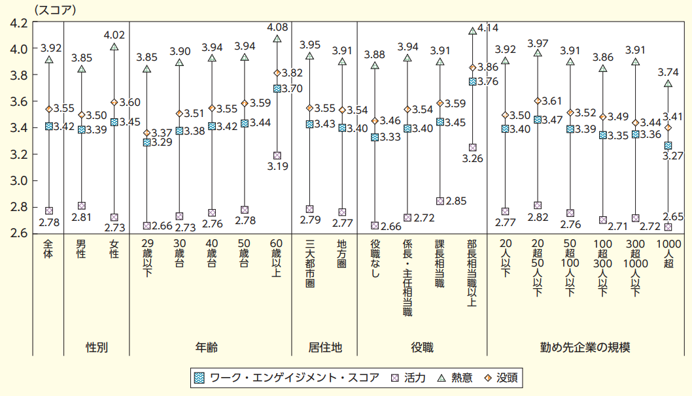

# 1分で「自分は仕事にやりがいを感じているか？」を判断できるテストが便利な件

「[科学的な適職](https://amzn.to/3evI3Er)」では「仕事の幸福を判断する64問」ってテストを紹介しております。名前のとおり「**自分はいまの仕事にどれぐらい満足してるか？**」を判断するための尺度なんですけど、とにかく質問数が多いのが難点ではあります。64って数字はさすがに手軽に使うには面倒ですもんね（そのぶん細かい不満点が分かるのが良いとこなんですが）。

---

ということで今回は、もっと手軽に仕事の満足度を判断できるツールを取り上げてみようかと思います。これは「[ワーク・エンゲージメント入門](https://amzn.to/2VdgaJK)」で有名なウィルマー・B・シャウフェリ博士が考案([R](https://link.springer.com/article/10.1023/A:1015630930326))した「**ワーク・エンゲージメント尺度**」で、おもに「**仕事を積極的にこなして活力を得られているか？**」ってのを調べるために使います。

ワーク・エンゲージメントは3つの要素で構成されていて、

1. **活力**：仕事をしているとエネルギーがみなぎるように感じられるかどうか？
2. **熱意**：仕事に対してプライドとやりがいを持っていられるかどうか？
3. **没頭**：我を忘れるぐらい仕事にのめり込んでいるかどうか？

ってポイントを重視してます。つまり、ワーク・エンゲージメントが高い人は、やりがいを感じつつ日々の課題に没頭しつつ生き生きと仕事をしているわけで、いかにも幸せそうなわけです。うらやましいですねぇ。

厳密に言えば「仕事の幸福度」とはちょい違う観点ではあるものの、エンゲージメントもかなり大事なポイントのひとつ。「いま自分は生き生きと仕事に取り組めているんだろうか？」ってのを判断する上では、非常に使えるテストではないかと。実際のところ、世界的にも広く使われて一定の評価を得てますし、たった17問に答えるだけですむ手軽さがウリなので、よろしいんじゃないでしょうか（短縮版は9問）。

ってことで、「**ワーク・エンゲージメント尺度**」は以下のようになります。それぞれの質問を読みながら「自分は仕事についてどう感じているだろう？」と考えながら、0〜6点の範囲で採点してください。「そのように感じたことは一度もない」なら「０点」を、「とてもよく感じる」場合は「６点」をつけていただければと。

### ワーク・エンゲージメント尺度17問バージョン

1. 仕事をしていると、活力がみなぎるように感じる。

2. 自分の仕事に、意義や価値を大いに感じる。

3. 仕事をしていると、時間がたつのが速い。

4. 職場では、元気が出て精力的になるように感じる。

5. 仕事に熱心である。

6. 仕事をしていると、他のことはすべて忘れてしまう。

7. 仕事は、私に活力を与えてくれる。

8. 朝に目がさめると、さあ仕事へ行こう、という気持ちになる。

9. 仕事に没頭しているとき、幸せだと感じる。

10. 自分の仕事に誇りを感じる。

11. 私は仕事にのめり込んでいる。

12. 長時間休まずに、働き続けることができる。

13. 私にとって仕事は、意欲をかきたてるものである。

14. 仕事をしていると、つい夢中になってしまう。

15. 職場では、気持ちがはつらつとしている。

16. 仕事から頭を切り離すのが難しい。

17. ことがうまく運んでいないときでも、辛抱強く仕事をする。

© Schaufeli & Bakker (2003)

### 採点

すべてに点数をつけ終わったら、あとは以下のように計算してくださいませ。

- **総計**＝すべての点数を足して平均を出す
- **活力**＝質問1、4、8、12、15、17の点数を足して平均を出す
- **熱意**＝質問2、5、7、10、13の点数を足して平均を出す
- **没頭**＝質問3、6、9、11、14、16の点数を足して平均を出す

### ワーク・エンゲージメント尺度9問バージョン

1. 仕事をしていると、活力がみなぎるように感じる。 (活力 1) \*

2. 職場では、元気が出て精力的になるように感じる。 (活力 2)\*

3. 仕事に熱心である。 (熱意 2)\*

4. 仕事は、私に活力を与えてくれる。 (熱意 3)\*

5. 朝に目がさめると、さあ仕事へ行こう、という気持ちになる。 (活力 3)\*

6. 仕事に没頭しているとき、幸せだと感じる。 (没頭 3)\*

7. 自分の仕事に誇りを感じる。 (熱意 4)\*

8. 私は仕事にのめり込んでいる。 (没頭 4)\*

9. 仕事をしていると、つい夢中になってしまう。 (没頭 5)\*

© Schaufeli & Bakker (2003)

### 採点

すべてに点数をつけ終わったら、あとは以下のように計算してくださいませ。

- **総計**＝すべての点数を足して平均を出す
- **活力**＝質問1、2、5の点数を足して平均を出す
- **熱意**＝質問3、4、7の点数を足して平均を出す
- **没頭**＝質問6、8、9の点数を足して平均を出す

### 点数の見方

でもって、点数の見方はおおよそ以下のようになります（[厚労省白書](https://www.mhlw.go.jp/toukei_hakusho/hakusho/index.html)より）。

いろんな判断軸がありますが、めんどうな場合はとりあえず左端の「全体」を参考にしてください。総計が3.42前後なら、日本人としては「ワーク・エンゲージメント」は平均だとお考えください。

ちなみに、世界で見ると日本人のワーク・エンゲージメントは低めで、基本的にはトータルのスコアが4点前後の国が多かったりします。その理由は不明で、もしかしたら日本の労働環境が悪いのかもしれないし、もしかしたらポジティブな感情を表に出さない国民性が関係してるのかもしれません。なので、上記の結果についてはあまり厳密に受け取らず、「まぁ3.5点に近ければいいか……」ぐらいの感じでゆるくとらえていただければと思います。

いずれにせよ、「ワーク・エンゲージメント尺度」は手軽で評価の高いテストなので、定期的にチェックしてみちゃいかがかと思う次第です。ではまたー。
