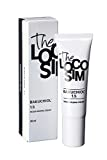

# 有名な美容成分がどこまで使えるのかガッツリ考えてみよう！#2「ハイドロキノン＆バクチオール編」

有名な美容成分について考えてみるシリーズ([#1](https://daigovideolab.jp/blog/1913141))。今回は割とリクエストが多かった「**ハイドロキノン**」と、近ごろよく耳にするようになった「**バクチオール**」について見てみましょう。

---

## **その3.ハイドロキノン**

### ハイドロキノンのポイントの美白効果は間違いない

まずハイドロキノンは昔から「美白に効く」と言われてきた成分で、肌の黒ずみ対策によく使われてたりします。

肌が黒ずむ原因はさまざまで、ホルモンバランスの変化、ニキビ跡、日焼けダメージなどが代表的なところですが、ハイドロキノンはこれらに幅広く役立ってくれるのがいい感じ。これは、ハイドロキノンがメラノサイトによるメラニンの生成を遅らせてくれるからです（チロシナーゼという酵素の働きをブロックする）。

と同時に、ハイドロキノンは強力な抗酸化物質でもあるんで、色素の原因となるフリーラジカルを吸収してくれるのもポイント。1980年代から多くの研究が行われていて、だいたい2～4％のクリームを4週間ほど肌に塗ると、色素沈着が改善されると考えられております([R](https://pubmed.ncbi.nlm.nih.gov/18045355/))。ここらへんは多くの知見がありまして、その効果については疑いようがないと言っていいでしょうね([R](https://www.ncbi.nlm.nih.gov/pmc/articles/PMC5707834/))。

### ハイドロキノンのポイントは効果より安全性

が、ハイドロキノンでよく議論になるのは、**効果よりは安全性のほう**です。というのもハイドロキノンは人体への働きが大きいだけに、いろんな副作用もささかかれてるんですよ。事実、FDAなどは「ハイドロキノンには発がん性がある」として、2％までのクリームしか許可してませんしね（日本では特に規制はない）。

では、現時点でハイドロキノンについてよく聞く副作用を、2007年に出たレビュー論文をベースにまとめてみましょう([R](https://pubmed.ncbi.nlm.nih.gov/18045355/))。

- **発がん性**：上述のとおりFDAが「高濃度のハイドロキノンには発がん性がある」と指摘しております。ただし、これはあくまでラット実験の結果をベースにした結論で、現時点でヒトへの発がん性は証明されてないので判断が難しいところです。個人的な見解としては、ヒトとラットはハイドロキノンの処理法が違うし([R](https://pubmed.ncbi.nlm.nih.gov/18045355/))、これだけ長年使われてて発がん性が認められてないので、おそらく安全だろうとは思うんですが……。

- **皮膚過敏**：ハイドロキノンは肌への刺激が大きいので、特にアレルギー体質な方だと肌のかゆみや赤みが起きることがあります。と同時に、ハイドロキノンを使うと肌が紫外線に弱くなるんで、かなり綿密に日焼け止めを塗らないとヤバい感じ。

- **オクロノーシス**：たまーに「ハイドロキノンで肌がさらに黒くなった！」との副作用が報告されることがあります。ただし、これはよほどの高用量を長期的に使わないと起きないはずなんで、まず心配はないかと。

### まとめ

というわけで以上をふまえた上で、私の雑感としては、

- 日本の化粧品みたいに10％を配合する商品が安全なのかは不明。だけど、アメリカの「2％まで」って基準も厳しすぎるような気はする

- ただし色素沈着への効果については、作用メカニズムもはっきりしていし、データの蓄積って点でもハイドロキノンを超えるものは少ない

- おそらく**4％ぐらいなら目立った副作用もないはず**だが（アレルギーの人は別として）、**2％から様子を見てみる**のはあり

- もし不安なのであれば、アゼライン酸やアルブチンのような代替物を考えてみるのもいいかもしれない（多分ハイドロキノンよりは効果が劣るでしょうが）

といったところです。そこまで怖い成分でもないので、激しい「しみ」にお悩みの方であれば使う価値は十分あると思う次第ですねー。

## **その4.バクチオール**

### バクチオールはレチノールよりすごい？

バクチオールはここ数年でよく聞くようになった成分で、なんで美容クラスタが騒いでいるかと言いますと、

- **レチノールの上位互換なんじゃないの？**

という噂があるからです。レチノールといえばこのブロマガでも[定番の美容アイテム](https://daigovideolab.jp/blog/1876231)としておなじみですが、これよりも効果と安全性が高いんじゃないか？って考え方があるんですよ。

確かに、レチノールは効果が高いぶんだけ肌荒れも起こしやすいので、より安全で同じ美肌効果が得られるならばありがたい話。一部には「トレチノインより良い！」なんて意見もありまして、気になるところじゃないでしょうか。

### バクチオールの効果がそこまですごいかと言うと……

では、具体的にバクチオールの効果はどうなの？ってことで、いくつかのデータを見てみましょう。

まず有名なのはカリフォルニア大学などの研究([R](https://pubmed.ncbi.nlm.nih.gov/29947134/))で、44人の参加者をランダム化の二重盲検試験で調べまして、

1. 0.5％のバクチオールクリームを1日2回ずつ塗る
2. 0.5％のレチノールクリームを1日1回顔に塗る

って感じで12週間の経過をみたところ、コンピューター分析で計測したシワと色素沈着の量は、**両グループでまったく変わらなかった**そうな。つまり、バクチオールは1日2回使ったのにレチノールと特に変化がなかったわけで、「うーん、そこまで優れてるわけでもないのかな‥」って気がしてくるわけです。

また、副作用の面で言いますと、

- レチノールを使った人は皮がむけたりチクチクした
- バクチオールを使った人は赤みが多く見られた（光過敏症はなかった）

とのこと。これだけ見る限りでは、「レチノールほど刺激はないかもだけど、別に段違いに良いわけでもない」ぐらいの印象っすね。まぁ一部の美容クラスタで言われるほどの効果ではなさそうであります。

にも関わらず、なぜバクチオールがここまで有名になったかと言いますと、いくつかの生体外研究([R](https://onlinelibrary.wiley.com/doi/abs/10.1111/ics.12117),[R](https://www.taylorfrancis.com/books/e/9780429192388/chapters/10.1201/b18895-4))で良い成果が出てるからです。これによると、バクチオールによる遺伝子発言はレチノールに非常に近く、コラーゲンやエラスチンを分解する酵素をブロックしてくれるというんですね。

が、この現象がヒトの皮膚でも同じように働くかはわかりませんし、果たして皮膚で活性されるかどうかも謎（ちなみに上記の生体外研究は、バクチオールの製品を作ってる会社が手がけてたりもします）。1970年代から豊富なデータのうらづけがあるレチノールと比べれば、現時点での証拠はどうにも弱いとしか言いようがないんですよねぇ。

### まとめ

まぁだからといってバクチオールの効果が否定されるわけでもないので、「ちょっと試してみたい！」という方がいれば止めようとも思いません。その際のポイントとしては、

- 全体的に見ると、レチノールよりバクチオールの方が刺激は少なそうなので、レチノールに肌がついていかない人は試してみるのもあり

- ただしバクチオールは植物由来の天然成分なので、もしかしたらアレルギー反応が出る可能性も否定できない

ってのがありますので、アレルギー体質な方はご注意ください。まぁ個人的にはあくまでもレチノールを試すほうが先だと思いますし、アルファヒドロキシ酸のように、もっとデータ数の多いスキンケア成分はありますので、かなり優先順位は低くなるでしょうねぇ。

[
次世代型レチノール バクチオール 1.5% 配合](//af.moshimo.com/af/c/click?a_id=790466&p_id=170&pc_id=185&pl_id=4062&url=https%3A%2F%2Fwww.amazon.co.jp%2Fdp%2FB08C4RR3P5)
