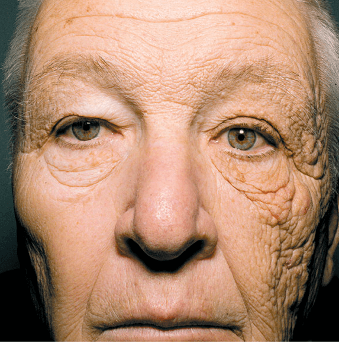
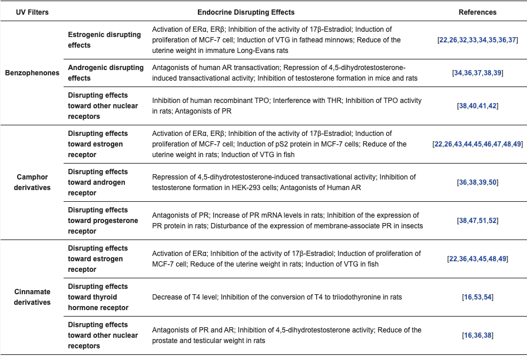

# SPF意味ある？成分が体に悪い？‥…日焼け止めについてよくある質問5つに徹底的に答えていくエントリ

だいぶ日差しもキツくなってきたので、日焼け止めの話題です。というのも、近ごろ日焼け止めに関するご質問が増えてきたもんですから。

なかでも数が多かったものをピックアップして見ていきましょうー。

---

## **1. SPFは高ければ高いほどいいの？**

これは本当によく受ける質問で、実に悩ましい問題だと思います。実は昔は「SPFの数値ってあんま意味なくないか？」と考えてまして、[SPF15の商品](https://yuchrszk.blogspot.com/2014/05/blog-post_1748.html)を使っていたこともありました。

その理由はシンプルで、「SPFが高くてもたいした差はない！」ってのが美容界の通説だったからです。実際、**紫外線のブロック率**を調べたFDAのデータ([R](https://www.ncbi.nlm.nih.gov/pmc/articles/PMC3460660/))によりますと、

- SPF15＝93.3％
- SPF30＝96.7％
- SPF50＝98.0％

みたいになってまして、SPF30と50の違いは1.3％しかない！というんですよね。これならSPFが高かろうが低かろうが「何度も塗り替えしていれば問題ない」と思うのが自然でしょう。

が、近年は「もしかしたらこの考えって間違ってたかも？」と思い始めまして、それというのもマックス・プランク教育研究所などのチーム([R](https://pubmed.ncbi.nlm.nih.gov/28146234/))が異論を述べているからです。軽く引用すると、

> メディアや健康のプロたちは、しばしば「SPF30以上の日焼け止めには小さな違いしかない」という間違った考え方を喧伝している。

みたいになります。ここまで厳しい意見が出た理由はシンプルで、

- **紫外線のブロック量じゃなくて、紫外線が肌を通過する量で判断すべきだ！**

って考え方があるからです。言われてみれば、紫外線をどれぐらい防ぐかよりも、紫外線が実際にどれぐらい肌に届いているかで判断したほうが現実的ですもんね。

この考え方をもとに改めてSPFの効果を判断すると、

- SPF15＝6.7％
- SPF30＝3.3％
- SPF50＝2.0％

みたいになります。こうして見ると、SPF15と50のあいだでは紫外線の通過量に結構な違いがあることが分かりますね。

では、この違いが現実的にどんな違いをもたらすのかと言いますと、2018年にNYUメディカルセンターなどが199人の男女におもしろい実験([R](https://pubmed.ncbi.nlm.nih.gov/29291958/))をしてます。参加者にSPF50とSPF100の日焼け止めを渡して、顔の右側と左側のどちらかにランダムに塗るように指示したんだそうな（もちろん被験者はどっちがSPF50なのか100なのかを知らない）。

すると、そこには結構な違いがありまして、

- 55.3％の参加者は、SPF50を塗った側がより日焼けしていた
- 顔の左右で違いがなかったのは39.7％だった
- SPF100を塗った側がより日焼けしていた参加者は5％だけだった

だったそうな。うーん、こう考えるとやはりSPFは大きい方がいいのかなーって気がしてきますね。

まぁこの実験とて決定的なものではないですし、結局のところ「日焼け止めは2時間おきに塗り直さなければならない」ってセオリーは変わらないので、どこまで気にすべきかは判断が難しいところです。なので個人的には、

- リゾート地に行くんだったらSPF100を使うのもいいよ！

- ただ現時点でSPF100超えの商品でこれといったのがないので、SPF35〜50ぐらいでもまぁいいとは思うよ！

ぐらいのアドバイスをしておきます。

## **2. 室内でも日焼け止めは塗るべき？**

外出時には日焼け止めがマストですが、果たして室内にいる時でも塗り直す必要はあるのかってご質問ですね。

というわけで、室内における日焼け止めについて考えてみたいわけですが、実はこれまた簡単は言いづらい問題だったりします。当たり前の話ですが、ひとくちに「室内」といっても日差しが強い窓際と地下室では全く影響が異なるもんですから。

一例として、この問題について有名なのは「The New England Journal of Medicine」に掲載された論文([R](https://www.nejm.org/doi/full/10.1056/NEJMicm1104059))で、当時69歳だったトラック運転手のおじいさんの事例を掲載しております。

ご覧のとおり顔の左右で肌の劣化が大きくことなってますね。28年間トラックを運転するなかで左側の窓から差し込む日差しを浴び続けた結果、このような状態になったんだそうな。たとえ室内だろうが、窓際で何年も日光を浴び続ければ、ヤバいことになっちゃうわけっすね。

というと「**やっぱ室内でも日焼け止めはマストなんだ！**」って気分になりそうですけど、そう簡単にはいかないのが難しいところです。というのも室内の場合は、

1. 窓から差し込む日光の量
2. 自分が室内のどこにいるか
3. 肌が紫外線に弱い状態になっているか

って3つの要素によって大きく変わってくるもんですから。ただ、ここらへんの計算は本当に難しくて、

- **拡散曝露の割合**：周囲の物体や大気に反射した紫外線がどれぐらい肌に届くか([R](https://journals.plos.org/plosone/article?id=10.1371/journal.pone.0166729),[R](https://doi.org/10.5694/j.1326-5377.1998.tb138960.x))

- **天空率をどう測るか**：窓から「どれぐらい空が見えるか？」を表す数値。だだったぴろい屋外で完全に空が見えてれば天空率は100％、木々や建物で半分ぐらい空が隠れていれば天空率は50％([R](https://onlinelibrary.wiley.com/doi/abs/10.1111/j.1751-1097.2009.00677.x))

- **窓からの距離の問題**：基本的には窓から離れるほど指数関数的に拡散曝露は下がっていき、3メートルも離れるろほどんとなくなる

みたいなのをベースにしなきゃいけないんですよ。というわけで、正確なところを計算するのは私もあきらめてます（笑

そこで、すべてをひっくるめたうえで超ざっくりしたガイドラインを出しておくと、

- 日本の平均的な腰高窓のサイズ（W1,690 x H1,170ぐらい）の近く（30cm〜1mぐらい）にいる場合は、日焼け止めを塗った方が無難

- 窓から2〜3mも離れたらほぼ日焼け止めは不要なレベル

みたいになります。まぁ「室内のどこにいても紫外線が怖い！」って考え方も間違いではないので、あとは面倒さやコストとの兼ね合いでお考えいただければと。

## **3. 日焼け止めの成分って体に悪い？**

日焼け止めの成分は体に悪い！ケミカルだ！みたいな話もよく聞くところで、なかでも怖いのは「体内でホルモンバランスを乱す！」みたいな説でしょう。実際、ネットの一部では「日焼け止めが環境ホルモンとして作用する！」って意見もありまして、なんか怖いんですよねー。

で、確かに「日焼け止め成分の悪影響」を指摘した研究([R](https://pubmed.ncbi.nlm.nih.gov/27527194/))はありまして、浙江大学などのチームが環境ホルモン作用が確認されたデータまとめてくれております。ただ、これらの実験が問題なのは、

- 確認されたデータが動物実験か細胞を使ったものばかり！

なんですよね。くわしくは表2のデータを見ていただければと思いますが、ラットとか魚とか昆虫を対象にしたテストばっかりなんですよ。

それも、いずれの研究も市販の日焼け止めではありえないレベルの成分を使ってるんで、「これをヒトに適用するのは無理だろう」と思うばかりなんですよね。

まぁだからといって「ヒトにまったく悪影響がない！」とも断言できなわけでうけど、いまんとこ人間を対象にしたテスト([R](https://www.researchgate.net/publication/330639950_When_to_apply_sunscreen_a_consensus_statement_for_Australia_and_New_Zealand))では問題が出てないのも確かなんで、個人的には別に心配してなかったりはします。

## **4. 日焼け止めは太陽の光を防ぎすぎちゃうのでは？**

これまた近年よく聞くようになった話で、「太陽の光はビタミンDの産生に必要だから、日焼け止めの使いすぎもよくない！」って話です。この話には確かに真実がありまして、室内でずっと仕事をしている人はビタミンDが不足しがちなことは「パレオな男」でも何度か取り上げてたりします。

太陽のメリットはメタ分析([R](https://pubmed.ncbi.nlm.nih.gov/30412763/))でもあきらかになっていて、日光を浴びた量と心疾患の死亡率を比較したら、

- **太陽を浴びてるの人の方が長生きだ！**

って結論が出ちゃったんですよね。これを見ると、確かに日焼け止めはよくないのでは……って考えにもなっちゃうわけです。

ただし、個人的にはこの論文は「どうかなー？」と思ってたりもします。というのも、

- 病気のせいで外に出られてない人を調整してないじゃん！

ってのがあるからなんですよね。当然、心臓病のせいで日光を浴びられない人は多くいるわけで、このような人たちを組み込んでいかないと日光のメリットが大きく上振れしちゃうはずなんですよね。

では、現実的に日光とビタミンDの関係はどうなのかというと、113人の男女を対象にしたRCTがありまして([R](https://pubmed.ncbi.nlm.nih.gov/7726582/))、これによると、

- 15分も浴びれば必要なビタミンDは作られる
- というか、たいていの人は日焼け止めをまんべんなく塗るわけでもないんで、そのスキマや頭皮からUVが入り込み、意外なほどビタミンDは生成される

みたいになってたりします。もちろん日光のメリットがあるのは確かなんですが、それにしても日焼け止めを使わないデメリットの方がデカいので、そこはご注意ください。

## **5. SPF表示がある化粧品を使ってれば十分？**

昔からSPF表示があるファンデーションやBBクリームは多く、「これなら日焼け止めも不要では？」と思ってしまうのは自然な話。なんだけど、実際にはこのタイプの化粧品だけでは紫外線を防ぐためには心もとなかったりします。なぜならば、

- **化粧品の量では十分な紫外線ブロック効果が得られないから！**

って理由があるからです。日焼け止めの効果が出る量ってのはおおまかに決まっていて([R](https://onlinelibrary.wiley.com/doi/full/10.1111/phpp.12099))、SPF表記どおりの効果を得るためには肌1cm2あたり2mgが必要だったりするんですよ。

ところが、たいていのSPF系ファンデーションは1日に0.05ミリぐらいしか使わないはずなんで、これをSPF50の商品に換算するとSPF1ぐらいまで下がっちゃうんですよ。なので、いかにSPF系のファンデーションを使おうが、日焼け止めは必須だとお考えください。
