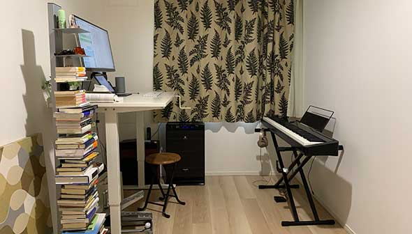

# 科学的に理想の仕事部屋を目指そう！#1「生産性が上がる部屋の条件とかオブジェとか」

---

ほとんど引きこもりで仕事をしている私ですが、新型コロナの自粛期間にはさすがに普段よりも家にいる時間が長くなったわけです。そこで、ふと「もっと仕事部屋を改良できないかなー」とか思ったんですよ。

「環境が人を作る！」ってのは間違いがないところで、私たちの生産性が、環境音や観葉植物、照明、壁紙の色といったいろんな要素に左右されていることは複数のデータで実証されております。歴史上の偉人も作業部屋にはこだわりぬいてまして、例えばプルーストなどは部屋の壁をコルク張りにしてノイズを消した上に、厚いカーテンで光を遮断して執筆にはげんだそうな。

って、もちろんそこまでやる必要もないとは思うものの、やはりある程度まで環境を整えるのが生産性アップの基本でありましょう。ちなみに私の仕事部屋はこんな感じでして、決して悪くはないものの、もっとできることがあるだろうって気がしております。

では「理想の作業空間とはどんなもんか？」ってことで、今回からは「**生産性を上げるための****自室改良ガイドライン**」をまとめていきます。

実のところ、この分野についてはロジャー・ウルリッヒ先生([R](https://www.researchgate.net/profile/Roger_Ulrich4))やティナ・シーリグ先生([R](http://www.tinaseelig.com/))などが良いデータを提供してくれていて、取り組みやすいんですよね。「どうにも集中して仕事ができない…」とか「良いアイデアが浮かばない…」みたいな方は、いくつか取り入れてみてはいかがかと思う次第です。

## **1. 最強の仕事部屋に欠かせない三大条件**

さて、「**最強の仕事部屋**」を考えるには、照明、色彩、構造、環境音などいろんな要素を組み込む必要がありますが、ここではまず最初の超前提として、「**生産性が上がる部屋の3条件**」みたいなものをまとめておきます。とりあえず、この前提が満たされていないと、他にどんなテクニックを使っても効果が減るかも何でご注意ください。

### **1-1. 最強の仕事場は分離されていなければならない**

パフォーマンスを発揮するためには、まず仕事場が食事や睡眠といった生活のエリアからハッキリと区別されている必要があります。よく「寝室は寝るためだけに使わないと、脳が『ここは睡眠の場所なのだ』と認識してくれない」って話を聞きますが、これは仕事部屋についても同じ。作業場は徹底して区分けしないと、人間は「これは作業場なのだ！」と感じてくれないんですよね。

ちなみに、一部の科学者なんかは「デジタルワーク用の机」と「アナログ作業用の机」を分けるケースもあったりしますけど、日本の住環境だとなかなか難しいんで、できる範囲でやっていきたいところです。例えば、「どうしてもダイニングテーブルしか作業スペースがない！」みたいな場合は、作業を始める前に、

- 食事には使わないマットやクロスなどをPCの下に敷いてみる

- 仕事をする時だけテーブルの上に観葉植物を置く

- 自分が尊敬する人物の写真やフィギュアなどを乗せてみる

といったカスタマイズを行うだけでも、脳はある程度までダマすことが可能だったりします。この場合は、もちろん仕事が終わったらすぐに全て片づけて、もとの食事用テーブルにもどすことをお忘れなく。この作業をサボると、また脳が混乱を始めちゃいますんで。

この手法は旅行先で仕事をする時にも有効で、家から簡単に持ち運べるようなマットや置物を用意し、ホテルの部屋などに配置するといいでしょう。まぁ最終的には「専用の部屋」で仕事を行うのが最強なんですけど、そう贅沢も言ってられないですからね。

### **1-****2. 最強の仕事場は決まった時間に使わねばならない**

これは上記と重なるポイントで、いかに良い場所に作業場を作っても、不定期な時間に使っているとイマイチ生産性が上がらなかったりします。その理由も上と同じで、同じ時間に部屋を使うことで、脳が「ここは生産性を発揮するための場所なんだ！」ってのを認識してくれるからです。

事実、バルザックやダーウィンやピカソといった人たちが、かなりキッチリしたスケジュールで仕事場に出かけてたのは有名な話([R](https://amzn.to/2WMOSuC))。こちらも「部屋と生産性」を考える上では、見過ごせないポイントであります。

### **1-****3. 最強の仕事場は見た目で使用目的が分からねばならない**

なにせ人間の脳は怠け者なので、現代のこぎれいなオフィスみたいに「デスク上にPCがポツンと一個」みたいな状態だと「あれ？ここで何をすればいいんだっけ？」と混乱を始めるんですよ。

もちろん、だからといって汚いデスクにする必要はありませんが、なんらかのスケッチやモックアップ、写真、プロダクトなど「仕事の内容」がすぐにわかるようなものを置いておく必要があります。私の場合は、本の執筆に使う資料がドンと置いてあったり、アンチエイジングにまつわるサプリなどが見えるとこに配置してあったりしますね。

## **2. 生産性ブーストのために部屋に何を置くか？**

理想の仕事場における基本的なポイントがわかったところで、次は「壁面」のお話です。まずは、仕事場にどんなオブジェなどを飾るといいのか？みたいな手軽なとこから見ていきましょうー。

### **2-1. とりあえずアートを飾る**

もっとも手軽なのは、ビジュアルアートやグラフィックデザンで部屋を飾る手法でしょう。

「パレオな男」でもチラホラ書いてるとおり、アートのベネフィットはかなりのとこまで実証([R](https://www.ncbi.nlm.nih.gov/pmc/articles/PMC2804629/),[R](https://www.ncbi.nlm.nih.gov/pmc/articles/PMC2804629/),[R](https://www.tandfonline.com/doi/full/10.1080/07421656.2016.1166832))されていて、美術品を見たりアートについて学ぶと、

- 新しい経験や学習へのモチベーションが上がる
- リスクを取る気持ちがブーストする
- QOLと日々の幸福度が上がる
- ストレスが軽る
- 健康が増進される
- 創造性が刺激される

みたいなご利益が得られて非常にいい感じです。私の部屋にはいまテキスタイルが飾ってあるんですけど、もうちょい抽象画もあしらってみるか……。

ちなみに、アートを飾る際のポイントとしましては、

- 作品の中央部がだいたい床から58～60インチの高さになるように吊るすといい感じ

- もし部屋の窓が小さいとか窓外の光景が汚い場合は、大自然のポスターを貼って空間を広げてみるのもあり

- もし部屋の天井が低いなら、垂直のラインで構成された作品を高めの位置に飾って視線を上に向けるのもあり

- ジャクソン・ポロックみたいな抽象画や印象派系の近代絵画は苦手で……たいな場合は、好きな映画のポスター、尊敬する学者の肖像、偉人の名言を額装したものなどを使うのもあり

- アートは新鮮さが重要なので、定期的にローテーションができるように、安いポスターなどをいくつか用意しとくといい感じ。なんなら安いモニターを「アート表示用」に導入してもよい

といったところを押さえておくといい感じです。私ももうちょい現代アート系のポスターでも飾ろうかと。

### **2-2. ノスタルジックなアイテムを飾る**

いままでの人生で起きた良い出来事、好きな場所、好きな人たちを表すようなオブジェや写真、記念品を置くのも生産性の向上に役立ったりします。というのも、**過去への感傷や憧れといった感情は、良いアイデアを思いつくために欠かせない「拡散思考」を生む**傾向があるんですよ。

例えば、サウサンプトン大学が行った研究では、ノスタルジックな気持ちをかき立てるような記憶を思い出すように求められた被験者は、そうでない被験者よりも、よりクリエイティブな文章を書くのがうまくなったんだとか(R)。どうやらノスタルジックな回想には、アートと同じように新しい体験への欲求を増幅させ、ポジティブな気分を育む作用があるみたいなんですね([R](https://pubmed.ncbi.nlm.nih.gov/29607707/))。

ってことで、この知見を活かす際のポイントは、以下のようになります。

- 遠い記憶を誘発できれば、室内に置くものは何でもOKです。旅行の土産、懐かしい写真、スクラップブック、家宝などなど、好きなものをお選びください。例えば、作家のロアルド・ダールなんかは、若い頃に手術で取り出した腰骨の一部を作業デスクの上に置いてたぐらいなんで、とにかく何でも問題ありません

- オブジェの置き方も、カジュアルまたはフォーマルのどっちでもOKです。大事な品なら額装してフォーマルに飾った方が非日常感が出ていいでしょうし、逆に記念品なんかは適当に机の上に置いたほうが目に入りやすくていいかもしれません。大事なのは、**過度に散らかった印象にならないレベルで部屋を飾る**ことなんで、そこさえご注意いただければと

基本的にノスタルジック系のアイテムはどんなものでもいいので、自分が心から「懐かしいなぁ」とか「あれは良い体験だったなぁ」と思えるような品であれば、生産性アップのメリットを得ることは可能です。好きなもので部屋を飾ってみてくださいませー。

といったところで初回はここまで。次からは、「そもそもどんな物件がいいのか？」みたいなところを考えていきたいと思っております。
