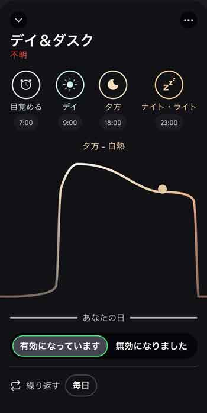
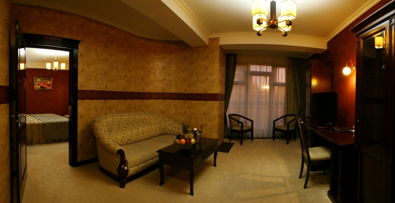

# 科学的に理想の仕事部屋を目指そう！#3「生産性が高まる照明＆室温とは？」

というわけで、科学的に理想の仕事部屋を目指していくシリーズの3回目です([#1](https://daigovideolab.jp/blog/1926268),[#2](https://daigovideolab.jp/blog/1927155))。

---

このシリーズでは、「**生産性が上がりやすい部屋の条件とは？**」って問題についてデータをもとに考えていき、それに従って自分の仕事部屋も変えられたらいいなーってとこを目標にしてます。すべて取り入れる必要はないものの、部屋の模様替えにお困りの方は参考にしていただければと。

で、前回は「どんな物件を選ぶといいのか？」ってポイントを見てみましたんで、今回は部屋のアンビエントな部分を見ていこうと思います。照明とか音などの問題を最適化するにはどうすりゃいいのか？って問題ですな。

## **1. 創造性が必要な仕事はノイズレベル70dbで**

まずは作業場の環境音についてです。これについては「創造性が必要な仕事」と「集中力が必要な仕事」でパターンが違いまして、まずは数字の計算や細かい機械の修理みたいに、正確さ、細かさ、直線的な推論などを必要とする作業をする場合は、

- **無音がベスト！**

ってのは間違いないとこです。集中力が必要な場合はちょっとのノイズでもパフォーマンスは落ちるんで、ノイズキャンセリングヘッドホンを使っとけば間違いないでしょう。なので私も本の校正をするときは完全に無音でやってます。

が、これが「文章を書く」とか「本の構成を考えたる」といった創造性が必要なタスクでは話が変わってきまして、

- **70dbの環境音がベスト！**

って感じになってくるんすよ。これはブリティッシュコロンビア大学などが行った研究([R](https://academic.oup.com/jcr/article-abstract/39/4/784/1798283?redirectedFrom=fulltext))にもとづいていて、チームは街中で以下のような環境音を2パターン採取したんですね。

- ロードサイドの軽食店の音
- 客でにぎわうショッピングモールの音

続いて65人の被験者を集めまして、全員に採取した音をBGMとして流しつつ、「斬新なマットレスのアイデアを考
えてください！」と指示したんだそうな。この時、バックグラウンドの音量を3パターンに分けていて、

- 50dB
- 70dB
- 85dB

って感じで作業してもらったら結果はこんなふうになりました。

- 50dBの環境音を聴きながら作業したときよりも、全体的に70dBの音を聞いた場合の方が全体的に創造性テストの点数が高かった

- ただし、環境音が85dBだった場合には逆に創造性が低下した

というわけでこの結果について研究チームいわく、

> 解決策を見つけたいときは、静かな部屋で考えるのではなく、比較的騒がしい環境に入ることで、脳が抽象的に考えるようになり、創造的なアイデアが生まれやすくなる

とのことで、どうやら良いアイデアを思いつきたいときは70dBが最適っぽいんですよね。現代の仕事はクリエイティブなものがほとんどなんで、**室内のノイズをとりあえず70dBに説得**しとくのもいいんじゃないかと。

70dBがどんなもんかというと、だいたい「**ちょっと流行ってるスタバ**」ぐらいのレベルです。それ以外の目安も書いておくと、

- 80dB＝パチンコ屋の店内、走行中の電車内
- 70dB＝活気があるオフィス、高速を走ってるときの車内
- 60dB＝普通の会話、デパートの中
- 50dB＝川のせせらぎ、静かなオフィス

みたいになります。具体的なノイズの導入法としては、

- [coffitivity](https://coffitivity.com/)みたいな環境音ジェネレーターを使う
- [Raining.fm](https://raining.fm/)みたいな自然音ジェネレーターを使う
- [mynoise](https://mynoise.net/NoiseMachines/whiteNoiseGenerator.php)みたいなホワイトノイズジェネレーターを使う
- [AVANTEK](https://amzn.to/3hXYkDE)とか[マーパック](https://amzn.to/2Xs2tI1)とか[Dreamegg](https://amzn.to/3kdXQeG)みたいなホワイトノイズマシンを使う

といったあたりがいいんじゃないでしょうか。デシベルの計測については、最近はApple Watchにもデフォで測定器が入ってますし、「[デシベル X](https://apps.apple.com/jp/app/%E3%83%87%E3%82%B7%E3%83%99%E3%83%AB-x-dba-%E3%83%87%E3%82%B7%E3%83%99%E3%83%AB%E3%83%86%E3%82%B9%E3%82%BF%E3%83%BC/id448155923)」みたいなノイズ測定アプリもありますんでこれをお使いください。

## **2. 照明を太陽サイクルに合わせる**

次は室内照明の話です。こちらの基本的な考え方はシンプルで、

- **太陽の変化による明るさと色温度を再現すべし！**

みたいになります。ざっくり言えば、

1. 日の出時には暖かい琥珀色の光
2. 朝や昼下がりにはゆっくりと冷たく明るい光に変化
3. 夕方になるとまた琥珀色に変化

みたいな流れを照明で再現するわけっすね。なにせ人間は数百万年にわたって太陽の光の色や強度の変化を感知しながら生きてきたんで、光の強さと色温度にしたがってホルモンの分泌が変わり、気分とエネルギーが左右されるように設計されているんですよ([R](https://www.sciencedirect.com/science/article/abs/pii/S036013230200118X))。そう考えると、日が沈んだあとも蛍光灯が煌々と照ってるオフィスなんかは、条件としては非常によろしくないですな。

というわけで最近は「[LIFX](https://amzn.to/2Xndn1B)」みたいに自然光の移り変わりを再現できる照明も出てますんで、こちらを使ってみるのも吉。

また、近年ではパナソニックなんかも[「昼光色」と「電球色」を調整できる照明](https://amzn.to/2Pm6Ujp)が出てるんで、こちらを試すのも良いでしょう（お値段が張りますが）。

## **3. 創造的な作業をするときは150ルクスに**

上では「**自然の変化に従ったライトが良い！**」って話をしましたが、こと創造性が必要なタスクを行う場合はできるだけ薄暗くしとくのが吉であります。

ネタ元はシュトゥットガルト大学などの研究([R](https://www.sciencedirect.com/science/article/abs/pii/S0272494413000261))でして、チームは114人のドイツ人学生を集めて、それぞれを3パターンの照明をあしらったオフィスで作業させたんだそうな。

1. 150ルクス(薄暗い明かり)のオフィス
2. 500ルクス(一般的な推奨レベル)のオフィス
3. 1,500ルクス(明るい光)のオフィス

その上で創造性テストを行ったところ、ベストの成績を出したのは薄暗い部屋で作業した被験者で、明るい部屋で
作業した被験者よりも多くの問題を解くことができ、さらに「自由で抑制されていない気分」を感じたとのこと。一方で、明るい部屋と一般的な照明の部屋で作業した参加者は、テストの点に有意差がなかったらしい。

この現象にちてチームは、「薄暗い照明が抑制された気分」解き放ち、創造性を改善するのだろう」と申しておられます。どうやら、光が少ないと私たちの注意は内面に向かいやすくなり、そのぶんだけ思考の幅が広がるみたいなんですよね。

逆に、1,500ルクスぐらいの光の下にいると、逆に明るさのせいで警戒心が起動し、ストレスがたまっちゃう可能性があるそうな。まぁ細かい計算などを行うときはいいかもですが、良いアイデアが思いつかなくて悩んじゃってるような場面では150ルクスにしといていただければと。ただし、なかには150ルクスだと暗すぎて作業ができない！みたいな方もおられるでしょうから、その場合は300ルクスまでを目安にしてもらえるといい感じです。

150ルクスってのはちょい暗めの喫茶店ぐらいで、だいたい↓のようなイメージとお考えください。結構な暗さっすよね。

## **4. 室温はどうすべきか？**

最後に「生産性が上がる室温とは？」って問題についてですが、残念ながらこれは決定的な答えが出しづらい話だったりします。

というのも、第一に実験によってかなりバラバラな報告が出てまして、ある研究では「25℃の環境でタイピングをしたグループは最も生産性が高かった！」と報告している一方で、また別の研究では「室温が20度から25度まで上昇するにつれて、被験者の能力が着実に低下した！」なんて結果が出てるんですよ([R](https://www.sjweh.fi/show_abstract.php?abstract_id=1823),[R](http://ergo.human.cornell.edu/Conferences/EECE_IEQ%20and%20Productivity_ABBR.pdf))。

さらに別の研究([R](http://www.journals.marketingpower.com/doi/pdf/10.1509/jmr.08.0205))では、「創造的な作業には27度がベストで、論理的な作業には26度」なんて報告もあるんですけど、個人的にはこの数値にはわりと疑問。1度の差で思考スタイルに差が出るかなーってのが正直なところなんで。

まぁそれぞれの報告に食い違いが出るのも当然で、

- 仕事中の服装によって個人の体感が変わる
- 性別や年齢によって代謝が違う
- 暑いところからクーラーが効いた部屋に入った場合も体感が違う

みたいな変数に左右されちゃうんで、「これがベストだ！」とは言いづらいんですよね。うーん、悩ましい。

ってことで、「作業パフォーマンスが爆上がりする室温」については、現時点では考えてみるだけ無駄。なので、いまんとこの解決策としては、

- **時間、温度、服装、時期、作業パフォーマンスなどを記録して、自分なりのスイートスポットを見つける！**

しかないのが正直なところです。非常にめんどうな作業ですけども、多くのデータを見てると室温が1度変わるだけでも脳のパフォーマンスが違ってくるケースは少なくないんで、やってみる価値はあるかなーってとこですね。

ちなみに、私の場合は「[Ambi Climate 2](https://amzn.to/2EIJnqA)」っていうエアコン操作ガジェットを使っていて、人工知能に快適な温度を覚え込ませております。自動で適度な室温に調整してくれて便利なんですが、たまに変な温度に変えてくることがあって、なかなか難しいもんだなぁ‥‥とか思っております。

## **次回予告**

ってことで今回は終了。次回はおそらくシリーズ最終回で、ここまで取り上げた以外に生産性が高い部屋を作るポイントをまとめていこうと思っております（「香り」とか「壁の使い方」とか、そんな感じで）。どうぞよしなにー。
